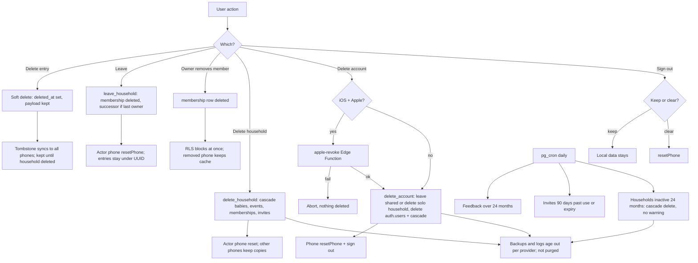

> **Historical document.** It describes the app as it was on 24 October 2026 (build 6). Many findings were fixed afterwards. For the current status, see [legal-update-2026-10-24.md](legal-update-2026-10-24.md).

# Moraki: developer technical, functional and privacy assessment

- **Date:** 2026-10-24.
- **Prepared for:** C.E. CODE DESIGNS LTD, for the Cyprus data-protection lawyer.
- **Questions:** `assessment/questionnaire.md`.
- **Source verified:** `main` at `4182a3fb`. The app code is identical to the build submitted to TestFlight: **Moraki 1.0.0 (6)**, EAS build `65a8ec0a-19c0-4ced-9482-6041633d04e7`, built 2026-10-18 from `89b169fc`. `git diff 89b169fc 4182a3fb`, leaving out `public/`, `docs/` and `design/`, is empty.
- **Method:** a read-only review of the source, migrations, configuration, the website (`public/`) and the docs.
  - Nothing was run against production.
  - Facts the owner confirmed from dashboards are marked **owner-confirmed**.
  - Anything that lives only in a dashboard is marked **Unknown — NOT DETERMINABLE FROM CODE**, with the dashboard named.
- **Earlier work:** `privacy-audit-2026-10-18.md`, re-checked here against the fixes merged since (#184–#191).
- **Not legal advice.** Answering these questions does not by itself establish GDPR compliance.

## Summary for the lawyer: the most important findings

1. **No age, guardian or Terms acceptance in the app.**
   - The app never asks a user's age.
   - It never asks for a parent or guardian declaration.
   - It never shows the Terms during sign-up.
   - Any adult, such as a grandparent, a nanny or an unrelated person, can create a household. Ownership can pass to any member, a viewer included.
   - The website Terms say 18+, while the App Store age rating is 4+. (Q29–38, Q79–81.)
2. **Health-data consent gates uploads of entries only.**
   - Creating a household uploads the baby's name, birth date and birth weight before consent.
   - A member who hasn't agreed can still pull and read the household's history.
   - A withdrawn owner can still read, export and invite.
   - The consent record keeps only the version and the latest grant and withdraw times, so re-granting overwrites the earlier ones. Users can also edit their own consent rows through the API. (Q82–94, Deliverable 5.)
3. **Data leaves the phone from first launch.**
   - Every launch sends an Expo update check (US: IP address and an install ID) and Sentry release-health sessions, before any account or consent.
   - Native crash, hang and session events bypass the app's JavaScript scrubber.
   - Sentry IP storage is off (owner-confirmed). (Q6–7, Q148–150, Q155.)
4. **Deleted data persists.**
   - Deleted entries keep their full content on the server and on every phone for the life of the household. Nothing purges them.
   - A deleted account's entries in a shared household stay under its ID.
   - Removed members, and every other member's phone after a household is deleted or swept, keep the full local copy. It stays readable offline and exportable, and its reminders keep firing.
   - PDF reports stay in the app's cache. Exports are deleted after sharing (#184). (Q95–111, Q70–76, Q166.)
5. **The weight chart is a medical-boundary question.**
   - It draws lines at 100% and 90% of birth weight and markers at Day 10 and Day 14.
   - The call script and the PDF show the change since birth in grams and percent.
   - The About screen, Terms and Privacy say "no warnings, no ranges". (Q130–132.)
6. **Backups and environments.**
   - **Supabase plan:** production runs on Supabase **Pro** (owner decision 2026-10-24, in place before launch). Per Supabase's Pro plan documentation: the project never pauses, so sync and the cleanup jobs keep running, and daily backups are kept for 7 days. Point-in-time recovery is a paid add-on and is not enabled. Confirm in Supabase → Database → Backups after the upgrade.
   - There is a single Supabase project, so TestFlight test data sits in production. (Q9, Q115–121.)
7. **Mismatches with the published website.**
   - Placeholders remain: `[Registered address]`, `[Email provider]`, `[Region]`, and `[date]` on Age guides and FAQ.
   - Privacy says "date and time of birth", but the app records a date only.
   - Privacy §12 and Terms §12 promise in-app notice of changes, which doesn't exist.
   - The Greek pages write the registration number in Greek letters.
   - The website doesn't mention backups. (Q198, Q181.)
8. **Out-of-app deletion and identity.**
   - Deletion by email is verified only by the sender address.
   - Nothing handles a request from a guardian who isn't in the household.
   - Google access is not revoked. Apple's is, on iOS (#186, owner-tested). (Q110–113, Q125.)
9. **Server-side validation.**
   - Entry payloads and baby names have no server-side length or format limits. All checks run in the app.
   - Administrators with dashboard or secret-key access can read all health data. Nothing in the code restricts or logs that. (Q19–20, Q46, Q53.)

The full gap list, by severity, is Deliverable 8 (part 3). What is in build 6 and what is planned is Deliverable 9.

## Contents

- **Part 1:** Sections A–C (questions 1–55): architecture, storage, accounts, guardian authority, baby data.
- **Part 2:** Sections D–F (questions 56–128): households, consent, retention and deletion. Deliverables 5 and 6.
- **Part 3:** Sections G–L (questions 129–205): medical, external services, notifications, website, terms, release verification. Deliverables 2, 3, 4, 7, 8 and 9.

Deliverable 1 is this document.

---

# Part 1 — Sections A to C

# Developer assessment, part 1: Sections A, B and C (questions 1–55)

- **Prepared:** 2026-10-24, read-only review of the code. This is not legal advice.
- **Code examined:** `main` at `4182a3fb`. The app code is identical to TestFlight build 6 (see Q2).
- **Sources of fact:**
  - "owner-confirmed 2026-10-18/24" marks a dashboard fact the owner stated. It is not visible in code.
  - "Unknown — NOT DETERMINABLE FROM CODE (…)" marks a fact that lives only in a dashboard.
- **Platform:** iOS is the only shipped platform. Android is planned (v1.1). Where Android differs, the answer says so. There is no Android build artefact to inspect.
- **Earlier audit:** `docs/compliance/privacy-audit-2026-10-18.md`. Each of its points used here was checked again against current code. Where #184–#191 changed something, the answer says so.

---

## SECTION A — App architecture and infrastructure

### A1. Application architecture

**1. Frameworks, libraries and versions**

Status: Implemented.

Answer: Exact versions, resolved from `package-lock.json`:

| Area                 | Package                                   | Version                                                                                                                                        |
| -------------------- | ----------------------------------------- | ---------------------------------------------------------------------------------------------------------------------------------------------- |
| Runtime              | Expo SDK (`expo`)                         | 57.0.24                                                                                                                                        |
|                      | React Native                              | 0.86.3 (New Architecture on)                                                                                                                   |
|                      | React                                     | 19.2.3                                                                                                                                         |
|                      | TypeScript                                | ~6.0.3                                                                                                                                         |
|                      | expo-router                               | 57.0.22                                                                                                                                        |
| Local database       | expo-sqlite                               | 57.0.3, built with `useSQLCipher: true`. The vendored SQLCipher is **4.7.0 community**; on iOS it uses CommonCrypto (`-DSQLCIPHER_CRYPTO_CC`). |
|                      | drizzle-orm                               | 0.45.3 (ORM and migrations)                                                                                                                    |
| Backend client       | @supabase/supabase-js                     | 2.117.0. auth-js and realtime-js are 2.117.0 too.                                                                                              |
| Crash reporting      | @sentry/react-native                      | 8.28.0                                                                                                                                         |
| Over-the-air updates | expo-updates                              | 57.0.24 (pulls in expo-eas-client 57.0.4)                                                                                                      |
| Notifications        | expo-notifications                        | 57.0.20 (local notifications only; pulls in expo-application 57.0.3)                                                                           |
| Sign-in SDKs         | expo-apple-authentication                 | 57.0.2                                                                                                                                         |
|                      | @react-native-google-signin/google-signin | 16.1.5                                                                                                                                         |
| Secure storage       | expo-secure-store                         | 57.0.4                                                                                                                                         |
|                      | expo-crypto                               | 57.0.3                                                                                                                                         |
| Files and sharing    | expo-file-system                          | 57.0.7                                                                                                                                         |
|                      | expo-sharing                              | 57.0.21                                                                                                                                        |
|                      | expo-print                                | 57.0.2 (PDF report)                                                                                                                            |
| Language             | i18next                                   | 26.4.2                                                                                                                                         |
|                      | react-i18next                             | 17.0.14                                                                                                                                        |
|                      | expo-localization                         | 57.0.2                                                                                                                                         |
| Validation           | zod                                       | 4.6.5                                                                                                                                          |
| Other                | uuid                                      | 11.1.1                                                                                                                                         |
|                      | expo-dev-client                           | 57.0.19 (development builds)                                                                                                                   |

Not present: no analytics SDK, no advertising SDK, no AsyncStorage, no HealthKit, no Health Connect, and no camera, photo, location or document-picker libraries.

Evidence:

- `package.json:6-46`
- `package-lock.json` (entries `node_modules/<name>`)
- `app.json:48-96` (plugins), `app.json:51-56` (SQLCipher)
- the SQLCipher version comes from the vendored `expo-sqlite/vendor/sqlcipher` (`CIPHER_VERSION_NUMBER 4.7.0`, community build) and `expo-sqlite/ios/ExpoSQLite.podspec:45-48`

**2. Build submitted to Apple; identical to development?**

Status: Implemented.

Answer:

- The build is TestFlight **build 6**: version **1.0.0 (6)**, EAS build `65a8ec0a-19c0-4ced-9482-6041633d04e7`.
- It was built on 2026-10-18 from commit `89b169fc` ("Merge pull request #188 … web/v2").
- `git diff 89b169fc 4182a3fb -- . ':!public' ':!docs' ':!design'` is **empty**. The 7 commits since then touched only `docs/` (4 files) and `public/` (23 files). So the app code, `app.json`, `eas.json`, `package.json`, `supabase/` and `src/` on `main` are byte-identical to build 6.
- The build number is not in the repo. `eas.json` sets `appVersionSource: remote` and `autoIncrement: true`, so EAS assigns it.
- Whether build 6 has been _submitted for App Review_, rather than only uploaded to TestFlight: Unknown — NOT DETERMINABLE FROM CODE (App Store Connect).

Evidence:

- `app.json:6`
- `eas.json:3, 28-35, 37-42`
- `git log 89b169fc..4182a3fb`

**3. Does the app run completely offline without an account?**

Status: Implemented.

Answer:

- Yes. On first launch the app opens a local encrypted database and seeds placeholder household, baby and user IDs. Every logging screen works against that database.
- Supabase settings are read lazily. If they are missing, sign-in is simply hidden.
- No screen waits on the network to render.
- Without an account the phone holds **no baby profile** (name, birth date). That exists only once a household is created on the server. Offline-only users therefore log entries for an unnamed baby.
- Opening the app still makes some network requests (Expo update check, Sentry session), even without an account. See Q6.

Evidence:

- `src/db/client.ts:84-101`
- `src/db/migrations/0001_seed_local_identity.sql`
- `src/sync/AuthProvider.tsx:20-31`
- `src/sync/supabaseEnv.ts:49-55`
- `src/features/startup/DatabaseGate.tsx:40-61`

**4. Offline functions vs those needing a connection or account**

Status: Implemented.

Answer:

- **Works offline and signed out:**
  - Logging every activity: bottle and breast feed, diaper, sleep timer, pump, milk stock, health note or temperature, medication, weight, appointment.
  - Edit, delete and undo.
  - History, Insights, the weight chart.
  - Local feed and appointment reminders.
  - The PDF report and call script.
  - JSON/CSV export.
  - Night mode and language settings.
- **Needs a connection, account or both:**
  - Sign in: email code, Apple or Google.
  - Creating a household (`create_household` RPC).
  - Editing baby details (direct `babies` update).
  - Invites (create, revoke, accept).
  - Granting or withdrawing consent (RPCs).
  - Sync: push, pull, realtime.
  - Changing roles, the household reminder interval, leaving, deleting a household or account.
  - Feedback.
  - About links (they open the browser).
- **Signed in but offline:** entries queue in the outbox and sync later. Sign-in stays valid offline, because the session is read from SecureStore.
- **iOS and Android:** no difference in code. Google sign-in on Android also needs Play services.

Evidence:

- `src/features/onboarding/useHouseholdSetup.ts:51-81`
- `src/sync/household.ts:48-75, 139-150`
- `src/privacy/useConsent.ts:47-76`
- `src/sync/feedback.ts:50-54`
- `src/sync/auth.ts:126-140`
- `src/sync/SyncProvider.tsx:110-173`
- `src/features/auth/socialSignIn.ts:65`

**5. Can users manually disable cloud sync after signing in?**

Status: Not implemented as a setting. Partial ways exist.

Answer: There is no sync on/off switch. The only toggle in Settings is reminders. A signed-in user can stop sync in three ways:

| Action                            | What stops                                                              | What carries on                                                                 |
| --------------------------------- | ----------------------------------------------------------------------- | ------------------------------------------------------------------------------- |
| **Withdraw consent**              | Pushing from this phone (the client gate) and event writes (server RLS) | Pull, realtime and reading the household. The baby profile can still be edited. |
| **Sign out**                      | All sync                                                                | Entries kept or cleared, as the user chooses                                    |
| **Leave or delete the household** | All sync. The phone is reset                                            | —                                                                               |

Evidence:

- `src/sync/pushEngine.ts:38-48`
- `src/sync/pullEngine.ts:83-87` (pull ignores consent)
- `src/features/settings/useSignOut.ts:33-40`
- `supabase/migrations/20260923060000_consent.sql:64-78`
- `src/features/settings/RemindersCard.tsx:28-36`

**6. Does opening the app trigger external network requests?**

Status: Implemented (yes).

Answer: On every launch, even signed out and before any consent screen:

1. **Expo Updates** (`https://u.expo.dev/<projectId>`, then Expo's CDN; US-based processor).
   - Defaults apply: `checkAutomatically` ON_LOAD, `fallbackToCacheTimeout: 0`.
   - Sent: IP address, platform, runtime/app version, channel, current update IDs, and the random persisted `EAS-Client-ID` install UUID.
2. **Sentry** (`*.ingest.de.sentry.io`, EU), only if the build carries a DSN. The production build does: `EXPO_PUBLIC_SENTRY_DSN` is in the EAS production environment (owner-confirmed).
   - `Sentry.init` runs at module load, before the database opens.
   - Session tracking is on by default (`enableAutoSessionTracking` is not set), so a release-health session envelope is sent at start.
   - Sent: release, environment, OS, device model, a per-install ID from the native SDK, and session status.
   - No user, no IP stored (the "Prevent storing IP addresses" setting is ON, owner-confirmed 2026-10-18/24).
   - Crash events go through the allow-list scrubber.

**Only when signed in:**

3. **Supabase** (`*.supabase.co`):
   - token refresh while in the foreground;
   - a household lookup if the phone has no household record;
   - push then pull on start, every 60 s and on return to the foreground;
   - the Realtime websocket on channel `household:<uuid>`.

   Sent: JWT (user ID), household/event data, IP address.

**Not on launch:**

- Fonts are bundled, so there is no Google Fonts call.
- The Google SDK loads lazily, on button press.
- No push token is registered.
- iOS itself fetches `apple-app-site-association` for `applinks:moraki.app` through Apple's CDN at install or update, not on app launch.

Evidence:

- `app.json:105-112`
- `eas.json:28-35`
- `app/_layout.tsx:29-34`
- `src/observability/sentry.ts:19-45`
- `src/observability/dsn.ts:15, 25-45`
- `src/sync/AuthProvider.tsx:39-56`
- `src/sync/auth.ts:179-183`
- `src/sync/useAccountHousehold.ts:24-34`
- `src/sync/SyncProvider.tsx:31-32, 110-173`
- `src/sync/realtime.ts:17-45`

Website claim check: Privacy §7 describes the Expo update check accurately, with IP, platform, version and install ID going to the US. Privacy §2 says crash reports "can include a random identifier for this installation". That is accurate.

Not mentioned on the website: Sentry **session** (release-health) pings on every launch. The home and features pages say "No trackers and no analytics, in the app" (`public/index.html:62`, `public/features/index.html:54`). Sentry session tracking is diagnostics rather than analytics, but the lawyer should decide whether that wording needs a qualifier.

**7. Data sent to external services before an account or consent?**

Status: Implemented (yes, limited).

Answer: Before any account or consent, the Expo update check and the Sentry session or crash reports described in Q6 are sent.

- Neither contains entries, baby data or an account.
- Both carry the IP address in transit and an install identifier.
- No Supabase request is made while signed out. Supabase-js only calls the network when a stored session exists.

After sign-in but before consent, these reach Supabase:

- the baby profile (`create_household`: baby name, birth date/time, optional birth weight, the creator's display name and relation);
- baby-detail edits;
- invite actions;
- pulls of other members' health data.

Event uploads wait for consent. The consent text discloses this (`consent.who`).

Evidence:

- Q6 references
- `src/sync/household.ts:48-64, 139-150`
- `supabase/migrations/20260922173137_create_household.sql:10-45` (no consent check)
- `supabase/migrations/20260922160300_rls_policies.sql:46-52` (babies policies have no consent check)
- `src/i18n/en.json:884`

**8. Automatic upload of locally created records after account creation?**

Status: Implemented.

Answer:

- When a signed-in phone gets a household, `useLinkHousehold` re-labels every pre-account entry, and its queued outbox ops, to the real household, baby and user IDs.
  - **Owner** (the person who created the household): this happens automatically, without asking.
  - **Joiner** with local entries: only after they tap "Add to the household". Until then the phone shares nothing.
- The actual upload is the push engine draining the outbox. It runs only when the account has agreed to the current consent version (2026-10-18).
- So the trigger is: household created or joined, then the entries are re-labelled, then **consent granted**, then upload. Without consent the entries stay queued on the phone.

Evidence:

- `src/sync/useAdoption.ts:42-70, 117-125`
- `src/db/adoptHousehold.ts:54-120`
- `src/sync/pushEngine.ts:38-48, 77-79`
- `src/sync/SyncProvider.tsx:68-76`
- `src/i18n/en.json:515` (localEntries copy)

**9. More than one backend environment; separation; no real data in testing?**

Status: Partially implemented.

Answer:

- The app connects to whichever Supabase URL and publishable key are inlined at build time. It refuses secret keys and legacy anon keys.
- Development uses a **local** Supabase stack in Docker (`supabase/config.toml`, ports 55321+). Seed data for dogfooding goes to that local stack (`seed:dogfood` script).
- There is **one hosted project, production** (`docs/10-release-runbook.md:22-25`: "the staging-or-prod question is closed"). The three-project plan in SDD §2 (`docs/02-sdd-and-build-plan.md:59`) was not carried out.
- EAS profiles `development`, `preview` and `production` map to update channels with the same names. Which Supabase project the development and preview EAS environments point at: Unknown — NOT DETERMINABLE FROM CODE (EAS dashboard → Environment variables).
- TestFlight builds are production builds against the production project. **TestFlight testers' data, including the owner's test data, is in the production database.**
- Whether any real-family health data has been entered during testing: Unknown — NOT DETERMINABLE FROM CODE (Supabase table editor).
- Sentry tags every event with an environment from `EXPO_PUBLIC_SENTRY_ENV`.

Evidence:

- `src/sync/supabaseEnv.ts:21-59`
- `eas.json:6-35`
- `package.json:63`
- `supabase/config.toml:5-14, 158-162`
- `.env.example`
- `src/observability/dsn.ts:44`

### A2. Storage and infrastructure

**10. Where is data stored locally?**

Status: Implemented.

Answer:

- **Database:** expo-sqlite with SQLCipher, file **`moraki-encrypted.db`** in expo-sqlite's default directory: on iOS `<app sandbox>/Documents/SQLite/`. It replaced a pre-encryption `moraki.db`, which is converted once and then deleted.
- **Tables:** `events`, `outbox`, `sync_errors`, `babies`, `memberships`, `meta` (which also holds device prefs).
- **Android (planned):** the same plugin, in the app's internal databases directory.

Evidence:

- `src/db/client.ts:42-63`
- `src/db/encryption.ts:14-17, 63-109`
- `src/db/schema.ts:8-97`
- `expo-sqlite/ios/SQLiteModule.swift:23-28` (documentDirectory/SQLite)

**11. Is the SQLite database encrypted at rest? Keys?**

Status: Implemented.

Answer:

- **Encryption:** SQLCipher 4.7.0 (AES-256, SQLCipher defaults) with a **raw 256-bit key**. The key is 32 random bytes from the OS CSPRNG (`expo-crypto getRandomBytes`), applied with `PRAGMA key = "x'…'"` as the first statement.
- **Key storage:** in the iOS Keychain (Android: Keystore-backed SecureStore) under `moraki.db.key`, with `AFTER_FIRST_UNLOCK_THIS_DEVICE_ONLY`. That means it is readable after the first unlock since boot, never synced by iCloud Keychain, and does not move to another device.
- **Lost key:** if the key is missing or wrong, the encrypted file is deleted and a new database is started. A signed-in phone pulls its household again; unsent entries are lost.
- **Export compliance:** `ITSAppUsesNonExemptEncryption` is `false`, while SQLCipher is used. This is an export-compliance answer for the owner; see `docs/adr/011-sqlcipher.md`.

Evidence:

- `src/db/client.ts:27-40, 53-62`
- `src/db/encryption.ts:44-49, 63-115`
- `app.json:15-17, 51-56`

Website claim check: Privacy §10 ("encrypted database (SQLCipher) … key in your phone's secure keychain") matches. The earlier audit's "planned" wording is gone.

**12. iOS Data Protection or equivalent?**

Status: Implemented (OS default, not explicitly configured).

Answer:

- The app sets no file-protection attribute and no `com.apple.developer.default-data-protection` entitlement. The database file therefore gets the iOS default class, **Complete Until First User Authentication**, on top of SQLCipher.
- The keychain items: the DB key uses after-first-unlock, this-device-only. The session uses SecureStore's default, `WHEN_UNLOCKED`.
- Android uses file-based encryption (OS default) plus the Keystore.
- The final entitlements and Info.plist: Unknown — NOT DETERMINABLE FROM CODE (EAS build artefact).

Evidence:

- `app.json:12-25`
- `src/db/client.ts:34-40`
- `src/sync/sessionStore.ts:6`

**13. Device backups (iCloud/iTunes, Android)?**

Status: Implemented (iOS: included; Android planned: excluded).

Answer:

- **iOS:** the database file is in `Documents/` and is not excluded from backup. It is therefore **included in iCloud and Finder/iTunes backups as SQLCipher ciphertext**.
  - Its key is `…THIS_DEVICE_ONLY`, so a backup restored to another device cannot open it. The app then deletes it and starts fresh, re-pulling from the server if signed in.
  - The **session token** (SecureStore default `WHEN_UNLOCKED`, not this-device-only) can be carried in encrypted backups to a new device.
  - The user removes backups through iOS Settings → [name] → iCloud → Manage Storage → Backups, or by deleting the local backup.
  - On iPhone, keychain items (the session and DB key) can survive deleting the app. The privacy policy §8 says so.
- **Android (planned):** expo-secure-store's config plugin applies backup rules that include only `sharedpref` and exclude SecureStore. The database is not backed up. Not verified on a built APK.

Evidence:

- `src/db/client.ts:27-44`
- `src/sync/sessionStore.ts:6`
- `src/sync/auth.ts:19, 29-36`
- `expo-secure-store/plugin/build/withSecureStore.js` and `android/src/main/res/xml/secure_store_*_rules.xml`
- `app.json:59`

**14. Temporary storage, preferences, logs, caches, keychain**

Status: Implemented.

Answer:

| Where                      | What                                                                                                                                                                                                                                                                                                                       |
| -------------------------- | -------------------------------------------------------------------------------------------------------------------------------------------------------------------------------------------------------------------------------------------------------------------------------------------------------------------------- |
| **SQLCipher DB**           | `events`: full payloads, including soft-deleted rows. `outbox` and `sync_errors`: full JSON bodies of pending or refused ops. `memberships`: caregivers' display names, relations, roles. `babies`. `meta`: IDs, pull cursor and device prefs.                                                                             |
| Device prefs inside `meta` | night mode, language, reminder settings, kept-duplicate IDs, the consent copy (`userId`, version, `grantedAt`), and the household record (baby name, birth time, birth weight, role)                                                                                                                                       |
| **Keychain / SecureStore** | `moraki.db.key`. `moraki.auth` plus chunks: the Supabase session (access and refresh JWT, plus the user object with email, identities and metadata; for Google this includes the name and picture URL). The Google Sign-In SDK keeps its own keychain state. The app never calls `GoogleSignin.signOut` or `revokeAccess`. |
| **iOS notification store** | scheduled local notifications: title "Moraki", a generic body, and data `{id, category, bodyKey, time}`. The ID contains the appointment's event UUID. No health data.                                                                                                                                                     |
| **Cache**                  | Export JSON/CSV files are **deleted after the share sheet closes** (#184). **PDF report files from `expo-print` are not deleted** and stay in the app cache until iOS purges it.                                                                                                                                           |
| **SDK caches**             | Sentry's on-disk envelope queue (unsent reports). Downloaded EAS update bundles.                                                                                                                                                                                                                                           |
| **Logs**                   | `console.warn` with an event ID only, never a payload, when a stored or pulled row fails validation. No other app logging.                                                                                                                                                                                                 |

Evidence:

- `src/db/schema.ts:8-97`
- `src/db/repositories/devicePrefs.ts:17-101`
- `src/db/client.ts:27-40`
- `src/sync/chunkedStorage.ts:40-73`
- `src/notifications/expoPort.ts:63-76`
- `src/privacy/useExport.ts:62-96`
- `src/features/report/useReport.ts:79-86`
- `src/db/repositories/events.ts:99, 104, 459`

**15. Production Supabase region; all data in Frankfurt?**

Status: Unknown from code (documented).

Answer:

- `docs/compliance/processors.md:20` records `eu-central-1` (Frankfurt) as "confirmed in the dashboard 2026-09-27".
- Auth (`auth.users`, `auth.identities`, sessions) is in the same Postgres project, so it would be in the same region.
- The code cannot show the region: the URL is in the EAS environment and its host does not encode a region. Unknown — NOT DETERMINABLE FROM CODE (Supabase → Project Settings → General / Infrastructure).
- Backup storage location and plan:
  - Production runs on Supabase **Pro** (owner decision 2026-10-24, in place before launch). It was on the Free plan during TestFlight.
  - Backup location and retention: Unknown — NOT DETERMINABLE FROM CODE (Supabase → Database → Backups).

Evidence:

- `docs/compliance/processors.md:15-23`
- `docs/compliance/dpia.md:161-165`

Website claim check: Privacy §7 says "Frankfurt, Germany (EU)". This is consistent with the docs. Confirm it in the dashboard.

**16. Other databases, storage, edge functions, APIs, serverless?**

Status: Implemented.

Answer: In use:

| Service                                                  | Use                                                                                                                                                  |
| -------------------------------------------------------- | ---------------------------------------------------------------------------------------------------------------------------------------------------- |
| **Supabase Postgres**                                    | all server tables                                                                                                                                    |
| **Supabase Auth**                                        | email OTP, Apple and Google ID-token sign-in                                                                                                         |
| **Supabase Realtime**                                    | `postgres_changes` on `events`. The app treats each message as a ping only, but Realtime does deliver the changed row to subscribed members' phones. |
| **pg_cron**                                              | three daily sweeps: feedback after 24 months, invites 90 days after use or expiry, inactive households after 24 months                               |
| **One Edge Function, `apple-revoke`** (Deno on Supabase) | calls `appleid.apple.com/auth/token` and `/auth/revoke`. Secrets are set and the function is deployed (owner-confirmed).                             |
| **Sentry**                                               | EU                                                                                                                                                   |
| **Expo EAS Update**                                      | US                                                                                                                                                   |
| **SMTP for the sign-in email**                           | Google Workspace per docs                                                                                                                            |
| **Apple and Google identity services**                   | sign-in                                                                                                                                              |

Not used:

- Supabase Storage: no bucket and no `storage.from` call. The local `config.toml` enables storage for the dev stack only.
- Push services (APNs/FCM), analytics, or any third-party API.

Evidence:

- `supabase/migrations/20260922215426_realtime_events.sql:11`
- `src/sync/realtime.ts:30-45`
- `supabase/migrations/20260928090000_retention_sweeps.sql:41-60`
- `supabase/migrations/20261018093000_sweep_inactive_households.sql:30-64`
- `supabase/functions/apple-revoke/index.ts:1-57`
- `src/sync/erasure.ts:79-90`
- `docs/compliance/processors.md`

**17. Encryption in transit and at rest in Supabase; key management**

Status: In transit: Implemented. At rest: Supabase-managed (Unknown from code).

Answer:

- **In transit:**
  - The client talks HTTPS/WSS to `*.supabase.co`.
  - The URL parser accepts `http://` too, for the local dev stack only.
  - iOS App Transport Security is not relaxed in `app.json`, so a release build would refuse plain HTTP.
  - The production URL value is in EAS and not printed here.
- **At rest:**
  - There is no application-level or column encryption. Event payloads (`jsonb`), baby names and notes are stored in plaintext in Postgres.
  - Disk and backup encryption and its keys are managed by Supabase/AWS, not by Moraki. Specifics: Unknown — NOT DETERMINABLE FROM CODE (Supabase security documentation / DPA).
  - Moraki holds no encryption keys for server data.

Evidence:

- `src/sync/supabaseEnv.ts:28`
- `app.json:12-25`
- `supabase/migrations/20260922151518_core_schema.sql:27-60`

**18. Who can technically access production data?**

Status: Implemented (by design); partly Unknown.

Answer:

| Who                                   | Access                                                                                                                                                                                                                                   |
| ------------------------------------- | ---------------------------------------------------------------------------------------------------------------------------------------------------------------------------------------------------------------------------------------- |
| **App users**                         | Only through RLS. Members read their own household's rows (households, memberships, babies, events). Writers write, with consent for events. Owners see invites. Consents and feedback are self-only. `anon` has no policy on any table. |
| **Developer / company administrator** | Full access through the Supabase dashboard (Table editor, SQL editor) and the secret key (`SUPABASE_SECRET_KEY`, held in the developer's local `.env`, never in the app). Both bypass RLS.                                               |
| **Supabase / AWS personnel**          | Per Supabase's terms and DPA. NOT DETERMINABLE FROM CODE.                                                                                                                                                                                |
| **Sentry**                            | Only scrubbed crash and session data                                                                                                                                                                                                     |
| **Expo**                              | Update-check metadata only                                                                                                                                                                                                               |
| **Google Workspace**                  | Email address and sign-in code                                                                                                                                                                                                           |
| **Apple / Google**                    | Sign-in tokens                                                                                                                                                                                                                           |

Who holds dashboard seats, and their roles: Unknown — NOT DETERMINABLE FROM CODE (Supabase → Organization → Members).

Evidence:

- `supabase/migrations/20260922160300_rls_policies.sql:1-75`
- `supabase/migrations/20260925120000_feedback.sql:29-35`
- `supabase/migrations/20260927120000_invite_rate_limit.sql:26-29`
- `.env.example` (SUPABASE_SECRET_KEY "server-side only")
- `src/sync/supabaseEnv.ts:36-45`

**19. Can admins or developers view baby health records? Restrictions, logging?**

Status: Yes, technically possible. No in-code restriction or procedure.

Answer:

- Anyone with dashboard access or the secret key can read every household's entries in plaintext, including notes, medication and soft-deleted rows.
- The repo contains:
  - no admin UI;
  - no break-glass procedure;
  - no access-audit table or trigger;
  - no documented access policy.
- Whether Supabase logs dashboard and SQL-editor access, and whether MFA is enforced on the account: Unknown — NOT DETERMINABLE FROM CODE (Supabase → Organization → Security / Audit logs; availability depends on plan).

Evidence:

- the absence of any audit migration in `supabase/migrations/`
- `docs/compliance/dpia.md:157-170` (R7 covers processor breach, not insider access)

**20. Backend security measures**

Status: Implemented (code-side); partly Unknown.

Answer:

- **RLS and permissions:**
  - RLS is enabled on every public table. Policies are default-deny and `authenticated`-only.
  - Helper functions are `security definer` with an empty `search_path`.
  - Locked columns are enforced by a trigger: an event's household, baby, type and author can't change.
  - Only the owner may change roles or relations.
  - A household must keep an owner.
  - Event writes require consent to the current version (`has_consent()`).
  - Every RPC has `revoke … from public, anon`. Sweep and hand-over functions are revoked from `authenticated` too.
  - 16 pgTAP test files (`supabase/tests/database/00–15`) cover the schema, anon denial, policies, role gaps, consent, erasure and sweeps.
- **Secrets:**
  - The app accepts only `sb_publishable_…` keys and refuses `sb_secret_…`.
  - Apple revocation secrets are Supabase secrets, never in the repo.
- **Rate limits:**
  - In code: invite accepts, 20 attempts per hour per account plus a 5-second freshness check (no per-IP limit); feedback, 10 per hour per account (trigger); `push_events`, at most 100 ops per call.
  - There is no rate limit on `push_events`/pull calls themselves.
  - Auth rate limits and OTP settings on the hosted project: Unknown — NOT DETERMINABLE FROM CODE (Supabase → Authentication → Rate limits). The local `config.toml` values (`email_sent = 2`/h, `otp_expiry = 600`) apply only to the local stack.
- **Edge function:** `apple-revoke` checks the caller's JWT with `auth.getUser` and logs only failure codes.
- **Administrator authentication** (MFA, SSO) for the Supabase, EAS, Sentry and Apple accounts: Unknown — NOT DETERMINABLE FROM CODE (each dashboard).
- **Gap: no server-side payload validation.** `push_events` accepts any JSON object as `payload`, with no Zod-equivalent schema and no length limit. Validation is client-only; other phones skip payloads they can't read. A modified client could store arbitrary or oversized content in a household it can write to.

Evidence:

- `supabase/migrations/20260922151518_core_schema.sql:115-122`
- `supabase/migrations/20260922160300_rls_policies.sql:10-128`
- `supabase/migrations/20260924090000_household_keeps_an_owner.sql`
- `supabase/migrations/20260923060000_consent.sql:20-28, 67-78`
- `supabase/migrations/20260927120000_invite_rate_limit.sql:18-132`
- `supabase/migrations/20260925120000_feedback.sql:44-58`
- `supabase/migrations/20260922183314_push_events.sql:28-60, 110-124`
- `src/sync/supabaseEnv.ts:36-45`
- `supabase/functions/apple-revoke/index.ts:23-46`
- `supabase/config.toml:200-237`

---

## SECTION B — Accounts, authentication and user identity

### B1. Account creation

**21. Is an account optional except for sync and sharing?**

Status: Implemented, with three more exceptions.

Answer:

- Yes for all logging, history, insights, reminders, report, call script and export (Q4).
- An account is **also** required for:
  - a **baby profile** (name, birth date, birth weight): there is no local-only baby profile, so the weight chart's birth-weight line and the age in days need a household;
  - **feedback**;
  - **editing baby details**.

Evidence:

- `src/features/onboarding/useHouseholdSetup.ts:51-52`
- `src/features/settings/useBabyProfile.ts:98-104`
- `src/features/feedback/useFeedback.ts:51`

**22. Which login methods are enabled?**

Status: Implemented.

Answer:

- In code, three methods:
  - **email one-time code**: `signInWithOtp` with `shouldCreateUser: true`, then `verifyOtp` with 6 digits;
  - **Sign in with Apple**: native, iOS 13+, nonce-checked;
  - **Google sign-in**: native SDK, then an ID token.
- No password, phone/SMS, anonymous, magic-link (as a link), MFA or other providers.
- The Apple button shows only where `isAvailableAsync()` is true, so on iOS only. Android would offer email and Google.
- The Google button shows only if the build has `EXPO_PUBLIC_GOOGLE_WEB_CLIENT_ID`. The production build does (owner-confirmed).
- Hosted provider toggles: Unknown — NOT DETERMINABLE FROM CODE (Supabase → Authentication → Providers). The local `config.toml` enables Apple and Google.

Evidence:

- `src/sync/auth.ts:66-119`
- `src/features/auth/socialSignIn.ts:13-71`
- `src/features/auth/SignInScreen.tsx:63-81`
- `src/sync/googleEnv.ts:11-13`
- `supabase/config.toml:179-185, 334-369`

**23. Information received and stored per method**

Status: Implemented.

Answer:

| Method         | Moraki receives                                                                                                                        | Stored by Supabase Auth                                                                              |
| -------------- | -------------------------------------------------------------------------------------------------------------------------------------- | ---------------------------------------------------------------------------------------------------- |
| **Email code** | the email address                                                                                                                      | `auth.users` with email, created/last-sign-in times; the code is stored hashed until used or expired |
| **Apple**      | only the EMAIL scope is requested, not the name. The token carries Apple's stable user ID (`sub`) and an email, real or private relay. | user ID, email, and the `auth.identities` row with provider `sub`                                    |
| **Google**     | default scopes (`openid email profile`), so the token carries `sub`, email, **name and profile-picture URL**                           | the same, plus name and picture in `raw_user_meta_data`/identity data                                |

- Moraki itself shows none of the Google name or picture. The session object containing them is cached in the phone's keychain (Q14).
- The **household name** shown to others is a separate display name typed by the user (1–40 characters), plus an optional relation.
- Supabase Auth also records sessions and audit events, which can include IP and user agent. These are Supabase-managed; see Q25.

Evidence:

- `src/features/auth/socialSignIn.ts:28-32, 64-70`
- `src/sync/auth.ts:75-119, 147-169`
- `supabase/migrations/20260922151518_core_schema.sql:17-25`
- `docs/compliance/processors.md:69-76`

Website claim check: Privacy §2 matches: Apple relay; Google name and picture stored by the auth provider, not shown or used.

**24. Email delivery service for auth emails**

Status: Unknown from code (documented).

Answer:

- Supabase Auth sends the 6-digit code through **custom SMTP**. The documented provider is **Google Workspace** (`docs/compliance/processors.md:25-33`).
- It receives the recipient address and the code in the message body (template `supabase/templates/sign-in-code.html`).
- Processing region: the docs say "confirm the data region setting on the account". Unknown — NOT DETERMINABLE FROM CODE (Google Workspace Admin → Data regions; Supabase → Authentication → SMTP settings).
- Apple and Google sign-ins send no email.

Evidence:

- `docs/compliance/processors.md:25-33`
- `supabase/config.toml:250-256`
- `docs/10-release-runbook.md:30-33`

Website claim check: Privacy §7 lists "Google Workspace … Google's infrastructure" for sign-in emails. That is consistent but vague on region. The same table still shows the **placeholders `[Email provider]` and `[Region]`** for the `hello@moraki.app` mailbox (`public/privacy/index.html:277`).

**25. Logging of codes, auth events, IPs, failed attempts, sessions**

Status: App: none. Supabase: Unknown.

Answer:

- **App code:** no logging of codes or emails. Auth errors map to reason codes with no address or code (`auth.ts:8-16`). Sentry never receives a user and drops request breadcrumbs.
- **Edge Function:** logs only a failure code.
- **Database:** `invite_attempts` records user ID and time of invite-code attempts. Retention: it is pruned within the function; see `20260927120000_invite_rate_limit.sql`.
- **Supabase Auth** (`auth.audit_log_entries`, `auth.sessions` with IP and user agent; API, auth and Edge logs with IPs): retention and contents are Unknown — NOT DETERMINABLE FROM CODE (Supabase → Logs; plan-dependent retention; Pro from launch, owner decision 2026-10-24). On Pro, Supabase's plan documentation gives 7 days of log retention for API, auth and Edge logs. Confirm in Supabase → Logs after the upgrade.

Evidence:

- `src/sync/auth.ts:8-64`
- `src/observability/sentry.ts:41-43`
- `src/observability/scrub.ts:70-79`
- `supabase/functions/apple-revoke/index.ts:44, 54-55`
- `supabase/migrations/20260927120000_invite_rate_limit.sql:18-76`

**26. Sign in with Apple private relay; can users receive communications?**

Status: Implemented (sign-in); communications Unknown.

Answer:

- Sign-in works with a relay address. Supabase stores the relay email, and the account is keyed on Apple's `sub`.
- Moraki sends **no** account or legal email to anyone. The only email path is the OTP, which Apple users never need. There is no change-notice or warning email; the inactivity sweep sends no warning.
- Whether `moraki.app` / the SMTP sender is registered in Apple's "Sign in with Apple for Email Communication" (needed for relay delivery): Unknown — NOT DETERMINABLE FROM CODE (Apple Developer → Services → Sign in with Apple for Email Communication).
- **Deletion by email** cannot match a relay user. The support page says so and offers alternatives: reinstall, sign in with Apple and delete in-app, or write giving the sign-up date.
- **Account deletion with Apple** revokes the Apple token through `apple-revoke` before `delete_account` (#186). The owner tested it successfully on TestFlight (owner-confirmed 2026-10-18/24).

Evidence:

- `src/features/auth/socialSignIn.ts:28-32`
- `src/sync/erasure.ts:67-90`
- `supabase/functions/apple-revoke/index.ts`
- `supabase/migrations/20261018093000_sweep_inactive_households.sql:7-9`
- `public/support/index.html` (#delete section)

**27. Linking multiple login methods; duplicate identities**

Status: No linking feature. Behaviour is Supabase-default and Unknown on the hosted project.

Answer:

- There is no UI or code to link identities. Locally, `enable_manual_linking = false`.
- Supabase's automatic identity linking (same verified email, another provider, same user) is a hosted setting: Unknown — NOT DETERMINABLE FROM CODE (Supabase → Authentication → settings).
- An Apple relay address never matches the real email, so the same person can end up with **two separate accounts**.
- Server rule: `accept_invite` refuses an account that already has a membership (`MKI04`). Two accounts of one person are independent members.
- The app reads all linked providers only to decide whether Apple revocation is needed on delete.

Evidence:

- `supabase/config.toml:183`
- `src/sync/auth.ts:142-169`
- `supabase/migrations/20260927120000_invite_rate_limit.sql:119-121`

**28. Existing local records when a different account logs in on the same device**

Status: Implemented.

Answer:

| Case                                                                           | What happens                                                                                                                                                                                                                                                                                                    |
| ------------------------------------------------------------------------------ | --------------------------------------------------------------------------------------------------------------------------------------------------------------------------------------------------------------------------------------------------------------------------------------------------------------- |
| **The phone was never linked** (entries made signed out)                       | The next account adopts them. If that account creates a household, they move in **automatically**. If it joins one, the user is asked "Add to the household" / "Keep on this phone".                                                                                                                            |
| **The phone is linked to account A**, and A signed out choosing "keep entries" | Account B is blocked from moving or syncing those entries (`other_account`). Settings shows "Entries from another account" with "Clear this phone". Until B clears it, **A's local entries (the baby's history) stay on the phone and remain visible** in the app's lists, but are never sent to B's household. |
| **A signed out choosing "clear"**                                              | `resetPhone` deletes all local entries, outbox, caregivers, baby and household record, and A's consent copy.                                                                                                                                                                                                    |

Evidence:

- `src/features/settings/useSignOut.ts:13-49`
- `src/db/adoptHousehold.ts:54-61`
- `src/sync/useAdoption.ts:42-126`
- `src/sync/pushEngine.ts:43-47`
- `src/db/resetPhone.ts:31-66`
- `src/i18n/en.json:510-521, 578-585`

### B2. Adult eligibility and guardian authority

**29. Minimum age enforced by the app?**

Status: Not implemented.

Answer:

- There is no age question, date-of-birth field or age gate anywhere in onboarding, sign-in or consent.
- The 18+ rule exists only in the website terms: §2, "You must be 18 or over to use it" (`public/terms/index.html:88`).
- The app never shows or links the terms during sign-up. The terms link exists only under Settings → About.
- The App Store age rating draft is **4+** (`docs/store/app-store-listing.md:203-227`). The final rating: Unknown — NOT DETERMINABLE FROM CODE (App Store Connect).

Evidence:

- `app/onboarding/*.tsx`
- `src/features/auth/SignInScreen.tsx`
- `src/features/onboarding/HouseholdSetupScreen.tsx:55-121`
- `src/features/privacy/ConsentScreen.tsx`
- `src/i18n/en.json` ("about.legal")

Website claim check: Terms §2 (18+) is **not enforced or shown in the app**. Terms §12 promises to "tell you in the app before the change applies". There is no in-app mechanism for terms changes; only the consent version bump exists.

**30. Requirement to confirm being parent or legal guardian?**

Status: Not implemented.

Answer:

- No guardian declaration exists.
- Household setup asks only "Your name" and an **optional** chip "You are the baby's (optional)": Mother, Father, Grandparent, Caregiver or Other. It can be left blank, and "Caregiver", "Grandparent" or "Other" are accepted equally.

Evidence:

- `src/features/onboarding/HouseholdSetupScreen.tsx:55-83`
- `src/sync/household.ts:4-5`
- `src/i18n/en.json:673-686`

Website claim check: Privacy §5 says "you consent on their behalf as someone with parental responsibility". The app neither asks for nor records this.

**31. Exact text of the declaration and when it is shown**

Status: Not implemented.

Answer: There is no declaration text. The nearest wording is the optional relation label "You are the baby's (optional)" (EN `householdSetup.you.relation`; EL equivalent in `el.json`) on the household-setup screen after sign-in.

Evidence: `src/i18n/en.json:679`

**32. Is the declaration mandatory before a baby profile or health-data upload?**

Status: Not implemented.

Answer:

- No. The baby profile is created with no declaration and, as of build 6, **before consent** (Q7).
- Health-event upload requires only the consent screen ("I agree"), which contains no guardian statement.

Evidence:

- `supabase/migrations/20260922173137_create_household.sql:10-45`
- `src/i18n/en.json:880-900`

**33. Is guardian status verified or self-declared?**

Status: Not implemented.

Answer: Neither. It is not asked. The optional relation is unverified free choice.

Evidence: Q30.

**34. Is the declaration stored with timestamp and version?**

Status: Not implemented.

Answer:

- There is no declaration record.
- What is stored: `memberships.relation` (optional; no timestamp of its own, only `joined_at`) and `consents` (`policy_version`, `granted_at`, `withdrawn_at`). Both are deleted with the account by cascade.

Evidence:

- `supabase/migrations/20260922151518_core_schema.sql:17-25, 97-103`

**35. Can a grandparent, nanny or unrelated caregiver create a household?**

Status: Yes; nothing prevents it.

Answer: Any signed-in account can call `create_household`. It is offered in the app to any account without a household, and the server checks only that the caller is signed in. Choosing "Grandparent", "Caregiver" or "Other", or no relation, makes no difference.

Evidence:

- `supabase/migrations/20260922173137_create_household.sql:19-45`
- `src/features/onboarding/useHouseholdSetup.ts:51-81`

**36. Can a household be transferred to a non-guardian owner?**

Status: Yes.

Answer:

- When the last owner leaves or deletes their account while others remain, they pick a successor from **any** member, a viewer included. If they name nobody, the server falls back to the longest-standing caregiver, then a viewer.
- An owner can also, via the API but not the UI, set another member's role to `owner`. `memberships_update` allows owners to change roles, and nothing restricts the value. The UI offers only caregiver or viewer.
- There is no guardian check at any step.

Evidence:

- `supabase/migrations/20261005150000_erasure_successor.sql:13-63, 68-92`
- `supabase/migrations/20260922160300_rls_policies.sql:40-42, 114-128`
- `src/features/settings/useRoles.ts:16-20, 64-69`

**37. Can a second parent or guardian be identified separately from caregivers?**

Status: Not implemented.

Answer:

- Roles are `owner`, `caregiver` and `viewer` only. Every invitee joins as caregiver or viewer and may pick an optional, unverified relation (Mother, Father, etc.).
- There is no guardian flag, no co-guardian role, and no separate invite type.
- Several owners are technically possible in the schema (Q36), but there is no UI to appoint one.

Evidence:

- `supabase/migrations/20260922151518_core_schema.sql:15, 22`
- `src/features/household/JoinScreen.tsx:103-110`
- `src/sync/household.ts:4`

**38. Another legal guardian contacts support: access, objection, deletion**

Status: Not implemented (no defined process).

Answer:

- No in-app or documented procedure exists for a non-member guardian.
- The support page covers only a user deleting _their own_ account by emailing `hello@moraki.app` from the sign-in address. The privacy policy says "Anything else: email … we answer within one month".
- Technically, only the controller could act through the dashboard or SQL. Examples: delete a household, export a household's rows, or add a membership. There is no tooling, no identity-verification step and no audit trail for it.

Evidence:

- `public/support/index.html` (#delete)
- `public/privacy/index.html` §9
- the absence of any admin or support function in `supabase/`

---

## SECTION C — Baby profiles and data collection

### C1. Baby information

**39. Every field collected about a baby, including hidden ones**

Status: Implemented.

Answer:

`public.babies`:

| Field                                        | Notes                                                                                                                   |
| -------------------------------------------- | ----------------------------------------------------------------------------------------------------------------------- |
| `id` (UUID v7)                               |                                                                                                                         |
| `household_id`                               |                                                                                                                         |
| `name`                                       | text                                                                                                                    |
| `born_at`                                    | timestamptz. The app collects a **date only** (a 0–365 "days ago" stepper), stored as **12:00 local time** on that day. |
| `birth_weight_g`                             | optional, 500–7000 g                                                                                                    |
| **`birth_length_mm`** and **`head_circ_mm`** | hidden: in the schema, server and local, but **no UI writes them**, so they are always null                             |
| `updated_at`                                 |                                                                                                                         |
| `deleted_at`                                 | never set by the app                                                                                                    |

`public.households.name` is set to the **baby's name** at creation. No app path updates it when the baby is renamed, so a stale copy of the first name can remain.

Locally, the household record pref also holds the baby name, birth time and birth weight. Per-entry data is covered in Q43.

Evidence:

- `supabase/migrations/20260922151518_core_schema.sql:5-37`
- `supabase/migrations/20260922173137_create_household.sql:8-9, 36-43`
- `src/db/schema.ts:8-18`
- `src/features/onboarding/useHouseholdSetup.ts:13-20, 42-44`
- `src/sync/household.ts:139-150`
- `src/sync/useReminderSettings.ts:53-55` (only the reminder columns of `households` are ever updated)

Website claim check: Privacy §2 says "date and time of birth". The app records a date; the time is a fixed noon, not entered by the user.

**40. Mandatory fields for a baby profile**

Status: Implemented.

Answer:

- **Mandatory:**
  - baby name (non-empty after trimming);
  - birth date (always set: the stepper defaults to 0 days ago, i.e. today);
  - the creator's display name.
- **Optional:** birth weight and the creator's relation.
- The server requires only that `name` and `born_at` are non-null.

Evidence:

- `src/features/onboarding/useHouseholdSetup.ts:51-65`
- `supabase/migrations/20260922151518_core_schema.sql:30-31`

**41. Nickname or pseudonym allowed?**

Status: Implemented (free text).

Answer:

- The field is labelled "Name", is free text and is not checked against anything. A nickname, initial or emoji works. The app does not suggest using a nickname.
- Limits are inconsistent:
  - **60** characters at setup;
  - **40** on the Baby details edit screen;
  - **no server limit**.

Evidence:

- `src/features/onboarding/useHouseholdSetup.ts:13-18`
- `src/features/settings/useBabyProfile.ts:17-20`
- `src/i18n/en.json` `householdSetup.baby.name`

Website claim check: Privacy §2 says "often a nickname". The app does not prompt for one.

**42. Multiple babies per household; one baby in multiple households?**

Status: One baby per household in the app; partly allowed by the schema.

Answer:

- **Babies per household:** the app supports one, with a single `local_baby_id` and `findHousehold` taking the first baby. The schema and RLS (`babies_insert` for writers) would accept more babies via the API, but no UI creates them. Twins currently need two households, and one account can only be in one.
- **One baby in several households:** not possible. `babies.household_id` is a single foreign key.
- **Households per account:** limited to one when _joining_ (`MKI04`). `create_household` has **no server-side check** for an existing membership; only the client prevents a second.

Evidence:

- `src/db/identity.ts:13-41`
- `src/sync/household.ts:82-121`
- `supabase/migrations/20260922160300_rls_policies.sql:49-50`
- `supabase/migrations/20260927120000_invite_rate_limit.sql:119-121`
- `supabase/migrations/20260922173137_create_household.sql:24-34`

**43. Information stored per feature**

Status: Implemented.

Answer:

- **Every entry** carries the common columns: `id`, `household_id`, `baby_id`, `type`, `occurred_at`, `ended_at`, `payload`, `group_id`, `created_by`, `updated_by`, `client_created_at`, `server_updated_at`, `seq`, `deleted_at`.
- **Payloads** are Zod-validated on the client:

| Feature                                  | Stored                                                                                                                                                                                                                                                                                                                                                                                                              |
| ---------------------------------------- | ------------------------------------------------------------------------------------------------------------------------------------------------------------------------------------------------------------------------------------------------------------------------------------------------------------------------------------------------------------------------------------------------------------------- |
| **Breastfeeding** (`feed_breast`)        | `side` left/right/both. Start and end time. `left_s`/`right_s` exist in the schema but the UI does not write them.                                                                                                                                                                                                                                                                                                  |
| **Bottle** (`feed_bottle`)               | `ml` 1–400. `milk` breast/formula/mixed. Optional `from_stock` fridge/freezer. A mixed feed is two events sharing a `group_id`.                                                                                                                                                                                                                                                                                     |
| **Sleep**                                | start and end (a running timer has `ended_at` null). `place` exists in the schema but has **no UI**.                                                                                                                                                                                                                                                                                                                |
| **Diaper**                               | `kind` wet/dirty/both. `color` and `note` (≤280) exist in the schema but have **no UI**.                                                                                                                                                                                                                                                                                                                            |
| **Pumping and stock** (`pump`)           | `ml` 1–600, `dest` fridge/freezer/fed                                                                                                                                                                                                                                                                                                                                                                               |
| **Stock adjustment** (`stock_adjust`)    | `loc`, signed `delta_ml`, `reason` discard/move/correction. Stock totals are computed, not stored.                                                                                                                                                                                                                                                                                                                  |
| **Temperature / health note** (`health`) | optional `note` ≤500, optional `temp_c` 34–43, optional `tags` from rash, vomiting, cough, congestion, fussy, jaundice, other. At least a note or a temperature is required.                                                                                                                                                                                                                                        |
| **Medication**                           | `name` 1–60, optional `dose` ≤30 (free text). The time is `occurred_at`.                                                                                                                                                                                                                                                                                                                                            |
| **Weight**                               | `grams` 500–15000, `source` home/clinic. There is no height or head-circumference entry.                                                                                                                                                                                                                                                                                                                            |
| **Appointments**                         | `title` 1–100, optional `doctor` ≤60, `clinic` ≤80, `notes` ≤500, up to 20 `questions` of ≤200 each. The time is `occurred_at`.                                                                                                                                                                                                                                                                                     |
| **Reminders**                            | Nothing stored as data. Computed on the phone from entries plus settings: household `reminder_interval_min` 60–480 and `second_reminder_min` 15–120 on the server, a per-device on/off pref. Scheduled as local notifications with neutral text: "Next feed may be due", "Appointment tomorrow at {{time}}", "Appointment in an hour". #184 removed the free-text appointment title from notifications.             |
| **Reports and exports**                  | Not stored on the server. The PDF report (24 h, 3 days or 7 days) is built on the phone and includes: baby name and age, counts, feeds, diapers, sleep, the last temperature, health notes with tags, medications, weight change, and the next appointment with doctor, clinic and questions. It stays in the cache (Q14). The JSON/CSV export is built on the phone and its files are deleted after sharing (Q55). |

Evidence:

- `src/domain/activities/feedBreast.ts:5-10`
- `feedBottle.ts:5-9`
- `sleep.ts:6-8`
- `diaper.ts:5-12`
- `pump.ts:5-8`
- `stockAdjust.ts:5-10`
- `health.ts:6-31`
- `medication.ts:6-13`
- `weight.ts:5-8`
- `appointment.ts:7-55`
- `src/domain/activities/index.ts:14-24`
- `src/features/diaper/DiaperSheet.tsx:48-65`
- `src/domain/report/buildReport.ts:25-95, 136-160`
- `src/i18n/en.json` (`reminders`)
- `supabase/migrations/20260922151518_core_schema.sql:5-13, 44-60`

**44. Height, allergies, symptoms, milestones, diagnoses, vaccinations?**

Status: Not implemented, with two exceptions.

Answer:

- There are no height, allergy, milestone, diagnosis or vaccination fields.
- **Symptoms** are captured as fixed health tags: rash, vomiting, cough, congestion, fussy, jaundice, other. Any of the missing items can still be typed into the free-text note or appointment fields.
- `birth_length_mm` and `head_circ_mm` exist as unused columns.

Evidence:

- `src/domain/activities/health.ts:6-14`
- `supabase/migrations/20260922151518_core_schema.sql:33-34`

**45. Photos, files, documents, audio or attachments?**

Status: Not implemented.

Answer:

- There is no image picker, camera, document picker, audio recording or Supabase Storage use.
- iOS declares no camera, photo or microphone permission.
- The app only _creates_ files: the PDF report and the JSON/CSV export, handed to the share sheet.

Evidence:

- `package.json:6-46`
- `app.json:12-25`
- `src/privacy/useExport.ts`
- `src/features/report/useReport.ts`

**46. Character limits on free-text fields**

Status: Implemented on the client only.

Answer:

| Field                                       | Client limit (Zod plus input `maxLength`) | Server limit              |
| ------------------------------------------- | ----------------------------------------- | ------------------------- |
| Health note                                 | 500                                       | none (`payload jsonb`)    |
| Medication name / dose                      | 60 / 30                                   | none                      |
| Appointment title / doctor / clinic / notes | 100 / 60 / 80 / 500                       | none                      |
| Appointment questions                       | 20 × 200                                  | none                      |
| Diaper note (no UI)                         | 280                                       | none                      |
| Baby name                                   | 60 at setup, **40** on edit               | **none**                  |
| Caregiver display name                      | 40                                        | 1–40 (check constraint)   |
| Feedback message                            | 2000                                      | 1–2000 (check constraint) |

`push_events` stores any JSON object, so the limits rely on the official client (Q20).

Evidence:

- `src/domain/activities/health.ts:17, 27`
- `medication.ts:6-12`
- `appointment.ts:7-14`
- `diaper.ts:11`
- `src/features/onboarding/useHouseholdSetup.ts:13-18`
- `src/features/settings/useBabyProfile.ts:17-20`
- `supabase/migrations/20260922151518_core_schema.sql:21, 51`
- `supabase/migrations/20260925120000_feedback.sql:16`
- `src/sync/feedback.ts:8`

**47. Can free text contain parents' health, medical conditions or other adults?**

Status: Yes (cannot be prevented).

Answer:

- Nothing filters or classifies free text. Notes, medication, appointment fields and questions can hold anything, including:
  - the mother's health or breastfeeding problems;
  - clinicians' names (doctor and clinic fields);
  - third parties.
- Bottle `milk: breast` and pumping volumes are data about the lactating parent as well as the baby.
- The feedback screen asks users to leave health details out. No equivalent hint exists on the note fields.

Evidence:

- `src/domain/activities/health.ts:27`
- `appointment.ts:8-13`
- `pump.ts:5-8`
- `feedBottle.ts:7`

Website claim check: Privacy §2 states free text is treated as health data and that appointments can name a clinician. Terms §4 makes the user responsible for what they type about others. Both are consistent.

**48. Automatic collection from sensors, Apple Health, Health Connect, wearables, location, other apps?**

Status: Not implemented.

Answer:

- None of these.
- There is no HealthKit or Health Connect entitlement or library, no location, contacts, Bluetooth or motion library, and no wearable integration.
- Device data that is read:
  - time zone and locale, used for display;
  - Sentry's device and OS context and install ID;
  - Expo's install ID.

Evidence:

- `package.json:6-46`
- `app.json:12-47`
- `src/ui/deviceTimeZone.ts`
- `src/observability/scrub.ts:67`

**49. Third-party APIs to enrich, validate, classify or analyse baby data?**

Status: Not implemented.

Answer:

- None. All totals, insights, stock, duplicates, reminders and the weight series are computed on the phone by pure functions in `src/domain/`.
- There is no AI or ML service and no server-side analysis.

Evidence:

- `src/domain/*`
- `docs/compliance/processors.md:13-77`

**50. Is baby health data sent to any service not strictly necessary?**

Status: No, with two residual points.

Answer:

- Health data goes only to Supabase: the database, plus Realtime fan-out to household members' phones.
- **Sentry:**
  - JS events go through the allow-list scrubber, which keeps no request bodies, breadcrumb data or user, and redacts quoted text and IDs.
  - **Native crashes and session pings bypass `beforeSend`.** They carry no app data by design, but are not scrubbed.
  - A redacted error message can still carry unquoted fragments such as numbers.
- **Expo:** receives no household data.
- **Notifications:** neutral since #184.
- **Exports and PDFs** go wherever the user shares them.

Evidence:

- `src/observability/sentry.ts:24-43`
- `src/observability/scrub.ts:62-183`
- `src/domain/activities/appointment.ts:35-55`
- `src/sync/realtime.ts:30-45`
- `docs/compliance/privacy-audit-2026-10-18.md` §5

### C2. Technical metadata

**51. Creator ID, timestamps, modification time, device ID or other metadata per record?**

Status: Implemented.

Answer:

- **Events:**
  - `created_by` and `updated_by` (user UUIDs; the server forces `updated_by` = caller);
  - `client_created_at` (phone clock);
  - `occurred_at` / `ended_at`;
  - `server_updated_at` (set on every write);
  - `seq` (sync cursor);
  - `deleted_at`;
  - `group_id`.
- **Other tables:**
  - Memberships: `joined_at`. Babies: `updated_at`. Households: `created_by`, `created_at`.
  - Consents: `granted_at`, `withdrawn_at`.
  - Feedback: `app_version`, `platform`, `locale`, `created_at`.
- **No device ID** is stored on any record. `push_tokens.device_id` exists, but the table is unused.
- Supabase Auth adds its own `last_sign_in_at`, sessions and audit rows (Q25).

Evidence:

- `supabase/migrations/20260922151518_core_schema.sql:5-113`
- `supabase/migrations/20260922183314_push_events.sql:110-124, 146-151`
- `supabase/migrations/20260925120000_feedback.sql:11-21`

**52. Can members see who created or modified each entry?**

Status: Implemented (creator only).

Answer:

- Members see the **creator's display name** on every entry: in History, in Home's recent list, and in the entry screen ("Logged 14:05 · Anna").
- A departed member's entries show "Another caregiver".
- The **last editor (`updated_by`) is not shown** in the app. It is, though, included in the JSON/CSV export as a UUID.
- Members also see each other's display name, relation and role (Settings → Caregivers). Emails are never shown.

Evidence:

- `app/entry/[id].tsx:81-82`
- `src/domain/entries/describeEntry.ts:27-50`
- `src/features/history/HistoryScreen.tsx:95`
- `src/features/home/HomeScreen.tsx:524`
- `src/i18n/en.json:112, 407-408`
- `src/sync/pullCaregivers.ts:19-34`
- `src/domain/export/exportHousehold.ts:69-71`

Website claim check: Terms §3 says entries of someone who left show "as logged by someone who has left". The app shows "Another caregiver". The meaning matches; the wording differs.

**53. Can another caregiver edit records? Is the original or edit history kept?**

Status: Editing implemented; history not implemented.

Answer:

- Any owner or caregiver who has consented can edit or soft-delete **any** entry in the household, including another person's. Viewers can't.
- A patch merges fields into the row and overwrites `updated_by`. **No previous version or edit history is kept** on the server or the phone. The only exception is the in-memory 6-second undo.
- Delete is a soft delete. The full payload is kept with `deleted_at` set.
- Whether database backups or point-in-time recovery hold earlier versions: Unknown — NOT DETERMINABLE FROM CODE (Supabase → Database → Backups; Pro plan from launch: daily backups kept 7 days).

Evidence:

- `supabase/migrations/20260923060000_consent.sql:70-78`
- `supabase/migrations/20260922183314_push_events.sql:136-152`
- `src/db/repositories/events.ts:262-330`

**54. Duplicate detection across caregivers: what is processed and shown?**

Status: Implemented.

Answer:

- On Home, the phone compares **its own** non-deleted feeds with feeds of the **same kind** (breast or bottle) **created by other caregivers** within **5 minutes**.
- The data used is `created_by`, the type and `occurred_at`, all already on the phone. The comparison runs locally; nothing is sent.
- It shows "{{name}} logged a feed too at {{time}}. Same feed?" with "Same feed", which soft-deletes **only the user's own** entry, or "Keep both".
- A "keep both" answer is remembered per phone, for the last 50 entry IDs, and never synced.

Evidence:

- `src/domain/duplicates/duplicateFeeds.ts:3-54`
- `src/features/home/useHome.ts:190-200`
- `src/i18n/en.json:142-146`
- `src/db/repositories/devicePrefs.ts:82-88`

**55. Are database, household or baby IDs exposed in URLs, invites, reports or logs?**

Status: Implemented (limited exposure).

Answer:

| Where                                                | What is exposed                                                                                                                                                                                                                                        |
| ---------------------------------------------------- | ------------------------------------------------------------------------------------------------------------------------------------------------------------------------------------------------------------------------------------------------------ |
| **Invite links** (`https://moraki.app/join/<CODE>`)  | Only the 8-character code; no household or baby ID. The website's access logs record the code when the link is opened in a browser. Retention: Unknown — NOT DETERMINABLE FROM CODE (Apache/cPanel host; provider and region not stated by the owner). |
| **Internal app routes** (e.g. `/entry/<event-uuid>`) | Not web URLs. Sentry navigation breadcrumbs keep no route data and redact UUIDs.                                                                                                                                                                       |
| **JSON export**                                      | `householdId`, every caregiver's `userId`, display name and role, event IDs, `createdBy`/`updatedBy` UUIDs                                                                                                                                             |
| **CSV export**                                       | event IDs and author UUIDs. Soft-deleted entries are excluded from both exports.                                                                                                                                                                       |
| **PDF report**                                       | No IDs                                                                                                                                                                                                                                                 |
| **Logs**                                             | Local `console.warn` with an event ID only                                                                                                                                                                                                             |
| **Realtime**                                         | The channel is named `household:<uuid>`, visible only to Supabase                                                                                                                                                                                      |
| **Local notification data**                          | The appointment event UUID, on the device only                                                                                                                                                                                                         |

Evidence:

- `src/sync/invites.ts:11`
- `public/join.js:1-30`
- `public/.well-known/apple-app-site-association`
- `src/observability/scrub.ts:69-79, 88-99, 131-143`
- `src/domain/export/exportHousehold.ts:47-100`
- `src/privacy/useExport.ts:45-59`
- `src/db/repositories/events.ts:99, 104, 459`
- `src/sync/realtime.ts:31`
- `src/notifications/expoPort.ts:64-70`
- `docs/compliance/processors.md:85`

Website claim check: Privacy §9 and the support page say the export holds "names and roles of the people in your household" and excludes deleted entries. That matches. It also contains their user UUIDs, which the website does not mention.

---

# Part 2 — Sections D to F

# Developer assessment, part 2: sections D, E and F (questions 56–128), and deliverables 5 and 6

- **Source verified:** `main` at `4182a3fb` (2026-10-24). The app code is the same as TestFlight build 6 (`89b169fc`). That build includes #184 (export files deleted after sharing), #185 (consent v2026-10-18 and the inactive-household sweep) and #186 (Sign in with Apple revocation). `89b169fc` is an ancestor of `4182a3fb`, and nothing under `src/` or `app/` changed between them.
- **Method:** I read the code, migrations, pgTAP tests and the website only. Nothing was run against Supabase.
- **Owner-confirmed, not from code:**
  - Production runs on Supabase **Pro** (owner decision 2026-10-24, in place before launch).
  - `supabase db push` has been run, so consent v2026-10-18 and the inactive-household sweep are live.
  - The `apple-revoke` Edge Function is deployed and tested.
- **Dashboard-only facts** are marked "Unknown — NOT DETERMINABLE FROM CODE (<dashboard>)".
- **iOS vs Android:** the app is one Expo/React Native codebase. Every flow below is the same on the planned Android app unless a difference is stated. The main difference is that Apple token revocation runs on iOS only.
- **Website files checked:**
  - `public/privacy/index.html` and `public/el/privacy/index.html` (the "privacy policy")
  - `public/terms/index.html` and `public/el/terms/index.html` (the "terms")
  - `public/support/index.html` and `public/el/support/index.html` (the "support page")
  - The Greek pages follow the English ones; I spot-checked them for the claims below.

---

## SECTION D — Households, Sharing & Permissions

### D1. Household permissions

**56. Roles, permissions and restrictions**

- **Status:** Implemented.
- **Answer:** There are three roles: `owner`, `caregiver` and `viewer`, in the enum `member_role`.

| Action                                                                                                            | Owner                                                               | Caregiver                                              | Viewer                                    |
| ----------------------------------------------------------------------------------------------------------------- | ------------------------------------------------------------------- | ------------------------------------------------------ | ----------------------------------------- |
| Read the household, members (`user_id`, `display_name`, `relation`, `role`, `joined_at`), the baby and all events | Yes                                                                 | Yes                                                    | Yes                                       |
| Insert or update events, including soft delete (needs current consent)                                            | Yes                                                                 | Yes, **any** event in the household, including others' | No                                        |
| Insert or update the baby's details (no consent needed)                                                           | Yes                                                                 | Yes                                                    | No                                        |
| Update household settings (name, reminder interval)                                                               | Yes                                                                 | No                                                     | No                                        |
| Create, list and revoke invites                                                                                   | Yes                                                                 | No                                                     | No                                        |
| Change another member's role or relation                                                                          | Yes                                                                 | No                                                     | No                                        |
| Change own display name or relation (API only; no app screen)                                                     | Yes                                                                 | Yes (display name only)                                | Yes (display name only)                   |
| Remove another member                                                                                             | Yes                                                                 | No                                                     | No                                        |
| Leave                                                                                                             | Yes, if others remain; picks a successor if they are the last owner | Yes                                                    | Yes                                       |
| Delete the household                                                                                              | Yes                                                                 | No                                                     | No                                        |
| Export JSON/CSV, or make a PDF report from the phone's copy                                                       | Yes                                                                 | Yes                                                    | Yes (no role check; works signed out too) |

- **Restrictions:**
  - An invite can never grant `owner`.
  - The last owner cannot demote or remove themselves.
  - Through the API, an owner _can_ set another member's role to `owner`. The app offers only caregiver or viewer.
- **Evidence:**
  - Roles: `supabase/migrations/20260922151518_core_schema.sql:15`
  - Policies: `20260922160300_rls_policies.sql:10-75`
  - Locked columns and the self-update trigger: `:87-128`
  - Consent on events: `20260923060000_consent.sql:67-78`
  - Invites can't grant owner: `20260922180014_invites.sql:12`
  - A household keeps an owner: `20260924090000_household_keeps_an_owner.sql`, then `20261005090000_erasure.sql:35-64`
  - App role changes are limited to caregiver or viewer: `src/sync/memberships.ts:30-42`
  - Export has no role check: `src/features/settings/SettingsScreen.tsx:152-167`
  - Tests: `supabase/tests/database/03_rls_policies.test.sql`, `04_rls_role_gaps.test.sql`, `09_keep_an_owner.test.sql`
- **Website claim check:** Terms §3 says "Each person the owner invites either logs entries or only views them." This is consistent. Neither page says that a caregiver can edit or delete _other people's_ entries.

**57. Do new members see history from before they joined?**

- **Status:** Implemented.
- **Answer:** Yes. A new phone pulls from cursor 0. `events_select` asks only for membership, so every event in the household comes down, soft-deleted ones included (as tombstones), whenever it was created.
- **Evidence:** `src/sync/pullEngine.ts:88-113`, `src/sync/pullEvents.ts:57-75`, `rls_policies.sql:55-56`.
- **Website claim check:** Privacy policy §6 says "Everyone you invite sees the same entries." This is consistent, but it does not say explicitly that all _past_ history is included.

**58. Can a guardian hide categories (such as medication) from caregivers?**

- **Status:** Not implemented. There is no per-category or per-field permission.
- **Answer:** Access is all or nothing for each household. The only lever is the role (viewer means read-only).
- **Evidence:** `rls_policies.sql:55-61` has no type-based policy.

**59. Who can create, edit, delete and export records?**

- **Status:** Implemented.
- **Answer:**
  - **Create, edit and soft-delete:** owner and caregiver, only while they hold current consent. The server sets `updated_by` to the caller.
  - **Viewers:** refused.
  - **Local logging:** anyone can log on the phone. While signed out or without consent, the entries wait in the outbox.
  - **Export and PDF:** anyone holding the phone, any role, signed in or not.
- **Evidence:**
  - Consent on writes: `consent.sql:70-78`
  - Server writes: `20260922183314_push_events.sql:103-161`
  - Local soft delete: `src/db/repositories/events.ts:305-330`
  - Export: `src/privacy/useExport.ts:29-87`
  - PDF: `src/features/report/useReport.ts:70-93`

**60. Who can invite, change permissions, remove members, transfer ownership and delete the household?**

- **Status:** Implemented.
- **Answer:**
  - **Owner only:** inviting, changing roles, removing members and deleting the household.
  - **Ownership transfer:** happens only when the last owner leaves or deletes their account. They pick the successor (decision D3). If none is named, the server falls back to the longest-standing caregiver, then viewer. The successor can be any member, including a viewer.
  - **No standalone "make X owner" screen** exists. It is possible through the API (see Q56).
- **Evidence:**
  - Invites: `invites.sql:20-55` (security invoker plus the `invites_insert` owner policy)
  - Roles and removal: `rls_policies.sql:40-44`, `src/sync/memberships.ts:30-61`, `src/features/settings/useRoles.ts:63-76`
  - Successor: `20261005150000_erasure_successor.sql:13-63`, `src/features/settings/useErasure.ts:40-43`
  - Household deletion: `erasure.sql:117-129`

**61. Are permissions enforced in the database or only in the UI?**

- **Status:** Implemented in the database.
- **Answer:**
  - Row Level Security is on for every table, and `anon` has no policy.
  - Triggers lock identity columns and stop non-owners changing role or relation.
  - Security-definer RPCs check who is calling (`is_owner`, `is_member`, `auth.uid()`).
  - The UI hides controls as well, but the server refuses the action regardless.
- **Evidence:**
  - `rls_policies.sql:1-128`, `consent.sql:64-78`, `erasure.sql:95-157`
  - pgTAP suites `02_rls_anon`, `03_rls_policies`, `04_rls_role_gaps`, `08_consent`, `09_keep_an_owner`, `13_erasure`, `14_erasure_successor`

**62. Can a user belong to several households? Are they isolated?**

- **Status:** One per account through the app. The database allows more.
- **Answer:**
  - `accept_invite` refuses a caller who already has a membership (MKI04).
  - `create_household` does **not** check this, so a script could create a second household. The app offers setup only when the account has no household.
  - Isolation is by RLS: every helper checks membership of the specific `household_id`. A composite foreign key stops an event pointing at another household's baby.
- **Evidence:** `invites.sql:90-92`, `20260927120000_invite_rate_limit.sql:118-120`, `20260922173137_create_household.sql:28-43`, `rls_policies.sql:10-25, 79-81`.

### D2. Invitations and access

**63. How are invite codes and links made, and what do they contain?**

- **Status:** Implemented.
- **Answer:**
  - **Generation:** the server's `create_invite` makes the code from `gen_random_uuid()` bytes, discarding bytes ≥ 240.
  - **Format:** 8 characters from `ABCDEFGHJKMNPQRSTUVWXYZ23456789`.
  - **Bias:** the generator uses `b % 30`, so the 31st character `9` never appears. The effective space is 30⁸.
  - **Contents:** none. The code is a random key, and the link is `https://moraki.app/join/<CODE>`.
  - **Share message:** contains the link and the code, but not the baby's name.
  - **The `invites` row holds:** household_id, role, created_by, expires_at, used_by, used_at.
- **Evidence:** `invites.sql:9-10, 20-52`, `src/sync/invites.ts:78-80`, `src/i18n/en.json` `invite.shareMessage`, `public/join.js:1-30`.

**64. How long do invites last? Can they be revoked, reused or forwarded?**

- **Status:** Implemented.
- **Answer:**
  - **Valid:** 7 days.
  - **Use:** one use. `used_at` and `used_by` are set on accept.
  - **Revoke:** the owner can revoke it at any time (row deleted). After that it answers "not found".
  - **Forwarding:** a code is a bearer secret. Anyone signed in who is not yet in a household can redeem it.
  - **Guessing:** limited to 20 attempts per hour **per account**. There is no per-IP limit.
  - **Retention:** rows are swept 90 days after use or expiry.
- **Evidence:** `invites.sql:15-16`, `invite_rate_limit.sql:31-129`, `src/sync/invites.ts:123-131`, `20260928090000_retention_sweeps.sql:38-60`.

**65. Can an invite give access to the wrong household?**

- **Status:** Partly mitigated.
- **Answer:**
  - Each code maps to exactly one household, and the server picks it.
  - The joiner is not shown which household it is before joining (Q66). A wrong or forwarded code therefore joins silently.
  - The remedies are the owner removing the person, or the person leaving.
- **Evidence:** `invite_rate_limit.sql:102-127`.

**66. What can a recipient see before accepting?**

- **Status:** Implemented (minimal).
- **Answer:**
  - **Web page `/join/CODE`:** shows only the code.
  - **App join screen:** asks for the code, the recipient's display name and their relation. No household, baby or member details are shown before acceptance.
  - **After accepting:** the baby's name comes back.
- **Evidence:** `src/features/household/JoinScreen.tsx:77-110`, `invites.sql:103-113`, `public/join.js`.

**67. Is the joiner told exactly what they will be able to see?**

- **Status:** Not implemented.
- **Answer:** The role description ("They can log entries and edit them, like you" / "They can see everything but log nothing") appears on the **owner's** invite screen, not the joiner's. Nothing tells the joiner they will see the full history.
- **Evidence:** `src/i18n/en.json` `invite.roleHint.*`, `join.intro`.

**68. What must a caregiver agree to before accessing records?**

- **Status:** Not implemented as a gate.
- **Answer:**
  - Joining requires only sign-in.
  - The health-data consent screen is offered right after sign-in. "Not now" is allowed, and refusing does not stop joining or reading.
  - There is no confidentiality acknowledgment and no Terms acceptance.
  - Consent gates only that caregiver's own **writes**.
- **Evidence:** `app/onboarding/sign-in.tsx:20-22`, `invite_rate_limit.sql:83-129` (no `has_consent()`), `src/sync/pullEngine.ts:83-87`, `pgTAP 08_consent.test.sql:90-93`.
- **Website claim check:** Privacy policy §4 discloses this: "You still see what others in the household share" before agreeing.

**69. Can a caregiver keep access after the guardian withdraws consent?**

- **Status:** Implemented as designed. Yes, they keep access.
- **Answer:**
  - Consent is per user. The owner withdrawing affects only the owner's own writes.
  - The other members' access, and their consent, are untouched.
  - The only way for a guardian to stop the others' access is to remove them or delete the household.
- **Evidence:** `consent.sql:1-9, 52-62`, `08_consent.test.sql:118`.

### D3. Removing people

**70. What happens immediately when a caregiver is removed?**

- **Status:** Implemented on the server only.
- **Answer:** The owner's phone deletes that `memberships` row (a direct table delete under the `memberships_delete` policy). From the next request:
  - RLS returns nothing for that household;
  - pushes are refused as `forbidden`;
  - invites, if any, are not affected.

  The removed person is **not notified**, and their phone is not cleared (Q72–74).

- **Evidence:** `src/sync/memberships.ts:50-61`, `rls_policies.sql:43-44`, `03_rls_policies.test.sql:348`, `09_keep_an_owner.test.sql:63`.

**71. Are access rights, sessions and realtime connections revoked immediately?**

- **Status:** Data access is cut immediately. Sessions are not revoked.
- **Answer:**
  - **Data:** every policy re-checks `memberships` live, so reads, writes and RPCs stop at once.
  - **Sessions:** the person's own Supabase session (their account) stays valid. Nothing revokes their JWT, and that is not needed for household access.
  - **Realtime:** the channel filters on `household_id`. Per Supabase Realtime documentation, RLS is applied to each change before delivery, so the removed user receives no further pings. The socket itself is not closed by the server.
  - **Token lifetime:** `jwt_expiry` is 3600 in the local `config.toml`. The hosted value is Unknown — NOT DETERMINABLE FROM CODE (Supabase → Auth settings).
- **Evidence:** `rls_policies.sql:10-25`, `src/sync/realtime.ts:30-49`, `supabase/migrations/20260922215426_realtime_events.sql:1-11`, `supabase/config.toml:168`.

**72. Does previously synced data stay on their device?**

- **Status:** Yes, it stays.
- **Answer:**
  - There is no remote-wipe path. `resetPhone` runs only on the device that performs leave, delete-household, delete-account, "sign out and clear", or the "clear phone" adoption choice.
  - After removal, pulls return 0 rows, and the local entries, baby and caregiver list stay.
  - Local reminders keep being computed from the cached entries.
- **Evidence:**
  - `resetPhone` callers: `src/db/resetPhone.ts:31-66`, `src/features/settings/useErasure.ts:65`, `useSignOut.ts:37`, `src/sync/useAdoption.ts:119`
  - The caregiver list is not replaced when empty: `src/sync/pullEngine.ts:118-121`
  - Reminders: `src/notifications/useReminders.ts:23, 54-55`
- **Website claim check:** Privacy policy §6 and Terms §3 say "a copy already on their phone stays there; we cannot reach it". This is consistent.

**73. Can a removed caregiver read the cached data offline?**

- **Status:** Yes.
- **Answer:** The UI reads SQLite only (rule 1), so the cached history stays fully readable, exportable and printable, online or offline. The database is SQLCipher-encrypted, but the phone's owner holds the key.
- **Evidence:** `src/db/react.tsx:66-71`, `src/privacy/useExport.ts`, `src/db/client.ts:27-40`.

**74. Does the app remove the household's records when that device reconnects?**

- **Status:** Not implemented.
- **Answer:** No. Losing membership is not detected as a trigger. The phone keeps its account-household record, and nothing calls `resetPhone`.
- **Evidence:** `src/sync/useAccountHousehold.ts:14-37`, `src/sync/pullEngine.ts:82-132`.

**75. Can a removed caregiver keep earlier PDFs or exports?**

- **Status:** Yes.
- **Answer:**
  - Exports (JSON/CSV) and PDFs are made on the device and handed to the OS share sheet.
  - The app deletes its own temporary JSON/CSV copy after sharing (#184).
  - Whatever the user saved or sent is outside the app's control.
- **Evidence:** `src/privacy/useExport.ts:62-76, 89-96`, `src/features/report/useReport.ts:78-85`.
- **Website claim check:** Privacy policy §8 ("Files you export — yours") and §9 are consistent.
- **Note:** I found no code that deletes the expo-print PDF temporary file after sharing. Its lifetime follows the OS cache.

**76. What happens to records created by the removed caregiver?**

- **Status:** Implemented.
- **Answer:**
  - Their events stay in the household, with `created_by` and `updated_by` set to their UUID.
  - Once their membership is gone, other phones' next pull drops them from the caregiver list. Their entries then show as logged by "someone who has left": the name disappears and the UUID stays.
  - Any remaining writer can still edit or delete those entries.
- **Evidence:** `src/sync/memberships.ts:44-49`, `src/sync/pullEngine.ts:118-121`, `erasure.sql:19-30`.

**77. What happens when the owner leaves? Can ownership be transferred, and to whom?**

- **Status:** Implemented.
- **Answer:**
  - **Sole member:** cannot leave; they must delete the household.
  - **Last owner with others present:** must choose a successor in the app (any other member, viewer included). The server checks that the successor is a member. If none is named (for example from an older client), the fallback is the longest-standing caregiver, then viewer.
  - **Not offered:** ownership transfer without leaving. Nothing checks that the successor is a parent or guardian.
- **Evidence:** `erasure_successor.sql:13-63`, `src/features/settings/useErasure.ts:36-43, 89-90`, `14_erasure_successor.test.sql:40-73`.

**78. Is there a process for disputed parental authority or custody changes?**

- **Status:** Not implemented.
- **Answer:**
  - There is no in-app or back-office process, no guardian flag, and no admin tooling.
  - The only technical levers are the owner removing a member, or the owner deleting the household.
  - A second guardian who is not the owner cannot remove the owner.
  - Support handling would mean manual SQL by the controller. Unknown — NOT DETERMINABLE FROM CODE (no runbook found).
- **Evidence:** No such code exists. `memberships_delete` is owner or self only (`rls_policies.sql:43-44`).

---

## SECTION E — Consent, Acceptance & Withdrawal

### E1. Consent collection

**79. At which steps are the Privacy Policy, Terms and health-data consent shown?**

- **Status:** Implemented (health consent only).
- **Answer:**
  - **Health-data consent:**
    - shown right after a successful sign-in, unless this account already agreed to the current version _on this phone_;
    - reachable later from Settings → Privacy → "Review consent".
    - It is never shown in local-only use.
  - **Privacy Policy, Terms and Support:** never shown during onboarding. They are reachable only as web links in Settings → About ("Privacy and help"). The consent screen does not link to the policy.
- **Evidence:** `app/onboarding/sign-in.tsx:15-22`, `app/(tabs)/settings.tsx:17`, `src/features/settings/PrivacyCard.tsx`, `src/features/privacy/AboutScreen.tsx:14-25`, `src/features/privacy/ConsentScreen.tsx`.
- **Website claim check:** Terms preamble: "By using Moraki you accept them." There is no in-app acceptance step.

**80. Exact English and Greek wording of every consent or agreement screen**

- **Status:** Implemented.
- **Answer:** The consent screen is the only agreement screen. Its full EN and EL text is quoted verbatim in **Deliverable 5** below. There is no Terms or guardian screen.
- **Evidence:** `src/i18n/en.json:880-900`, `src/i18n/el.json:880-900`, `ConsentScreen.tsx:11-20, 37-91`.

**81. Are Terms, privacy acknowledgment, guardian declaration and health consent separate actions?**

- **Status:** Only health consent exists.
- **Answer:**
  - Health-data consent is a separate, standalone action, not bundled.
  - There is **no** Terms acceptance, **no** privacy-policy acknowledgment and **no** parent or legal-guardian declaration anywhere in the app.
  - Household setup asks an optional "relation" (mother, father, grandparent, caregiver, other). It is not a declaration and is not verified.
- **Evidence:** `ConsentScreen.tsx:22-30`, `src/sync/household.ts:4`, `create_household.sql:10-44`.
- **Website claim check:** Privacy policy §5 says "you consent on their behalf as someone with parental responsibility". The app never asks the person to confirm that.

**82. Can users refuse cloud processing and keep using the app locally?**

- **Status:** Implemented.
- **Answer:** Yes.
  - **Without an account:** everything stays local.
  - **Signed in without consent:** logging works locally, and the outbox holds the entries and does not push.
  - **However, without consent the phone still:**
    - pulls and stores the household's data;
    - can create a household, which uploads the baby's name, birth time and birth weight;
    - can join households, edit the baby's details and send feedback.
- **Evidence:** `src/sync/pushEngine.ts:38-48, 77-79`, `src/sync/pullEngine.ts:83-87`, `src/sync/household.ts:48-74, 139-150`.

**83. Is any health-related data uploaded before consent is recorded?**

- **Status:** Yes, by design and disclosed.
- **Answer:** Event entries are never uploaded without consent, on either the client or the server. These go up without consent:
  - the baby profile (name, birth date/time, birth weight) via `create_household` and `babies` updates;
  - the caregiver's display name and relation;
  - feedback text (the user is asked to leave health details out).
- **Evidence:** `create_household.sql:10-48` (no consent check), `rls_policies.sql:49-52` (babies policies don't require consent), `src/sync/household.ts:139-150`, `src/sync/feedback.ts`.
- **Website claim check:** Disclosed in the consent text `consent.who` and in Privacy policy §4. This is consistent.

**84. Is consent affirmative, with no preselected boxes or misleading buttons?**

- **Status:** Implemented.
- **Answer:**
  - There is a single "I agree" button and no checkbox. "Not now" and a close button sit alongside it.
  - The screen closes only after the server has recorded the grant. A failure stays visible.
  - Refusing loses only syncing.
- **Evidence:** `ConsentScreen.tsx:22-67`.

**85. Is the text version, purpose, timestamp and identity recorded?**

- **Status:** Partly.
- **Answer:** `public.consents` holds one row per (user_id, policy_version), with `granted_at` and `withdrawn_at`. **Not recorded:**
  - the purpose;
  - the language shown (EN or EL);
  - the text itself or a hash of it;
  - the device;
  - any guardian identity separate from the account.

  Re-granting the same version overwrites `granted_at` and clears `withdrawn_at`, so earlier grant and withdraw cycles are lost. **Integrity gap:** the policy `consents_self` is `for all`, so a user can insert, update (including timestamps) or delete their own consent rows directly through the API. There is no trigger locking these columns.

- **Evidence:** `core_schema.sql:97-103`, `consent.sql:35-49`, `rls_policies.sql:72-73`.

**86. Can a user see their consent record?**

- **Status:** Partly.
- **Answer:**
  - The app shows "Consent: Agreed / Not agreed" and, on the consent screen, "You agreed to this on this account." with "Policy version 2026-10-18". No date is shown.
  - The status comes from the phone's local copy, not from the server.
  - Earlier versions of the text cannot be viewed in the app; they exist only in git history.
  - The person can read their rows through the API (RLS self).
- **Evidence:** `PrivacyCard.tsx`, `ConsentScreen.tsx:52-56, 70-89`, `src/privacy/useConsent.ts:40-86`.

**87. How are users told about changed documents? Is consent asked again?**

- **Status:** Partly.
- **Answer:**
  - **Consent text change:** bumping `consent_version()` on the server (done for 2026-10-18; owner-confirmed live) at once makes older grants not count. Writes are refused. The app treats a stored older version as not agreed (`agreedToCurrent`).
  - **What the user sees:** "Sharing is off until you agree to health data being processed." in Settings → Sync. There is **no** proactive prompt; the screen opens only at the next sign-in or from Settings.
  - **Builds before build 6** still carry 2026-09-23. Their pushes are refused by the server and moved to the sync-errors list.
  - **Privacy Policy and Terms changes:** there is **no** in-app notice mechanism at all.
- **Evidence:** `20261018090000_consent_version_2026_10_18.sql`, `src/domain/consent/consent.ts:6-19`, `src/features/settings/SyncCard.tsx:42`, `src/i18n/en.json:488`, `src/sync/pushEngine.ts:100-116`.
- **Website claim check:** **Differs.** Privacy policy §12 says "tell you in the app", and Terms §12 says "tell you in the app before the change applies". Neither is implemented. Privacy policy §12 also says "If a change affects what you consented to, we will ask for your consent again." The app does gate on it but does not actively ask.

### E2. Consent withdrawal

**88. Where can users withdraw consent?**

- **Status:** Implemented.
- **Answer:** Settings → Privacy → "Review consent" → "Withdraw my agreement" (EL: "Δες τη συναίνεση" → "Ανακαλώ τη συμφωνία μου"). Signed in only.
- **Evidence:** `PrivacyCard.tsx`, `ConsentScreen.tsx:52-56`.
- **Website claim check:** The menu path in Privacy policy §4 and §9 matches.

**89. What happens technically when a caregiver withdraws?**

- **Status:** Implemented.
- **Answer:**
  - **Server:** `withdraw_consent()` sets `withdrawn_at = now()` on the current-version row, which is kept. RLS then refuses that user's event inserts **and** updates, which includes soft deletes and edits of their earlier entries.
  - **Server data access:** reading, pulling, realtime, baby edits, invites, household settings and erasure RPCs keep working.
  - **Device:**
    - the local consent copy is set to null and pushes stop (`no_consent`);
    - new entries and local deletes queue in the outbox and sync if consent is given again;
    - the cache stays, and pulls continue.
  - **Existing records:** unchanged on the server and on every phone.
  - **Notifications:** local reminders continue. There is no push channel.
- **Evidence:** `consent.sql:52-62, 70-78`, `src/privacy/useConsent.ts:47-76`, `src/sync/pushEngine.ts:38-48`, `src/sync/pullEngine.ts:83-87`, `08_consent.test.sql:81-93`.
- **Website claim check:** Privacy policy §4 says "you can't change or delete the entries you already shared". This is consistent. **Stale internal docs:** `consent.sql:64-66` and `docs/02-sdd-and-build-plan.md:665` ("offers export and deletion") imply a withdrawn user can still delete entries. RLS blocks that.

**90. What happens when the household's legal guardian withdraws?**

- **Status:** Implemented the same way as Q89. There is no guardian-level authorisation.
- **Answer:**
  - The owner is treated like any member: only their own writes stop.
  - Other caregivers' consent and access continue, and the household's records stay on the server.
  - Nothing stops processing for the whole household except deleting the household.
- **Evidence:** `consent.sql:1-9`, `08_consent.test.sql:118-121`.

**91. Does withdrawal only stop future sync, while earlier records stay on the server?**

- **Status:** Yes.
- **Answer:** Yes. Earlier records stay readable to every member until the household is deleted (manually or by the 24-month sweep).
- **Evidence:** `consent.sql:51-62`. Consent text `consent.withdrawal` says so.

**92. Can the owner keep using or sharing history after withdrawing?**

- **Status:** Yes.
- **Answer:** After withdrawing, the owner can still:
  - read and pull everything;
  - export JSON/CSV and make PDF reports;
  - invite new members, who then see all history;
  - edit the baby's details;
  - remove members and delete the household.
- **Evidence:** `invites.sql:20-55`, `rls_policies.sql:49-52, 63-69`, `useExport.ts`, `useReport.ts`.

**93. Is withdrawal recorded? Can it be reversed? What happens on re-consent?**

- **Status:** Implemented.
- **Answer:**
  - Recorded as `withdrawn_at` on the row.
  - Reversible: `grant_consent()` upserts the row with `withdrawn_at = null` and a new `granted_at`. The earlier timestamps are overwritten (see Q85).
  - On re-consent, the queued outbox (new entries, edits and deletes) is pushed.
- **Evidence:** `consent.sql:35-49`, `08_consent.test.sql:109-114`.

**94. Does withdrawal affect other members or earlier exports?**

- **Status:** No effect.
- **Answer:** No. Other members are untouched, and exports are files outside the app.
- **Evidence:** `08_consent.test.sql:118-121`.

---

## SECTION F — Retention, Deletion & Data Subject Rights

### F1. Individual records

**95. What happens in the database when someone deletes an entry?**

- **Status:** Implemented as a soft delete.
- **Answer:**
  - **Phone:** in one transaction it sets `deleted_at` and `updated_by` and queues a `delete` op. The op is held for a 6-second undo window.
  - **Server:** `push_events` sets `deleted_at` and `updated_by`. The trigger assigns a new `seq` and `server_updated_at`. A delete is final: later patches or deletes are ignored, and an insert never resurrects the entry.
  - **Realtime:** pings the other phones, which pull the tombstone.
- **Evidence:** `src/db/repositories/events.ts:37, 300-330`, `push_events.sql:101-108, 131-151`, `core_schema.sql:71-85`.

**96. Is deletion a `deleted_at` flag?**

- **Status:** Implemented.
- **Answer:** Yes. `events.deleted_at` (and `babies.deleted_at`) are soft-delete flags. No client path hard-deletes an event (rule 7, and there is no delete policy on `events`).
- **Evidence:** `core_schema.sql:36, 57`, `rls_policies.sql:54-61`.

**97. Does the complete record stay in Supabase after a soft delete?**

- **Status:** Yes.
- **Answer:** The full row, including `payload` with any free-text note, medication name or temperature, stays on the server and on every member's phone (hidden in the UI) for the life of the household.
- **Evidence:** `push_events.sql:148-151`.
- **Website claim check:** Privacy policy §8, "Deleted entries", says "stays on our servers, with what it said, for the life of the household". This is consistent.

**98. Can anyone retrieve soft-deleted entries?**

- **Status:** Yes.
- **Answer:**
  - **Members:** through the API, since `events_select` does not filter `deleted_at`, and in their phone's SQLite (hidden from the UI).
  - **Controller:** through the Supabase dashboard, SQL or the service role.
  - **Export:** soft-deleted entries are **not** included.
- **Evidence:** `rls_policies.sql:55-56`, `src/sync/pullEvents.ts:52-56`, `src/db/repositories/events.ts:427-436`.

**99. Is there a scheduled job that purges soft-deleted entries?**

- **Status:** Not implemented.
- **Answer:** No. The only jobs are three pg_cron sweeps: feedback, invites and inactive households. Tombstones go only when their household is deleted.
- **Evidence:** `retention_sweeps.sql:41-60`, `20261018093000_sweep_inactive_households.sql:30-64`.

**100. How long must deletion markers stay for offline sync?**

- **Status:** Not defined in code.
- **Answer:** Technically, until every member phone has pulled past that `seq`. There is no per-device cursor on the server, so the system cannot tell when that has happened. Today they are kept forever (life of the household).
- **Evidence:** `src/sync/pullEngine.ts:92-113`, `src/db/repositories/outbox.ts` (the cursor is local only).

**101. Can the content be removed while keeping a minimal marker?**

- **Status:** Not implemented. Technically feasible.
- **Answer:** Feasible. A server job could set `payload = '{}'` (and clear `ended_at` and `group_id`) on rows with `deleted_at` set, keeping `id`, `household_id`, `seq` and `deleted_at`. Phones would still converge.
  - **Constraints:** `keep_columns` blocks only id, household_id, baby_id, type, created_by and client_created_at, so `payload` can be changed. The update would bump `seq`, which is harmless.
  - **Caveat:** phones would keep the content they already pulled until they pull the blanked row, and `applyFromServer` drops payloads that fail the Zod schema. Both would need checking.
- **Evidence:** `rls_policies.sql:102-104`, `src/db/repositories/events.ts:450-480`.

**102. Could an offline device recreate a permanently removed record?**

- **Status:** Not applicable today, since there is no hard purge. Analysed for the future.
- **Answer:**
  - **Today:** the tombstone makes a late `insert` "ignored", and a late patch or delete "ignored".
  - **If rows were hard-purged:**
    - a pending `insert` from an offline phone **would recreate** the row;
    - a pending patch or delete would be rejected as `not_found`;
    - a phone that never saw the delete would keep showing its local copy, because there is no tombstone left to pull.
- **Evidence:** `push_events.sql:103-134`.

### F2. Household and account deletion

**103. What happens exactly when a user deletes their account?**

- **Status:** Implemented.
- **Answer:** In order (Settings → Leave or delete → Delete account → confirm):
  1. **iOS, Apple-linked account only:** Apple's sheet asks for confirmation and gives a one-time `authorizationCode`. The `apple-revoke` Edge Function exchanges it and revokes the Apple token. If the person cancels, or the revoke fails, **nothing is deleted** (owner-confirmed: deployed and tested).
  2. **RPC `delete_account(successor)`, in one transaction:**
     - for each household: if others remain, the person leaves via `hand_over_and_leave`, with the chosen or fallback successor; if they are the sole member, the household is hard-deleted, cascading to the baby, events (tombstones included), memberships and invites;
     - then `delete from auth.users`, which cascades to memberships, consents, push_tokens, feedback, invite_attempts, and Supabase's own auth.identities and sessions.
  3. **That phone:** local sign-out, then `resetPhone({forgetAccount:true})`.
- **Evidence:** `src/features/settings/useErasure.ts:52-66`, `src/sync/erasure.ts:61-90`, `supabase/functions/apple-revoke/index.ts:20-57`, `src/features/settings/appleConfirm.ts`, `erasure_successor.sql:68-92`, `13_erasure.test.sql:81-116`.

**104. What happens exactly when an owner deletes a household?**

- **Status:** Implemented.
- **Answer:**
  - `delete_household` (owner only) hard-deletes the `households` row, which cascades to memberships, babies, events (including tombstones) and invites.
  - Accounts, consents and feedback of every member are untouched.
  - Only the caller's phone runs `resetPhone`. **Other members' phones keep their local copy.** Their pulls then return nothing, and they get no notice.
- **Evidence:** `erasure.sql:115-129`, `core_schema.sql:18-19, 29, 46-47, 89`, `useErasure.ts:64-65`.
- **Website claim check:** Privacy policy §9 says "Copies already on someone's phone … stay". This is consistent. The in-app text ("Other caregivers lose access too") does not say their phones keep a copy.

**105. Are these separate operations with different consequences?**

- **Status:** Implemented.
- **Answer:**
  - **Separate RPCs and screens:** `leave_household`, `delete_household` and `delete_account`, each with its own confirmation text.
  - **Delete household:** removes the household but keeps the account.
  - **Delete account:** removes the account and deletes only a household where the person is the sole member.
- **Evidence:** `src/i18n/en.json` `erasure.*`, `erasure.sql:93-157`.

**106. Does account deletion remove past records, attribution, contact details, auth records and local data?**

- **Status:** Partly, by design.
- **Answer:**

| Data                                                     | Removed?                                                                              |
| -------------------------------------------------------- | ------------------------------------------------------------------------------------- |
| Email, identities, sessions (auth.users and its cascade) | Yes                                                                                   |
| Display name and relation (membership)                   | Yes                                                                                   |
| Consents, feedback, push tokens, invite attempts         | Yes                                                                                   |
| Entries in a **shared** household                        | **No.** They stay, with `created_by`/`updated_by` = their UUID, now mapping to no one |
| `households.created_by`, `invites.created_by`/`used_by`  | **No.** The UUID stays; the foreign keys were dropped                                 |
| Local data on the deleting phone                         | Yes (`resetPhone`)                                                                    |
| Local data on the person's _other_ phones                | No. They are signed out once their refresh fails, but their data stays                |
| Other members' phones                                    | No                                                                                    |
| Supabase auth audit and API logs                         | Unknown — NOT DETERMINABLE FROM CODE (Supabase → Logs)                                |
| Backups                                                  | See Q115                                                                              |

- **Evidence:** `erasure.sql:7-30`, `erasure_successor.sql:68-89`, `src/db/resetPhone.ts:31-66`.

**107. In a shared household, what stays available to other members?**

- **Status:** Implemented.
- **Answer:**
  - Every entry the person logged, edited or deleted (including tombstones), the baby, and the household.
  - Their name disappears from the caregiver list at the next pull. Their entries show as logged by someone who has left.
  - Other members' local exports and PDFs made earlier may contain the person's name and user ID.
- **Evidence:** `src/domain/export/exportHousehold.ts:45-79` (the JSON includes caregivers' `userId` and `displayName`).

**108. Can the last owner delete their account while others are still in the household?**

- **Status:** Implemented.
- **Answer:** Yes. They must pick a successor in the app; the server falls back automatically if none is named. The household survives.
- **Evidence:** `useErasure.ts:40-43, 89-90`, `erasure_successor.sql:13-41, 68-89`.

**109. When a baby profile is deleted, does everything linked go too?**

- **Status:** Not applicable in the app. There is no "delete baby" action.
- **Answer:**
  - One baby per household. `babies` rows can be soft-deleted by a writer through the API, which hides the baby but deletes nothing.
  - Hard removal happens only with the household. Then the cascade removes the baby, events (feeds, notes, medication, appointments), memberships and invites.
  - Reports are never stored on the server.
- **Evidence:** `core_schema.sql:27-47`, `rls_policies.sql:46-52`, `03_rls_policies.test.sql:171`.

**110. Are auth identities removed, including at external identity providers?**

- **Status:**
  - Supabase Auth: Implemented.
  - Apple: Implemented on iOS.
  - Google: Not implemented.
- **Answer:**
  - **Supabase:** deleting `auth.users` removes the identities.
  - **Apple:** tokens are revoked before deletion, on iOS only. Android has no Apple sheet; the code deletes without revoking there.
  - **Google:** no `revokeAccess` call is made, so the app's grant stays in the person's Google account until they remove it.
- **Evidence:** `useErasure.ts:53-61`, `src/sync/erasure.ts:72-90`. No `GoogleSignin.revokeAccess` exists in `src/`.

**111. Is local data deleted automatically on account deletion, household removal or log-out?**

- **Status:** Partly.
- **Answer:**

| Event                                                                                | Local effect                                                                                                 |
| ------------------------------------------------------------------------------------ | ------------------------------------------------------------------------------------------------------------ |
| Delete account                                                                       | That phone is cleared, including the consent copy, and signed out                                            |
| Leave, or delete the household (the actor's phone)                                   | That phone is cleared. Consent, language, night mode and reminder settings are kept                          |
| Removed by the owner, the household deleted by someone else, or the inactivity sweep | **Nothing** on the affected phones                                                                           |
| Sign out                                                                             | The user chooses: "Sign out, keep entries" (nothing cleared) or "Sign out and clear this phone" (full reset) |
| Uninstall                                                                            | iOS: the SQLCipher database goes, but the keychain items (session token, database key) can survive           |

- **Evidence:** `src/db/resetPhone.ts:16-66`, `src/features/settings/useSignOut.ts:13-49`, `src/sync/auth.ts:121-124` (`signOut({scope:'local'})`).

**112. Can users ask for deletion without the app?**

- **Status:** Manual process. No form.
- **Answer:**
  - The support page says to email hello@moraki.app from the sign-in address. Hide My Email users are told to reinstall and delete in the app, or to write with their sign-up date.
  - There is no web form or tooling. The controller would run `delete_account` logic by hand. Unknown — NOT DETERMINABLE FROM CODE (no runbook for this found).
- **Evidence:** `public/support/index.html` (the "#delete" section).

**113. How is the person asking for deletion verified?**

- **Status:**
  - In the app: Implemented.
  - By email: not defined.
- **Answer:**
  - **In the app:** possession of a valid session, plus Apple re-confirmation for Apple accounts.
  - **By email:** the sender address only, which is weak. The Hide My Email fallback ("tell us the date you signed up") is weaker still.
  - There is nothing for a request about a _child's_ data from a non-member guardian.
- **Evidence:** `erasure_successor.sql:68-76`, `public/support/index.html`.

**114. Is deletion permanent, reversible or delayed?**

- **Status:** Implemented as immediate.
- **Answer:**
  - Immediate and irreversible in the live database. There is no grace period and no undo.
  - The app says "This can't be undone." and suggests exporting first.
  - Backups follow the Supabase plan (Q115).
- **Evidence:** `src/i18n/en.json` `erasure.cannotUndo`, `erasure.sql:131-157`.

### F3. Backups and inactive users

**115. What backups does Supabase keep for our plan?**

- **Status:** Planned: Supabase Pro from launch (owner decision 2026-10-24). Confirm the exact settings in Supabase → Database → Backups after the upgrade.
- **Answer:**
  - Owner decision 2026-10-24: production runs on Supabase **Pro** before launch.
  - Per Supabase plan documentation, to be confirmed in the dashboard:
    - the Free plan has no customer-restorable daily backups or PITR;
    - Pro includes daily backups kept for 7 days, with PITR as a paid add-on.
  - Nothing in the repository configures backups.
- **Website claim check:** **Not mentioned.** Neither the privacy policy nor the support page mentions backups. Privacy policy §9 says "Deletion removes the data from our servers" with no backup caveat.

**116. How long are backups kept? Can one customer's data be removed from them?**

- **Status:** Planned: Pro from launch. Confirm in the dashboard.
- **Answer:** Daily backups kept 7 days on Pro (Q115). Deleted data therefore leaves the backups at most 7 days after deletion. Supabase backups are whole-database snapshots; no code or tooling exists to remove one person's data from them.

**117. Do other backups, exports, snapshots or logs exist outside Supabase?**

- **Status:** Partly known.
- **Answer:**
  - **Sentry** crash events: 30 days (owner-confirmed earlier). Scrubbed, but native crashes and sessions bypass the JS scrubber.
  - **Expo/EAS** update-request logs: Unknown — NOT DETERMINABLE FROM CODE (Expo).
  - **Web host** access logs, including `/join/CODE` URLs: Unknown — NOT DETERMINABLE FROM CODE (web host).
  - **The mailbox** for hello@moraki.app: Unknown (email provider).
  - **On users' devices:** the iOS iCloud or device backups hold the SQLCipher database file, encrypted, with its key `…THIS_DEVICE_ONLY`. User-saved exports and PDFs also live there.
  - **The repository:** holds only a synthetic seed (`supabase/seed-dogfood.sql`).
  - I found no code that copies production data elsewhere.
- **Evidence:** `src/observability/sentry.ts`, `src/db/client.ts:27-40`, `app.json` updates block.

**118. Is the 24-month inactivity deletion implemented?**

- **Status:** Implemented.
- **Answer:**
  - `sweep_inactive_households()` is scheduled daily at 03:31 UTC with pg_cron. It deletes households with no activity in 24 months, by the same cascade as `delete_household`.
  - No warning email is sent.
  - It is live, per the owner's confirmation of `db push`. Whether the cron job runs successfully on the hosted project is Unknown — NOT DETERMINABLE FROM CODE (Supabase → Integrations → Cron).
  - On Pro, the project never pauses, so the cron jobs run daily. During TestFlight it was on Free, where an idle project pauses and runs no cron.
- **Evidence:** `20261018093000_sweep_inactive_households.sql:1-64`, `15_sweep_inactive_households.test.sql:58-104`.
- **Website claim check:** Privacy policy §8 says "deleted automatically … We don't send a warning first. Your account is not deleted." This is consistent. **Stale internal doc:** `docs/compliance/retention.md:52` still says the inactive sweep "is not built" (line 25 of the same file says it is built).

**119. How is inactivity measured?**

- **Status:** Implemented.
- **Answer:** A household counts as active if any of these happened within 24 months:
  - the household was created (`created_at`);
  - an event was inserted or updated (`server_updated_at`);
  - the baby's details changed (`babies.updated_at`);
  - a member joined (`joined_at`);
  - any member signed in (`auth.users.last_sign_in_at`);
  - any member's session was created or refreshed (`auth.sessions`).

  Simply opening the app while signed in counts, through the token refresh.

- **Evidence:** `sweep_inactive_households.sql:11-19, 36-53`.

**120. What is still stored after two years without use?**

- **Status:** Implemented. Gaps remain.
- **Answer:** The household and everything in it are deleted. These remain:
  - **The `auth.users` account:** email and identities, kept indefinitely.
  - **Consent rows:** kept indefinitely.
  - **`invite_attempts` rows:** user_id and timestamp, **never swept**.
  - **Feedback:** until its own 24-month sweep.
  - **`push_tokens`:** empty today.
  - **Data outside the database:** local copies on phones, and Supabase logs and backups.
  - **Accounts that never had a household:** never swept.
- **Evidence:** `sweep_inactive_households.sql:30-57` (households only), `invite_rate_limit.sql:18-29` (no sweep anywhere), `15_sweep_inactive_households.test.sql:92`.

**121. Is there a mechanism to find and delete abandoned households?**

- **Status:** Implemented for households. Not implemented for accounts.
- **Answer:** Yes, the Q118 sweep. Nothing identifies abandoned accounts. There is also no admin report listing households that are about to be swept.
- **Evidence:** As in Q118.

### F4. Privacy rights

**122. Can users export all their data? In what formats?**

- **Status:** Implemented, with omissions.
- **Answer:** Settings → Data export → "Export my data". It makes two files on the device and opens the share sheet:
  - **JSON:** exportedAt, householdId, the baby's name, birth time and weight, the caregivers' userId, display name and role, and each **live** event with its full payload and author UUIDs.
  - **CSV:** the live events only.
  - **PDF:** reports for 24 h, 3 days or 7 days, plus a call script (Settings → Report).

  **Not included:**
  - soft-deleted entries;
  - email;
  - consent records;
  - feedback;
  - invites;
  - the account's identities.

  The export reflects the phone's copy, not a server query. It works signed out.

- **Evidence:** `src/privacy/useExport.ts:36-76`, `src/domain/export/exportHousehold.ts:45-101`, `src/db/repositories/events.ts:427-436`, `src/features/report/useReport.ts:70-93`.
- **Website claim check:** Privacy policy §9 and the support page say "Deleted entries and email addresses are not included". This is consistent. **Stale:** `docs/compliance/retention.md:36` and the comment at `exportHousehold.ts:35-40` still say deleted entries are included.

**123. Can users correct their data, and does it reach every device?**

- **Status:** Partly.
- **Answer:**
  - **Entries:** any owner or caregiver with consent can edit any entry. The edit syncs through the outbox, `push_events` and a pull to every member's phone. A user without consent cannot correct already-shared entries.
  - **Baby details:** owner or caregiver, synced on pull.
  - **No app screen** to change one's own display name (the API allows it), one's relation, or one's email address.
- **Evidence:** `push_events.sql:136-147`, `src/sync/household.ts:130-150`, `src/sync/pullEngine.ts:55-75, 126-129`, `rls_policies.sql:40-42`.

**124. Can the system supply copies of all personal data about a user or child?**

- **Status:** Partly.
- **Answer:**
  - The in-app export covers the household's live entries and the baby.
  - A complete Article 15 copy needs manual SQL by the controller: auth.users, consents, feedback, invite_attempts, soft-deleted events, and the person's entries in a household they have since left. No tooling exists.
  - Unknown — NOT DETERMINABLE FROM CODE: Supabase logs.
- **Evidence:** As in Q122. Privacy policy §9 promises feedback by email.

**125. Are there procedures to identify the child and verify guardian authority before handling requests?**

- **Status:** Not implemented.
- **Answer:** No guardian status is stored or verified anywhere (see Q81). Only account possession (in the app) or sender email (manual) is checked.

**126. How are access, correction, deletion and export requests received and tracked?**

- **Status:** Self-service in the app. Manual by email.
- **Answer:**
  - In-app actions are self-service and not logged as "requests".
  - Email requests go to hello@moraki.app. Any tracking or ticketing is Unknown — NOT DETERMINABLE FROM CODE (mailbox provider).
  - In-app feedback (`public.feedback`) is not a rights channel.
- **Evidence:** `public/support/index.html`, `supabase/migrations/20260925120000_feedback.sql`.

**127. Can a deletion request be fulfilled without deleting other members' information?**

- **Status:** Implemented.
- **Answer:**
  - Yes. `delete_account` leaves shared households intact and hands over ownership; only the person's own account rows go.
  - This means the person's _entries_ in a shared household stay. Their full erasure would need a manual decision and SQL, because the entries are also other members' records.
- **Evidence:** `erasure.sql:7-30`, `erasure_successor.sql:68-89`, `13_erasure.test.sql:100`.

**128. What happens to reports, temporary files, server logs and backups after a deletion request?**

- **Status:** Partly.
- **Answer:**
  - **Reports and PDFs:** never stored on the server. The PDF temporary file is in the app cache, with no explicit deletion (Q75).
  - **JSON/CSV temporary files:** deleted after sharing.
  - **User-saved files:** out of reach.
  - **Server logs:** Unknown — NOT DETERMINABLE FROM CODE (Supabase → Logs, Sentry, Expo, web host).
  - **Backups:** not purged; they age out per the Supabase plan (Q115–116).
- **Evidence:** `src/privacy/useExport.ts:66-76`, `src/features/report/useReport.ts:78-85`.

---

## Deliverable 5 — Consent and sharing flow

### Step by step

1. **Install and first launch.** No account is needed. The SQLCipher database is created with placeholder household, baby and user ids, and everything is logged locally. No consent screen appears, because nothing is shared. (`src/db/client.ts`, `src/db/resetPhone.ts:58-64`)
2. **Local use.** Entries are written to `events` and the `outbox` in one transaction. The outbox is not sent while signed out (`pushBlock` returns `signed_out`). (`src/sync/pushEngine.ts:38-48`)
3. **Sign in** (email OTP, Sign in with Apple, or Google), from Settings → Account or from Join. (`src/features/auth/useSignIn.ts`)
4. **Consent screen.** It opens straight after sign-in, unless this phone already holds a current-version grant for this account (`app/onboarding/sign-in.tsx:20-22`).
   - **"I agree"** calls `grant_consent()`. The server upserts `(user_id, '2026-10-18')`, and the phone stores `{userId, version, grantedAt}` and closes.
   - **"Not now"** or close records nothing.
5. **Household.**
   - **Create:** Settings → "Set up household". `create_household` uploads the household, the owner's membership (display name, relation) and the baby (name, birth time, birth weight). **This is not consent-gated.** The phone's earlier local entries are adopted into the household's outbox. (`src/sync/household.ts:48-74`, `src/sync/useAdoption.ts:42-70`)
   - **Join:** code or link, then `record_invite_attempt()`, then `accept_invite(code, display_name, relation)`. **This is not consent-gated** either. A joiner who has local entries is asked whether to move them (D1). (`src/sync/invites.ts`, `useAdoption.ts:117-125`)
6. **Sync.**
   - **Pull and realtime:** run for any member, _with or without consent_, and bring in the household's whole history, tombstones included.
   - **Push:** runs only when signed in, linked to the household, _and_ holding a current-version consent. The server enforces the same rule through `has_consent()` in the events policies. (`src/sync/pullEngine.ts:83-87`, `pushEngine.ts:77-79`, `consent.sql:70-78`)
7. **Withdraw:** Settings → Privacy → Review consent → "Withdraw my agreement" calls `withdraw_consent()` (sets `withdrawn_at`). Pushes stop and pulls continue.

### Exact current consent wording (version 2026-10-18)

The keys are `consent.*` in `src/i18n/en.json:880-900` and `src/i18n/el.json:880-900`. The screen shows `title`, then `what`, `where`, `who`, `rights` and `withdrawal` as icon rows, then `version`.

| Key                | English                                                                                                                                                                                                                                                                                | Greek                                                                                                                                                                                                                                                                                                                                                 |
| ------------------ | -------------------------------------------------------------------------------------------------------------------------------------------------------------------------------------------------------------------------------------------------------------------------------------- | ----------------------------------------------------------------------------------------------------------------------------------------------------------------------------------------------------------------------------------------------------------------------------------------------------------------------------------------------------- |
| title              | Health data                                                                                                                                                                                                                                                                            | Δεδομένα υγείας                                                                                                                                                                                                                                                                                                                                       |
| what               | Moraki records what you log about your baby: feeds, diapers, sleep, pumping, weight, temperatures, notes, medication and appointments. That is health data, so we ask before your entries leave this phone.                                                                            | Το Moraki καταγράφει ό,τι γράφεις για το μωρό σου: ταΐσματα, πάνες, ύπνο, άντληση, βάρος, θερμοκρασίες, σημειώσεις, φάρμακα και ραντεβού. Αυτά είναι δεδομένα υγείας, γι' αυτό ζητάμε τη συμφωνία σου πριν φύγουν οι εγγραφές σου από αυτό το τηλέφωνο.                                                                                               |
| where              | Your entries are stored on this phone, encrypted. Once you sign in and agree, they also sync to servers in the EU, so the people in your household see them. Until you agree, your entries stay on this phone and are not shared. You still see what others in the household share.    | Οι εγγραφές σου αποθηκεύονται κρυπτογραφημένες σε αυτό το τηλέφωνο. Όταν συνδεθείς και συμφωνήσεις, συγχρονίζονται και σε διακομιστές στην ΕΕ, ώστε να τις βλέπουν τα άτομα του νοικοκυριού σου. Μέχρι να συμφωνήσεις, οι εγγραφές σου μένουν σε αυτό το τηλέφωνο και δεν μοιράζονται. Βλέπεις όμως ό,τι μοιράζονται οι άλλοι στο νοικοκυριό.         |
| who                | Only people in your household see it. The baby’s details you enter when you set up a household, like name, birth time and weight, are shared with the household as soon as you set it up, even before you agree. Nothing is ever sold, used for advertising or used to train anything. | Τα βλέπουν μόνο τα άτομα του νοικοκυριού σου. Τα στοιχεία του μωρού που γράφεις όταν φτιάχνεις νοικοκυριό, όπως όνομα, ώρα γέννησης και βάρος, μοιράζονται με το νοικοκυριό μόλις το φτιάξεις, ακόμα και πριν συμφωνήσεις. Τίποτα δεν πωλείται ποτέ, δεν χρησιμοποιείται για διαφημίσεις και δεν χρησιμοποιείται για την εκπαίδευση κανενός μοντέλου. |
| rights             | You can export your data at any time in Settings → Data export → Export my data. You can leave the household or delete your account in Settings → Leave or delete. The household’s owner can delete the whole household there too.                                                     | Μπορείς να εξάγεις τα δεδομένα σου όποτε θέλεις από τις Ρυθμίσεις → Εξαγωγή δεδομένων → Εξαγωγή των δεδομένων μου. Μπορείς να αποχωρήσεις από το νοικοκυριό ή να διαγράψεις τον λογαριασμό σου από τις Ρυθμίσεις → Αποχώρηση ή διαγραφή. Από εκεί ο διαχειριστής του νοικοκυριού μπορεί να το διαγράψει και ολόκληρο.                                 |
| withdrawal         | If you withdraw, your new entries stay on this phone and stop syncing. What you already shared stays with the household, as part of the baby’s record, until the household is deleted. Deleting your account takes it with it only if nobody else is in the household.                 | Αν ανακαλέσεις τη συμφωνία, οι νέες εγγραφές σου μένουν σε αυτό το τηλέφωνο και σταματούν να συγχρονίζονται. Όσα έχεις ήδη μοιραστεί μένουν στο νοικοκυριό, ως μέρος του ιστορικού του μωρού, μέχρι να διαγραφεί το νοικοκυριό. Η διαγραφή του λογαριασμού σου τα σβήνει μόνο αν δεν υπάρχει κανείς άλλος στο νοικοκυριό.                             |
| version            | Policy version {{version}}                                                                                                                                                                                                                                                             | Έκδοση πολιτικής {{version}}                                                                                                                                                                                                                                                                                                                          |
| versionName        | 2026-10-18                                                                                                                                                                                                                                                                             | 2026-10-18                                                                                                                                                                                                                                                                                                                                            |
| agree              | I agree                                                                                                                                                                                                                                                                                | Συμφωνώ                                                                                                                                                                                                                                                                                                                                               |
| working            | Saving…                                                                                                                                                                                                                                                                                | Αποθηκεύεται…                                                                                                                                                                                                                                                                                                                                         |
| notNow             | Not now                                                                                                                                                                                                                                                                                | Όχι τώρα                                                                                                                                                                                                                                                                                                                                              |
| granted            | You agreed to this on this account.                                                                                                                                                                                                                                                    | Συμφώνησες με αυτόν τον λογαριασμό.                                                                                                                                                                                                                                                                                                                   |
| withdraw           | Withdraw my agreement                                                                                                                                                                                                                                                                  | Ανακαλώ τη συμφωνία μου                                                                                                                                                                                                                                                                                                                               |
| withdrawHint       | New entries stay on this phone and stop syncing. What you already shared stays with the household.                                                                                                                                                                                     | Οι νέες εγγραφές μένουν σε αυτό το τηλέφωνο και σταματούν να συγχρονίζονται. Όσα έχεις ήδη μοιραστεί μένουν στο νοικοκυριό.                                                                                                                                                                                                                           |
| problem.offline    | No connection. Try again when you have one.                                                                                                                                                                                                                                            | Δεν υπάρχει σύνδεση. Δοκίμασε ξανά όταν υπάρχει.                                                                                                                                                                                                                                                                                                      |
| problem.signed_out | Sign in first, then agree.                                                                                                                                                                                                                                                             | Συνδέσου πρώτα και μετά συμφώνησε.                                                                                                                                                                                                                                                                                                                    |
| problem.unknown    | That didn't save. Try again.                                                                                                                                                                                                                                                           | Δεν αποθηκεύτηκε. Δοκίμασε ξανά.                                                                                                                                                                                                                                                                                                                      |

Related status line (`sync.noConsent`):

- **EN:** "Sharing is off until you agree to health data being processed."
- **EL:** "Η κοινή χρήση είναι κλειστή μέχρι να συμφωνήσεις με την επεξεργασία δεδομένων υγείας."

### What is stored in `public.consents`

| Column                                                      | Meaning                                              |
| ----------------------------------------------------------- | ---------------------------------------------------- |
| `user_id` uuid (PK part, FK `auth.users` on delete cascade) | The account that agreed                              |
| `policy_version` text (PK part)                             | `public.consent_version()`, currently `'2026-10-18'` |
| `granted_at` timestamptz, default now()                     | The latest grant. **Overwritten on re-grant**        |
| `withdrawn_at` timestamptz, nullable                        | Set by `withdraw_consent()`. Cleared on re-grant     |

- **Not stored:** purpose, language, text or hash, device, IP, or guardian status.
- **Integrity:** RLS `consents_self` is `for all`, so the user can also insert, update or delete their own rows directly through the API.
- **Phone copy:** the phone keeps its own copy in device prefs (`{userId, version, grantedAt}`). It is not refreshed from the server.
- **Evidence:** `core_schema.sql:97-103`, `consent.sql:11-62`, `20261018090000_consent_version_2026_10_18.sql`, `rls_policies.sql:72-73`, `src/privacy/useConsent.ts:62-66`.

### What consent gates, and what it does not

| Gated by current consent                                                                                            | **Not** gated                                                                    |
| ------------------------------------------------------------------------------------------------------------------- | -------------------------------------------------------------------------------- |
| Server: `events` insert and update, including soft delete and edits of one's own past entries (`consent.sql:70-78`) | Pull and read of all household events, members, baby; realtime                   |
| Client: pushing the outbox (`pushEngine.ts:38-48`)                                                                  | `create_household` (baby name, birth time, birth weight, display name, relation) |
|                                                                                                                     | `accept_invite` (joining and seeing all history)                                 |
|                                                                                                                     | `babies` updates; household settings; invites; removing members                  |
|                                                                                                                     | Export, PDF reports, local reminders, feedback                                   |
|                                                                                                                     | `leave_household`, `delete_household`, `delete_account`                          |

---

## Deliverable 6 — Deletion and retention flow

| Action / trigger                        | Who                             | Server effect                                                                                                                                                                                                                                                                                                                     | Actor's phone                                                                                                                                | Other phones                                                                  | Evidence                                                                                |
| --------------------------------------- | ------------------------------- | --------------------------------------------------------------------------------------------------------------------------------------------------------------------------------------------------------------------------------------------------------------------------------------------------------------------------------- | -------------------------------------------------------------------------------------------------------------------------------------------- | ----------------------------------------------------------------------------- | --------------------------------------------------------------------------------------- |
| Delete one entry                        | Owner or caregiver with consent | Soft delete: `deleted_at`, `updated_by`, new `seq`. **Full payload kept** for the life of the household                                                                                                                                                                                                                           | Hidden, 6 s undo, then the delete op is pushed                                                                                               | Tombstone pulled; row hidden but kept in SQLite                               | `events.ts:300-330`, `push_events.sql:148-151`                                          |
| Leave household                         | Any member, if others remain    | Membership hard-deleted; ownership handed to the chosen successor or the fallback. Entries keep the person's UUID                                                                                                                                                                                                                 | `resetPhone` (consent, language and reminder prefs kept); still signed in                                                                    | Name gone from the caregiver list at next pull                                | `erasure_successor.sql:45-63`, `useErasure.ts:63-65`                                    |
| Remove member                           | Owner                           | Membership hard-deleted (direct table delete)                                                                                                                                                                                                                                                                                     | Owner's list refreshed                                                                                                                       | **Removed phone keeps everything**; no notice, no wipe                        | `memberships.ts:50-61`                                                                  |
| Delete household                        | Owner                           | `households` deleted, cascading to babies, events (tombstones included), memberships and invites. Accounts, consents and feedback untouched                                                                                                                                                                                       | `resetPhone`                                                                                                                                 | **Keep their local copy**; pulls return nothing                               | `erasure.sql:117-129`                                                                   |
| Delete account                          | The person                      | iOS Apple accounts: `apple-revoke` first, aborting if it fails. Then shared households are left with a handover, sole-member households deleted, and `auth.users` deleted (cascading to consents, feedback, push_tokens, invite_attempts, identities and sessions). Entries in shared households keep the UUID. Google: no revoke | `resetPhone({forgetAccount:true})`, then sign-out                                                                                            | Keep copies; the person's other phones lose their session but keep their data | `useErasure.ts:52-66`, `erasure_successor.sql:68-92`, `functions/apple-revoke/index.ts` |
| Sign out, keep                          | The person                      | Nothing                                                                                                                                                                                                                                                                                                                           | Session cleared locally; entries, outbox and consent copy kept                                                                               | —                                                                             | `useSignOut.ts:33-48`, `auth.ts:121-124`                                                |
| Sign out and clear                      | The person                      | Nothing                                                                                                                                                                                                                                                                                                                           | `resetPhone({forgetAccount:true})`; unsent changes lost (warned)                                                                             | —                                                                             | `useSignOut.ts:21-37`                                                                   |
| Feedback sweep                          | pg_cron, daily 03:17 UTC        | Feedback older than 24 months deleted                                                                                                                                                                                                                                                                                             | —                                                                                                                                            | —                                                                             | `retention_sweeps.sql:21-22, 41-44, 59`                                                 |
| Invite sweep                            | pg_cron, daily 03:23 UTC        | Invites 90 days past use or expiry deleted                                                                                                                                                                                                                                                                                        | —                                                                                                                                            | —                                                                             | `retention_sweeps.sql:38-51, 60`                                                        |
| Inactive-household sweep                | pg_cron, daily 03:31 UTC        | A household with no activity for 24 months deleted, by the same cascade as delete household. No warning. Accounts kept                                                                                                                                                                                                            | —                                                                                                                                            | **Local copies kept**                                                         | `sweep_inactive_households.sql`                                                         |
| Not swept by anything                   | —                               | `invite_attempts`, accounts with no household, consent rows of live accounts, soft-deleted payloads in live households                                                                                                                                                                                                            | —                                                                                                                                            | —                                                                             | as in Q120                                                                              |
| Local cache                             | OS / user                       | —                                                                                                                                                                                                                                                                                                                                 | Until cleared in the app or uninstalled. iOS keychain items can survive uninstall; the encrypted database goes into iCloud or device backups | —                                                                             | `src/db/client.ts:27-40`                                                                |
| Exports and PDFs                        | The user                        | Never uploaded                                                                                                                                                                                                                                                                                                                    | JSON/CSV temporary files deleted after sharing; PDF temporary file left to the OS cache                                                      | —                                                                             | `useExport.ts:66-76`, `useReport.ts:78-85`                                              |
| Supabase backups                        | Supabase                        | Pro plan from launch: daily backups kept 7 days. Whole-database snapshots that age out; no selective removal. Unknown — NOT DETERMINABLE FROM CODE (Supabase → Backups)                                                                                                                                                           | —                                                                                                                                            | —                                                                             | owner-confirmed plan                                                                    |
| Logs (Supabase, Sentry, Expo, web host) | Providers                       | Sentry 30 days (owner-confirmed); the rest Unknown — NOT DETERMINABLE FROM CODE                                                                                                                                                                                                                                                   | —                                                                                                                                            | —                                                                             | —                                                                                       |



---

# Part 3 — Sections G to L and deliverables

# Developer assessment, part 3: sections G to L and deliverables 2, 3, 4, 7, 8 and 9

**Answers verified on:** 2026-10-24.
**Code examined:** a clean checkout of `main` at `4182a3fb` (2026-10-24, PR #191).

**Which build this describes.** The app code is identical to TestFlight build 6:

- version 1.0.0 (6), EAS build `65a8ec0a-19c0-4ced-9482-6041633d04e7`;
- built 2026-10-18 from commit `89b169fc` (the merge of PR #188).

`git diff --name-only 89b169fc..4182a3fb -- . ':!public' ':!docs' ':!design'` lists **0 files**. Everything merged since the build (#189, #190, #191) touches `public/` (23 files) and `docs/` (4 files) only. `package-lock.json` is the same as the lockfile behind the `node_modules` used for version checks.

**Method.** This is a read-only review of:

- the source, the migrations and the config;
- `node_modules` in `/Users/efthimioscharilaou/Projects/moraki`, for SDK internals;
- the website in `public/`;
- the compliance and store docs.

Nothing was built or run, and no dashboard was opened. Answers that depend on a dashboard say "NOT DETERMINABLE FROM CODE (<dashboard>)". Facts the owner supplied are marked **owner-confirmed**.

**Earlier audit.** The 2026-10-18 privacy audit (`docs/compliance/privacy-audit-2026-10-18.md`) was re-checked against this commit. These items in it have since been fixed:

- appointment reminders are neutral;
- the feedback copy no longer promises a reply;
- there is no Face ID string;
- export files are deleted after sharing;
- consent version 2026-10-18;
- the 24-month inactivity sweep;
- Apple token revocation;
- the legal pages;
- website v2;
- official App Store badges;
- the company details.

The other findings in that audit still hold unless an answer below says otherwise.

**Status values used:**

- **Implemented:** in build 6, or live on the server.
- **Planned:** not in build 6.
- **Not Applicable**
- **Unknown:** cannot be told from the code.

**iOS and Android.** Only iOS has shipped. Android is planned (v1.1, `docs/11-go-live.md:111`). `app.json` already has an Android package and intent filters. Android differences are noted where they matter.

---

## SECTION G: Medical functionality and safety

**129. Does Moraki only record, display, summarise and export what users enter?**

- **Status:** Implemented, with qualifications.
- **Answer:** Yes, apart from a few derived figures and fixed reference points. Every value comes from an entry a person typed. The app derives:
  - counts and sums (feeds, ml, diapers, sleep time);
  - averages (bottle amount, time between feeds);
  - the longest gap between feeds;
  - the age in days;
  - the weight change since birth, in grams and as a percentage;
  - a timer for the next feed reminder, from an interval the owner sets;
  - a suggested "Next side" for breastfeeding, the opposite of the last side used in 24 h.

  On top of these, the weight chart draws fixed reference lines and day markers (see Q131). Nothing is enriched from outside sources. This works the same signed out (from the phone's own entries) and signed in (from the household's entries pulled from Supabase).

- **Evidence:**
  - `src/domain/report/buildReport.ts:136-200`
  - `src/domain/home/homeState.ts:67-110` (the next side at :81-86)
  - `src/domain/insights/weekInsights.ts`
  - `src/domain/weight/weightSeries.ts:51-88`
- **Website claim check:** The website says "Moraki adds things up. It doesn't judge them" (`public/features/index.html:49`). That is accurate for the totals. The weight reference lines are the exception, covered in Q131.

**130. Does the app ever interpret health information, or judge a measurement as normal, abnormal, safe or concerning?**

- **Status:** Implemented (it does not interpret), with one boundary case.
- **Answer:** No text, colour or label judges a figure.
  - A test walks every shipped EN and EL string and fails on judging words: "normal", "healthy", "too little", "concerning", "you should", "we recommend", "diagnos", and their Greek forms such as φυσιολογικ, υγι-, ανησυχητικ, θα πρέπει and συνιστ-.
  - Input checks only refuse impossible entries: temperature 34–43 °C, weight 500–15000 g, birth weight 500–7000 g. They are worded as entry errors, for example "Enter a temperature from {{min}} to {{max}} °C."

  The boundary case is the weight chart. It draws lines at 100% and 90% of birth weight, and markers at Day 10 and Day 14. The code itself calls these "the two lines a clinician uses" (Q131). No text says what crossing a line means, but the lines are reference values.

- **Evidence:**
  - `src/i18n/copyRules.test.ts:14-46`
  - `src/domain/activities/health.ts:17-18`
  - `src/i18n/en.json:284, 321, 701`
  - `src/domain/weight/weightSeries.ts:17-21, 35-39`
- **Website claim check:** **Differs.** Several texts say there are no ranges:
  - the terms: "there are no warnings, ranges or scores" (`public/terms/index.html:67`);
  - the privacy policy: "with no ranges, warnings or scores" (`public/privacy/index.html:222`);
  - the app's About screen: "There are no warnings, no ranges and no colours on a figure" (`src/i18n/en.json:861`).

  A 90%-of-birth-weight line is arguably a range or threshold. Either the chart or these sentences should change (Deliverable 8, H1).

**131. Are there growth charts, weight percentages, reference lines or comparisons with birth weight? Give the exact calculations and messages.**

- **Status:** Implemented.
- **Answer:** The Trends tab has a weight card:
  - **Figures:** "Birth", "Latest" and "Since birth". "Since birth" is the latest weight minus the birth weight, shown as "+{{grams}} g", "−{{grams}} g" or "0 g". The screen reader says "{{grams}} g above/below birth weight" or "Same as birth weight".
  - **The chart, when a birth date is known:**
    - the x axis is days since birth, in the device timezone, from 0 to the later of 14 and the last weighing;
    - each weighing is a dot: filled for "Clinic", hollow for "Home";
    - there are two horizontal lines at `round(birthWeight × 0.90)` and `round(birthWeight × 1.00)`, labelled "90%" and "100%";
    - there are two vertical markers labelled "Day 10" and "Day 14".
  - **Each point** carries `pctOfBirth = round1(grams / birthGrams × 100)` (used in the report).
  - **The only explanatory text:** "Your pediatrician tracks this at check-ups." (EL "Ο παιδίατρός σου το παρακολουθεί στα ραντεβού.")
  - **The call script and the PDF** show "Change since birth: {{grams}} g ({{percent}}%)", where percent = `round1(pctOfBirth − 100)`. EL: "Διαφορά από τη γέννηση: {{grams}} g ({{percent}}%)".
  - **Not present:** percentiles, WHO curves, height or head-circumference charts.
  - **Colours:** neutral tokens only: ink, line, outline and soft text.

  The chart reads only the phone's local copy of the household record. A phone with no birth date shows the list without the chart.

- **Evidence:**
  - `src/domain/weight/weightSeries.ts:35-39, 57-58, 77-86`
  - `src/features/weight/useWeightLog.ts:32, 48-73`
  - `src/features/weight/WeightCard.tsx:35-112`
  - `src/domain/report/buildReport.ts:179-187`
  - `src/features/report/reportLabels.ts:60-88`
  - `src/i18n/en.json:615-645, 774-781` (EL at the same lines)
  - `src/ui/primitives/PointChart.tsx:118-146`
  - SDD 6.4 (`docs/02-sdd-and-build-plan.md:395-397`)

**132. Does the app use clinical guidelines, medical reference tables, percentile charts or published health standards?**

- **Status:** Implemented in a limited form (no tables or percentiles).
- **Answer:** There are no reference tables, percentile data or growth standards in the code. The 90% line and the Day 10 and Day 14 markers are constants that come from common clinical practice for regaining birth weight. The code comment says "The days regain is usually looked at" (`weightSeries.ts:35`). No published standard is cited or bundled. Growth percentiles are explicitly out of scope (`docs/02-sdd-and-build-plan.md:37`).
- **Evidence:**
  - `src/domain/weight/weightSeries.ts:35-39`
  - `docs/02-sdd-and-build-plan.md:37, 395-397, 679`

**133. Does the app calculate or recommend feeding amounts, sleep duration, medication dose or treatment?**

- **Status:** Not Applicable (no such feature). Two scheduling aids should be noted.
- **Answer:** No amount, sleep target, dose or treatment is calculated. Two things could be read as guidance:
  - **The feed reminder.** It fires a set interval after the last feed: default 180 minutes, adjustable from 60 to 480 in steps of 15, and set by the household owner. It is off until the person turns it on.
  - **The home screen's "Next side: left/right".** It shows the opposite of the last breast side used in the past 24 hours.

  Both are timers and alternations, not clinical calculations. Whether a 3-hour default counts as a recommendation is for the lawyer.

- **Evidence:**
  - `src/db/repositories/devicePrefs.ts:57-81`
  - `src/sync/useReminderSettings.ts:9-10`
  - `supabase/migrations/20260922151518_core_schema.sql:8-10`
  - `src/domain/home/homeState.ts:26-30, 81-86`
  - `src/i18n/en.json:76-78, 416`

**134. Does it identify medical risks, symptoms, dehydration, poor feeding, developmental problems or other conditions?**

- **Status:** Not Applicable (no detection). There is recording only.
- **Answer:** No detection logic exists. A health note can carry tags the parent chooses:
  - rash, vomiting, cough, runny nose, fussy, jaundice, other;
  - EN label "Symptoms"; EL label "Ετικέτες", meaning "Tags".

  The tags are stored and never evaluated. They are not printed in the PDF or the call script. Diaper and feed counts are totals only.

- **Evidence:**
  - `src/domain/activities/health.ts:5-14`
  - `src/i18n/en.json:285` and EL `:285`
  - `src/features/report/reportLabels.ts:114-138` (no tags printed)
- **Note:** The EN label "Symptoms" and the EL label "Tags" differ. "Symptoms" is the more clinical word.

**135. Does the app use AI, machine learning or automated rules for health recommendations?**

- **Status:** Not Applicable.
- **Answer:** There is no AI or ML library and no recommendation rule. The only automated rules are the reminder timer and the next-side alternation (Q133), plus duplicate-feed detection. That detection asks "{{name}} logged a feed too at {{time}}. Same feed?" and is about data entry, not health.
- **Evidence:**
  - `package.json` dependencies
  - `src/domain/duplicates/duplicateFeeds.ts`
  - `src/i18n/en.json` `home.duplicate.*`

**136. Are any health alerts, warning colours or risk labels shown?**

- **Status:** Not Applicable.
- **Answer:** None. The error colour is used only for invalid input. The About card has a decorative alert badge next to the disclaimer. The weight chart and the reports use neutral colours.
- **Evidence:**
  - `src/ui/primitives/PointChart.tsx:118-146`
  - `src/features/report/reportHtml.ts:82-109` (print colours: ink, soft and line)
  - `src/features/privacy/AboutScreen.tsx:29-33`

**137. Do reports add clinical interpretation, or only recorded information and totals?**

- **Status:** Implemented (records and totals only).
- **Answer:** The PDF and the call script reproduce entries and totals:
  - counts and amounts;
  - the age in days;
  - birth and latest weight, and the change in g and %;
  - the longest gap and the averages;
  - the last temperature;
  - each health note's text;
  - each medication name and dose;
  - the next appointment's title, date and questions.

  No figure is marked high or low. The PDF footer says "Logged by hand in Moraki. Not a medical record." The percentage change since birth is the only derived health figure.

- **Evidence:**
  - `src/domain/report/buildReport.ts:128-135`
  - `src/features/report/reportLabels.ts:16-194`
  - `src/features/report/reportHtml.ts:41-46`

**138. Can Moraki calculate a medication dose or suggest a schedule?**

- **Status:** Not Applicable.
- **Answer:** No. A medication entry holds a name (1–60 characters) and an optional free-text dose (up to 30 characters). There is no medication reminder and no dose logic.
- **Evidence:** `src/domain/activities/medication.ts:5-31`
- **Website claim check:** **Implies more than the app does.**
  - `public/features/index.html:49` says: "Medication: Name, amount and time, so nobody gives a second dose by mistake."
  - The age guides say: "Medication entries show the time of the last dose to everyone" (`public/age-guides/index.html:51`).

  The first sentence is a safety promise the app cannot guarantee (sync can be late, see Q140). Recommend rewording.

**139. How do reminders work technically: local notifications or server alerts?**

- **Status:** Implemented (local only).
- **Answer:** Everything is a local notification, scheduled through `expo-notifications`:
  1. Whenever the events or the settings change, the app recomputes the full list.
  2. It reconciles that list against what iOS already holds, cancelling and scheduling to match.

  The reminders are:
  - **Feed:** the first at last feed + interval, and an optional second 15–120 minutes later.
  - **Appointments:** one 24 h before and one 1 h before.

  The feed and appointment reminders share one per-phone on/off switch, which is labelled only as a feed reminder. The interval belongs to the household: it is stored in `households.reminder_interval_min` and pulled to each phone. Nothing is sent to a server to trigger a reminder. There is no push.

  - **Signed out:** the reminders use local entries.
  - **Signed in:** the reminders use the household's synced entries, so every phone computes the same times.
  - **Android (planned):** the same code. There `expo-notifications` uses AlarmManager. No exact-alarm permission is declared, so on Android 12+ timing may be inexact.

- **Evidence:**
  - `src/notifications/useReminders.ts:20-68`
  - `src/notifications/expoPort.ts:21-81`
  - `src/domain/reminders/allReminders.ts:20-43`
  - `src/domain/reminders/feedReminders.ts:33-61`
  - `src/domain/activities/appointment.ts:21-54`
  - `src/sync/useReminderSettings.ts:37-80`

**140. Can reminders fail because of OS permissions, device settings, background limits, connectivity or the app being closed?**

- **Status:** Implemented (yes, they can fail).
- **Answer:** Yes:
  - **Notification permission denied:** the switch stays off and the screen says why (`settings.reminders.denied`).
  - **iOS settings:** Focus modes, Do Not Disturb, Scheduled Summary and per-app notification settings can hide or delay them.
  - **No background refresh:** no background-fetch or task-manager module is installed. A feed logged on another phone only moves this phone's reminder once this app runs and syncs. Until then, a stale reminder ("No feed logged since {{time}}") can fire after a partner has already logged a feed.
  - **iOS keeps only the 64 soonest pending local notifications per app.** Many future appointments, at two reminders each, could push the later ones out.
  - **Device timezone:** reminders use the phone's timezone; a timezone change takes effect at the next recompute.
  - **Deleting the app** removes them.
  - **Connectivity** does not matter for firing: local reminders fire offline. It matters for learning about other caregivers' entries.
- **Evidence:**
  - `src/notifications/useReminders.ts:47-87`
  - `src/notifications/expoPort.ts:35-41`
  - `package.json` (no `expo-task-manager` or `expo-background-fetch`)
- **Website claim check:** The terms §1 says reminders "can be late, missing or wrong" (`public/terms/index.html:80-83`). That is consistent.

**141. Does Moraki guarantee every notification arrives on time?**

- **Status:** Not Applicable (no guarantee).
- **Answer:** No. Nothing in the app promises timely delivery. The terms disclaim it.
- **Evidence:** `public/terms/index.html:80-83`, `:150-156` (§7)

**142. Are medication reminders or emergency notifications in the current version?**

- **Status:** Not Applicable.
- **Answer:** No. There are only feed and appointment reminders. There are no medication reminders, emergency or urgent notifications, or caregiver activity alerts (push is planned for v1.1).
- **Evidence:**
  - `src/domain/reminders/allReminders.ts`
  - registry modules (only `appointment.ts` contributes reminders)
  - `docs/11-go-live.md:112`

**143. Could any feature lead a user to rely on Moraki instead of a healthcare professional?**

- **Status:** Unknown (a legal judgement). These are the features that could encourage reliance:
  1. **The weight chart** with its 90% and 100% lines and Day 10 and Day 14 markers (Q131). A parent may read "above the 90% line" as "fine".
  2. **The feed reminder**, "Next feed may be due", with a 3 h default (Q133). It can be stale (Q140).
  3. **The website's medication claim**, "so nobody gives a second dose by mistake" (Q138). It depends on timely sync.
  4. **The call script**, which presents "what a doctor or nurse line usually asks". It is framed as a tool for calling a clinician, which points users towards professional help rather than away from it.

  What mitigates this:
  - the About screen (Q144), which is reached only from Settings → About, not shown during onboarding;
  - the PDF footer;
  - the website footer, the terms §1 and the support FAQ.

- **Evidence:**
  - `src/features/settings/SettingsScreen.tsx:189-196`
  - `src/features/privacy/AboutScreen.tsx:44-56`
  - `public/features/index.html:49`

**144. Screenshots and exact text of all medical notices, warnings, health screens and PDF disclaimers.**

- **Status:** Implemented (text). Screenshots: see Deliverable 7.
- **Answer:** These are the exact strings from `src/i18n/en.json` and `src/i18n/el.json`. Line numbers are the same in both files for these keys.

| Key (line)                                            | Where it shows                                                            | EN                                                                                                                                                                        | EL                                                                                                                                                                                              |
| ----------------------------------------------------- | ------------------------------------------------------------------------- | ------------------------------------------------------------------------------------------------------------------------------------------------------------------------- | ----------------------------------------------------------------------------------------------------------------------------------------------------------------------------------------------- |
| `about.disclaimer.title` (859)                        | About screen card title; also the detail line of the Settings → About row | Moraki is a notebook, not a medical device                                                                                                                                | Το Moraki είναι τετράδιο, όχι ιατρική συσκευή                                                                                                                                                   |
| `about.disclaimer.notMedical` (860)                   | About                                                                     | It records what you type and adds it up. It is not a medical device, and it is not a substitute for your pediatrician, midwife or nurse.                                  | Καταγράφει ό,τι γράφεις και το αθροίζει. Δεν είναι ιατρική συσκευή και δεν αντικαθιστά τον παιδίατρο, τη μαία ή τον νοσηλευτή σου.                                                              |
| `about.disclaimer.noInterpretation` (861)             | About                                                                     | It never tells you what a number means. There are no warnings, no ranges and no colours on a figure, because reading those numbers is your clinician’s job, not an app’s. | Δεν σου λέει ποτέ τι σημαίνει ένας αριθμός. Δεν έχει προειδοποιήσεις, ούτε εύρη, ούτε χρώματα σε νούμερα, γιατί η ανάγνωση αυτών των αριθμών είναι δουλειά του γιατρού σου, όχι μιας εφαρμογής. |
| `about.disclaimer.askSomeone` (862)                   | About                                                                     | Take the figures to your next appointment, or read them out on the phone. The call script is made for that.                                                               | Πάρε τα νούμερα στο επόμενο ραντεβού, ή διάβασέ τα στο τηλέφωνο. Το κείμενο για το τηλέφωνο είναι φτιαγμένο γι' αυτό.                                                                           |
| `about.disclaimer.urgent` (863)                       | About                                                                     | If you are worried about your baby now, contact your doctor or your local emergency number. Do not wait for an appointment.                                               | Αν κάτι σε προβληματίζει για το μωρό σου τώρα, μίλα με τον γιατρό σου ή κάλεσε το τοπικό τηλέφωνο επείγουσας ανάγκης. Μην περιμένεις το ραντεβού.                                               |
| `insights.weight.note` (619)                          | Weight card, under the chart                                              | Your pediatrician tracks this at check-ups.                                                                                                                               | Ο παιδίατρός σου το παρακολουθεί στα ραντεβού.                                                                                                                                                  |
| `insights.weight.line` (627)                          | Labels of the chart's reference lines                                     | {{percent}}% (rendered "90%" and "100%")                                                                                                                                  | {{percent}}%                                                                                                                                                                                    |
| `insights.weight.mark` (628)                          | Labels of the chart's day markers                                         | Day {{day}} (rendered "Day 10" and "Day 14")                                                                                                                              | Ημέρα {{day}}                                                                                                                                                                                   |
| `insights.weight.change.up/down/same` (622-624)       | Weight figure, read by the screen reader                                  | {{grams}} g above birth weight / {{grams}} g below birth weight / Same as birth weight                                                                                    | {{grams}} g πάνω από το βάρος γέννησης / {{grams}} g κάτω από το βάρος γέννησης / Ίδιο με το βάρος γέννησης                                                                                     |
| `insights.weight.since` (630)                         | Weight figure label                                                       | Since birth                                                                                                                                                               | Από τη γέννηση                                                                                                                                                                                  |
| `report.call.weight.change` / `changeValue` (779-780) | Call script and PDF                                                       | Change since birth / {{grams}} g ({{percent}}%)                                                                                                                           | Διαφορά από τη γέννηση / {{grams}} g ({{percent}}%)                                                                                                                                             |
| `report.call.intro` (825)                             | Top of the call script                                                    | Read these out when you call a doctor or nurse line. Only what you logged.                                                                                                | Διάβασέ τα όταν τηλεφωνείς σε γιατρό ή νοσηλευτή. Μόνο όσα κατέγραψες.                                                                                                                          |
| `report.call.worry.hint` (817)                        | Call script, the "What I'm worried about" box                             | Stays on this screen. Nothing here is saved.                                                                                                                              | Μένει σε αυτή την οθόνη. Τίποτα από εδώ δεν αποθηκεύεται.                                                                                                                                       |
| `report.pdf.footer` (842)                             | Footer of every PDF (`reportLabels.ts:193`, `reportHtml.ts:116`)          | Logged by hand in Moraki. Not a medical record.                                                                                                                           | Καταγράφηκε με το χέρι στο Moraki. Δεν είναι ιατρικός φάκελος.                                                                                                                                  |
| `feedback.messageHint`                                | Feedback screen                                                           | Please leave out health details about your baby. We don't need them to fix the app.                                                                                       | Μην γράφεις στοιχεία υγείας για το μωρό σου. Δεν τα χρειαζόμαστε για να διορθώσουμε την εφαρμογή.                                                                                               |

**What is not in the app:**

- There is no medical notice during onboarding or on the consent screen.
- The consent screen does not link to the privacy policy.
- The PDF has no disclaimer beyond the footer.

**Website disclaimers:**

- the footer of every page: "Moraki is a notebook, not medical advice. If you’re worried about your baby, contact your doctor.";
- terms §1, which adds "112 in the EU" (`public/terms/index.html:62-80`);
- support, "Can Moraki tell me if something is wrong? No." (`public/support/index.html`);
- the FAQ, "Health questions".

The Greek versions are on the `/el/` pages.

- **Evidence:**
  - `src/features/privacy/AboutScreen.tsx:44-56`
  - `src/features/weight/WeightCard.tsx:112`
  - `src/features/report/reportLabels.ts:193`
- **Website claim check:** "no ranges" contradicts the 90% line (see Q130).

---

## SECTION H: External services, SDKs and international transfers

**145. The complete list of third-party SDKs, APIs, infrastructure providers and external services in the iOS production build.**

- **Status:** Implemented. The full table is in Deliverable 3.
- **Answer:** These services receive data at runtime:
  1. **Supabase:** PostgREST, RPC, Auth, Realtime and the Edge Function `apple-revoke`.
  2. **Sentry:** EU ingest.
  3. **Expo EAS Update:** `u.expo.dev` and Expo's asset CDN.
  4. **Apple:** Sign in with Apple, plus the token exchange and revoke called from the Edge Function.
  5. **Google:** Sign-In SDK and OAuth.
  6. **Google Workspace SMTP**, which Supabase Auth uses to send the sign-in code. The app does not contact it directly.
  7. **The moraki.app web host:** the OS fetches `/.well-known/apple-app-site-association`, and links open pages in the browser.

  Native SDKs in the binary:
  - sentry-cocoa 9.29.0;
  - GoogleSignIn ~> 9.0;
  - SQLCipher 4.7.0 (community), bundled with SQLite 3.49.1;
  - the Expo modules.

  Not present:
  - analytics, advertising and attribution SDKs, and Firebase;
  - any payment SDK.

- **Evidence:**
  - `package.json`
  - `app.json:44-91`
  - `node_modules/@sentry/react-native/RNSentry.podspec:66`
  - `node_modules/expo-sqlite/vendor/sqlcipher/sqlite3.c:107605`
  - `package-lock.json` (no firebase, analytics, segment, amplitude, mixpanel, facebook, appsflyer, adjust, branch, onesignal, posthog, bugsnag or crashlytics)

**146. For each provider: purpose, data received, region, retention, and sub-processors.**

- **Status:** Partly Implemented and partly Unknown (dashboard).

| Provider                   | Purpose                                 | Data received                                                                                                                                                                                | Region                                                                                                                                                                | Retention                                                                                                                                                                                                                 | Sub-processors                                                                          |
| -------------------------- | --------------------------------------- | -------------------------------------------------------------------------------------------------------------------------------------------------------------------------------------------- | --------------------------------------------------------------------------------------------------------------------------------------------------------------------- | ------------------------------------------------------------------------------------------------------------------------------------------------------------------------------------------------------------------------- | --------------------------------------------------------------------------------------- |
| Supabase                   | Database, auth, realtime, edge function | Everything synced (Deliverable 4), email, provider identities, sessions, IPs in API and auth logs                                                                                            | eu-central-1 Frankfurt (`docs/compliance/processors.md:20`, "confirmed in the dashboard"); NOT DETERMINABLE FROM CODE beyond that (Supabase → Settings → General)     | Rows: see Deliverable 2. Logs and backups: Unknown — NOT DETERMINABLE FROM CODE (Supabase → Logs / Database → Backups). Free plan (owner-confirmed); `docs/11-go-live.md:23` says the Free plan has no restorable backups | AWS (processors.md); full list NOT DETERMINABLE FROM CODE (Supabase sub-processor page) |
| Sentry                     | Crash reports, release-health sessions  | Scrubbed JS events; native crash and app-hang events (not scrubbed by JS); device model, OS, app version, locale; an install ID by default                                                   | EU (`*.ingest.de.sentry.io`, enforced in `src/observability/dsn.ts:15, 38-43`); org slug `ce-code-designs-ltd`, upload URL `https://de.sentry.io/` (`app.json:76-82`) | 30 days, with "Prevent storing IP addresses" on (owner-confirmed)                                                                                                                                                         | NOT DETERMINABLE FROM CODE (Sentry sub-processor list)                                  |
| Expo (EAS Update)          | Over-the-air JS updates                 | Phone IP, `EAS-Client-ID` (random persisted UUID), platform, runtime version, channel, current update IDs                                                                                    | United States (`processors.md:47-51`)                                                                                                                                 | Unknown — NOT DETERMINABLE FROM CODE (Expo dashboard / terms)                                                                                                                                                             | NOT DETERMINABLE FROM CODE                                                              |
| Apple (Sign in with Apple) | Login; token revocation on deletion     | Requested scope EMAIL only (`src/features/auth/socialSignIn.ts:30`); the revoke step sends a fresh authorization code plus a client-secret JWT from the Edge Function to `appleid.apple.com` | Global (independent controller, `processors.md:63-70`)                                                                                                                | Apple's own                                                                                                                                                                                                               | n/a                                                                                     |
| Google (Sign-In)           | Login                                   | Default scopes (openid, email, profile); Supabase stores the name and picture URL in `auth.identities`                                                                                       | Global (independent controller)                                                                                                                                       | Google's own                                                                                                                                                                                                              | n/a                                                                                     |
| Google Workspace (SMTP)    | Sends the sign-in code email            | Recipient email address and the 6-digit code                                                                                                                                                 | "Google's EU infrastructure; confirm the data region setting" (`processors.md:31`). Unknown — NOT DETERMINABLE FROM CODE (Google Workspace admin → Data regions)      | Unknown — NOT DETERMINABLE FROM CODE (Workspace)                                                                                                                                                                          | Google                                                                                  |
| moraki.app web host        | Website, association files              | IP, user agent, paths (including `/join/CODE`) in access logs                                                                                                                                | Apache shared hosting (owner-confirmed); provider and region not stated — Unknown                                                                                     | Unknown — NOT DETERMINABLE FROM CODE (host control panel)                                                                                                                                                                 | Unknown                                                                                 |
| hello@moraki.app mailbox   | Support and deletion requests           | Sender address, message content                                                                                                                                                              | Mailbox exists (owner-confirmed); provider and region not stated — Unknown                                                                                            | Unknown                                                                                                                                                                                                                   | Unknown                                                                                 |
| GoDaddy                    | Domain and DNS (`processors.md:86`)     | DNS queries (resolver IP)                                                                                                                                                                    | Unknown                                                                                                                                                               | Unknown                                                                                                                                                                                                                   | Unknown                                                                                 |

- **Website claim check:** The privacy policy's provider table still shows `[Email provider]` and `[Region]` placeholders (`public/privacy/index.html:277`). It does not list the web host or GoDaddy.

**147. Is Supabase the only service that receives synced baby health records?**

- **Status:** Implemented (yes, for synced records).
- **Answer:** Yes. Entries go only to Supabase, through `push_events`, and come back through pull and Realtime pings. The other ways health data can leave the phone are:
  - **Sentry:** exception messages are redacted (emails, UUIDs, `{…}`, `[…]` and quoted text are replaced; capped at 300 characters). Unquoted fragments such as numbers could survive (`src/observability/scrub.ts:86-99`).
  - **The share sheet,** for PDFs and exports, which the user starts. The file goes to whatever app the user picks (Mail, Messages, Files, iCloud Drive).
  - **iCloud and device backups.** These include the SQLCipher database file. Its key is in the keychain with `AFTER_FIRST_UNLOCK_THIS_DEVICE_ONLY`, so it does not travel with the backup, and Apple holds only an encrypted file (`src/db/client.ts:34-40`).

  Signed out: nothing reaches Supabase.

- **Evidence:**
  - `supabase/migrations/20260922183314_push_events.sql:39-175`
  - `src/sync/pushEngine.ts`
  - `src/sync/realtime.ts`

**148. Does Sentry receive user IDs, emails, household or baby IDs, medical notes, request payloads or other sensitive data?**

- **Status:** Implemented (JS path scrubbed). The native path is Unknown.
- **Answer:** For JS-originated events:
  - `sendDefaultPii: false`, `enableCaptureFailedRequests: false`, tracing off, `Sentry.setUser(null)`.
  - `beforeSend` is an allow-list: event id, timestamp, platform, level, logger, release, dist, environment, sdk, the redacted message, exceptions with stack frames (file, function, line and column only), and the contexts app, device, os, runtime and culture. Tags are set by code.
  - The `user`, `request` and `extra` fields, and every other field, are dropped.
  - Breadcrumbs are kept only for navigation, app.lifecycle and sentry.event, with `data` removed.

  So no user ID, email, household or baby ID (UUIDs are redacted), note or payload is sent from JS.

  **Native events do not pass through the JS scrubber.** These are native crashes, app hangs and watchdog terminations. Two details:
  - RNSentry's native `beforeSend` only drops duplicate JS exceptions and then calls the user's native callback, of which there is none (`node_modules/@sentry/react-native/ios/RNSentryStart.m:232-257`).
  - Native events can carry the sentry-cocoa install ID and native auto-breadcrumbs. Those breadcrumbs may include HTTP request URLs. Supabase REST URLs can contain household or baby UUIDs in query strings.

  Whether received native events contain `user.id`, an install ID, a session `did` or HTTP breadcrumbs is NOT DETERMINABLE FROM CODE (Sentry → Issues → open a native event). IP storage is off (owner-confirmed).

  **Session tracking** (release health) is on by default: `enableAutoSessionTracking` is not set (`src/observability/sentry.ts:24-40`). Crash reporting starts when the app starts, before sign-in or consent (`app/_layout.tsx:31`).

- **Evidence:** `src/observability/sentry.ts:24-44`, `src/observability/scrub.ts:61-183`
- **Website claim check:** The privacy policy §2 says that "before anything leaves the phone, the app removes who you are, any request or response content…". That is accurate for JS events only, not native crashes (`public/privacy/index.html`, "Crash reports").

**149. Is Sentry on in the Apple build? What region? Are scrubbing and session replay verified?**

- **Status:** Implemented.
- **Answer:**
  - **On:** Sentry is on whenever the build has `EXPO_PUBLIC_SENTRY_DSN`. The EAS `production` environment holds that variable (audit §"Owner's dashboard answers"), so build 6 reports.
  - **Region:** a DSN outside `*.ingest.de.sentry.io` makes the app refuse to start.
  - **Session replay is off:** there is no replay integration and no `replaysSessionSampleRate` or `replaysOnErrorSampleRate` in `Sentry.init`. The `@sentry/replay` packages are only transitive dependencies.
  - `attachScreenshot` and `attachViewHierarchy` are not set, so they keep their default, false.
  - **Client-side scrubbing** is as in Q148.
  - **Server-side data scrubbing** (Sentry's "Data Scrubber" and "Use Default Scrubbers") is NOT DETERMINABLE FROM CODE (Sentry → Project → Settings → Security & Privacy).
  - IP storage is off and retention is 30 days (owner-confirmed).
  - A hidden test error can be sent after 7 taps on the version label.
- **Evidence:**
  - `src/observability/dsn.ts:15-56`
  - `src/observability/sentry.ts:24-40`
  - `src/features/settings/SettingsScreen.tsx:213-227`
  - `src/observability/testError.ts:13-22`

**150. Does Expo EAS Update or another update service receive IP addresses, device or installation IDs, or usage information?**

- **Status:** Implemented.
- **Owner decision (2026-10-24): kept as it is** (option A). Update checks continue on every launch so security and bug fixes reach all users quickly. Proposed legal basis: legitimate interest. Transfer safeguards: Expo's EU Standard Contractual Clauses and its EU–US Data Privacy Framework certification. For the lawyer to confirm. The other options considered:
  - check only after sign-in;
  - no over-the-air updates;
  - an update server hosted in the EU.
- **Answer:** Yes. `expo-updates` is enabled with `checkAutomatically` at its default (`ON_LOAD`) and `fallbackToCacheTimeout: 0`. On every cold start it requests `https://u.expo.dev/<projectId>` with these headers:
  - `Expo-Platform: ios`
  - `EAS-Client-ID`: a random UUID that `expo-eas-client` persists for the install
  - `Expo-Runtime-Version`: "1.0.0", because the `appVersion` policy applies
  - `expo-channel-name: production`
  - the current and embedded update IDs

  The IP arrives over TCP. Expo's dashboard can count installs per update from these requests. This happens before any account or consent, and also when the user never signs in. The app's own JS never calls the Updates API. Android (planned) sends the same request with `Expo-Platform: android`.

- **Evidence:**
  - `app.json:99-106`
  - `eas.json:31-36`
  - `node_modules/expo-updates/ios/EXUpdates/AppLoader/FileDownloader.swift:444-467`
  - `node_modules/expo-eas-client/ios/EASClient/EASClientID.swift`
- **Website claim check:** The privacy policy §7 lists Expo, United States, "IP address, platform, app version and a random install id". That is consistent.

**151. Are Expo push notifications implemented? What passes through Expo, APNs and FCM?**

- **Status:** Planned (v1.1).
- **Answer:** No push. No code calls `getExpoPushTokenAsync` or `getDevicePushTokenAsync`, so no token is ever created or sent.
  - The `push_tokens` table exists but nothing writes to it.
  - The `expo-notifications` config plugin adds the `aps-environment` entitlement, so the binary has the push capability, but it is unused.
  - Nothing passes through Expo push, APNs or FCM.
- **Evidence:**
  - grep of `src` and `app` (no push-token calls)
  - `supabase/migrations/20260922151518_core_schema.sql:105-113`
  - `docs/11-go-live.md:112`

**152. Do push payloads contain the baby's name, health or feeding information, or other identifying content?**

- **Status:** Not Applicable (no push).
- **Answer:** There is no push. The local notification texts are in Q161.
- **Evidence:** as Q151.

**153. Do Apple and Google receive only what login needs?**

- **Status:** Implemented.
- **Answer:**
  - **Apple:** sign-in asks for the EMAIL scope only. Apple returns an ID token with a stable user ID and an email, which may be a private relay address. The account-deletion step re-authenticates with no scopes to get a fresh authorization code. The `apple-revoke` Edge Function then exchanges and revokes that code at `appleid.apple.com` (deployed and tested, owner-confirmed).
  - **Google:** `GoogleSignin.signIn()` uses the default scopes. Google's token includes the account name and picture URL, which Supabase Auth keeps in `auth.identities.identity_data`. Moraki never reads them, and the privacy policy §2 discloses them.
  - **Google access revocation:** no `GoogleSignin.revokeAccess()` call is made on account deletion.
  - Each provider learns that its account signed in to Moraki.
- **Evidence:**
  - `src/features/auth/socialSignIn.ts:30, 64-66`
  - `src/features/settings/appleConfirm.ts:13`
  - `src/sync/erasure.ts:72-90`
  - `supabase/functions/apple-revoke/index.ts:20-57`
  - `supabase/functions/apple-revoke/apple.ts:10-12`
- **Note:** `docs/store/app-privacy-answers.md` "Gaps" item 2 says the app asks Apple for FULL_NAME. That is stale: only EMAIL is requested now.

**154. Does the app use Firebase, Google Analytics, the Meta SDK, advertising IDs, attribution SDKs or marketing measurement?**

- **Status:** Not Applicable.
- **Answer:** None. No code calls the advertising identifier. `expo-application` (transitive) can read IDFV, but no app code calls it. There is no App Tracking Transparency prompt and none is needed.
- **Evidence:** `package-lock.json` scan (Q145); grep of `src` and `app`.

**155. Are crash reports, diagnostics or analytics produced automatically by libraries, even though no analytics was installed on purpose?**

- **Status:** Implemented (yes, three sources).
- **Answer:**
  1. **Sentry release-health sessions:** app start, crash-free or not, with an install ID. Automatic.
  2. **Sentry native app-hang and watchdog-termination events:** sentry-cocoa defaults, not overridden.
  3. **Expo update-check requests** (Q150), which Expo's dashboard aggregates.

  Outside the code:
  - Apple's App Store Connect crash logs and App Analytics, for users who opt in to share with developers;
  - TestFlight feedback;
  - Supabase API and auth logs.

  These are NOT DETERMINABLE FROM CODE (App Store Connect / Supabase → Logs).

- **Evidence:** `src/observability/sentry.ts:24-40` (no session or hang options set)
- **Website claim check:** **Differs in tone.** The site says "No trackers and no analytics, in the app or on this site" (`public/features/index.html:54`, `public/index.html:62`). Sentry sessions are diagnostics, not analytics, but the lawyer should confirm that wording.

**156. Does any service process data outside the EEA, including remote support, sub-processors, logs or backups?**

- **Status:** Implemented (yes, some).
- **Answer:**
  - **Known outside the EEA:** Expo (US: update checks with IP and install ID).
  - **Global, as independent controllers:** Apple and Google, for sign-in.
  - **Unknown:**
    - the Google Workspace data region;
    - the web host region;
    - the mailbox provider and region;
    - GoDaddy DNS;
    - whether Supabase and Sentry staff support access or sub-processors sit outside the EEA (NOT DETERMINABLE FROM CODE: the vendors' sub-processor lists and DPAs).
  - **Development tooling (code only, no user data):** GitHub, Anthropic Claude Code (`processors.md:84-87`).
- **Evidence:** `docs/compliance/processors.md:20, 31, 47-51, 63-87`

**157. Which data-processing agreements, vendor terms and transfer safeguards have been accepted or signed?**

- **Status:** Unknown (contracts are outside the code).
- **Answer:** According to the docs:
  - **Supabase:** the DPA is incorporated in its Terms of Service (`processors.md:21`).
  - **Google Workspace:** DPA accepted with the Workspace agreement (`:32`).
  - **Sentry:** "Sentry's DPA" (`:40`).
  - **Expo:** the terms §3.2 SCCs plus DPF certification, decision D7 (`:50`).
  - **Web host, mailbox and GoDaddy:** none recorded.

  Whether dated copies exist is NOT DETERMINABLE FROM CODE (vendor dashboards and the owner's records).

- **Evidence:** `docs/compliance/processors.md`

**158. Is any information sold, shared for targeted ads, used for profiling or passed to data brokers?**

- **Status:** Not Applicable.
- **Answer:** No. There is no code path for it. The consent text says "Nothing is ever sold, used for advertising or used to train anything" (`src/i18n/en.json` `consent.who`).
- **Evidence:** Q145, Q154.

---

## SECTION I: Notifications, reports, exports and communications

**159. Which notifications exist: feed reminders, appointment reminders, caregiver activity alerts, account notices or promotions?**

- **Status:** Implemented for feed and appointment reminders. Everything else is Planned or Not Applicable.
- **Answer:**
  - **Feed reminders:** "Next feed may be due", plus an optional second, "No feed logged since {{time}}".
  - **Appointment reminders:** "Appointment tomorrow at {{time}}" and "Appointment in an hour".
  - **Caregiver activity alerts:** none (push is v1.1).
  - **Account notices:** none.
  - **Promotional notifications:** none.

  One switch, "Remind me when a feed may be due", turns both kinds on or off. It is off by default.

- **Evidence:**
  - `src/i18n/en.json:413-423, 531-551`
  - `src/db/repositories/devicePrefs.ts:81`
  - `src/domain/reminders/allReminders.ts:26`

**160. Which OS permissions are requested, and what happens if refused?**

- **Status:** Implemented.
- **Answer:**
  - **iOS:** only notification permission, and only when the person turns reminders on (not at launch). If refused, the switch stays off and the screen says "Notifications are off for Moraki in your phone’s settings. Turn them on there first."
  - **System sheets, not permissions:** Sign in with Apple, Google sign-in and the share sheet.
  - **Not requested:** camera, photos, microphone, location, contacts, tracking, Health or Face ID. `faceIDPermission: false` is set (`app.json:56`).
  - **Android (planned):** `POST_NOTIFICATIONS` is a runtime prompt on Android 13 and later. The merged manifest is NOT DETERMINABLE FROM CODE (EAS build artefact).
- **Evidence:**
  - `src/notifications/useReminders.ts:73-87`
  - `src/notifications/expoPort.ts:35-41`
  - `src/i18n/en.json:535`

**161. Does notification text expose private information on the lock screen?**

- **Status:** Implemented (minimal content).
- **Answer:**
  - **Title:** always "Moraki".
  - **Bodies:** EN / EL
    - "Next feed may be due" / "Μπορεί να πλησιάζει το επόμενο τάισμα"
    - "No feed logged since {{time}}" / "Δεν έχει καταγραφεί τάισμα από τις {{time}}"
    - "Appointment tomorrow at {{time}}" / "Ραντεβού αύριο στις {{time}}"
    - "Appointment in an hour" / "Ραντεβού σε μία ώρα"

  No baby name, amount, title, note, temperature or clinic appears. A test asserts that only an `HH:MM` time is ever inserted. The lock screen does show that the person is caring for a baby and has an appointment. The notification's hidden `data` field holds the reminder ID, which includes the event UUID. It stays on the device and is not displayed.

- **Evidence:**
  - `src/i18n/en.json:413-423` and EL `:413-423`
  - `src/domain/reminders/allReminders.test.ts` ("never carries the appointment’s title…")
  - `src/notifications/expoPort.ts:63-75`
- **Website claim check:** The privacy policy §11 says reminders "show at most a time, never a title, a note, an amount, a temperature or any other figure". That is consistent (`public/privacy/index.html:443`).

**162. Are reminders stored locally, in Supabase or with an external notification provider?**

- **Status:** Implemented.
- **Answer:**
  - **Scheduled notifications:** in iOS's local notification store.
  - **The on/off choice:** the local pref `pref.reminders`.
  - **The interval and second reminder:** both on the phone (prefs) and on the household row in Supabase (`reminder_interval_min`, `second_reminder_min`). Only an owner can write them.
  - **Appointment times:** come from the synced appointment events.
  - **External notification provider:** none.
- **Evidence:**
  - `src/db/repositories/devicePrefs.ts:57-81`
  - `src/sync/useReminderSettings.ts:44-80`
  - `supabase/migrations/20260922151518_core_schema.sql:8-10`

**163. Are notifications switched off when a user leaves a household, withdraws consent or deletes the account?**

- **Status:** Partly Implemented.
- **Answer:**

| Event                                             | What happens to reminders                                                                                                                                                            |
| ------------------------------------------------- | ------------------------------------------------------------------------------------------------------------------------------------------------------------------------------------ |
| Leave household, delete household, delete account | `resetPhone` deletes every local event. The scheduler recomputes from no events and cancels all feed and appointment reminders. The on/off pref is kept but has nothing to schedule. |
| Sign out, "clear this phone"                      | Same as above.                                                                                                                                                                       |
| Sign out, "keep"                                  | Entries stay, so reminders keep firing.                                                                                                                                              |
| Withdraw consent                                  | Reminders continue: they are local, and local entries stay.                                                                                                                          |
| Removed by the owner                              | The phone is not wiped (there is no remote wipe), so reminders keep firing from the cached entries.                                                                                  |
| App deleted                                       | iOS removes them.                                                                                                                                                                    |

- **Evidence:**
  - `src/db/resetPhone.ts:31-66`
  - `src/features/settings/useSignOut.ts:34-48`
  - `src/notifications/useReminders.ts:47-68`
  - `src/privacy/useConsent.ts`

**164. What is in the PDF reports and the doctor-call script?**

- **Status:** Implemented.
- **Answer:**
  - **PDF (24 h, 3 days or 7 days):**
    - **Header:** "Moraki report — {{baby name}}", the range and when it was made.
    - **Stat tiles:** feeds, bottle total, breastfeeding time (if any), wet, dirty, sleep (if any).
    - **Baby:** name, age in days.
    - **Weight:** birth weight, latest weight and its day, change since birth in g and %.
    - **Feeds:** longest gap, average bottle, average time between feeds.
    - **Notes and medication:** last temperature with time; every health note's **full free text** with date and time; every medication name and dose with date and time.
    - **Next appointment:** title and date, plus every saved question. The doctor and clinic are not printed.
    - **Per-day table** for 3 and 7 days.
    - **Footer:** "Logged by hand in Moraki. Not a medical record."
    - **Not included:** who logged each entry, user IDs, emails.
  - **Call script** (always the last 24 hours, plus the next appointment):
    - age;
    - birth, latest and change in weight;
    - feeds and amounts in 24 h, longest gap, last feed;
    - diapers;
    - last temperature;
    - notes and medication;
    - the questions for the next appointment;
    - a "What I'm worried about" box that is never saved.
  - **Signed out:** both use local entries. The baby name and birth date are blank until a household exists on the phone.
- **Evidence:**
  - `src/features/report/reportLabels.ts:21-194`
  - `src/domain/report/buildReport.ts:59-94, 136-200`
  - `src/features/report/useCallScript.ts:23-64`
  - `src/features/report/CallScript.tsx:21-183`

**165. Are PDFs made entirely on the device, or sent to a server?**

- **Status:** Implemented (on device).
- **Answer:** On the device. `expo-print`'s `printToFileAsync` renders local HTML to a PDF. On iOS this uses WebKit's print formatter. The HTML uses the system font and no external resources.
- **Evidence:**
  - `src/features/report/useReport.ts:29-33, 79-81`
  - `src/features/report/reportHtml.ts:41-46, 85-118`

**166. Are exported files stored temporarily? Where, and for how long?**

- **Status:** Implemented for exports. Gap for PDFs.
- **Answer:**
  - **JSON and CSV export:** written to the app cache (`Paths.cache`), handed to the share sheet, then deleted in a `finally` block whether sharing worked or failed.
  - **PDF:** `expo-print` writes `Library/Caches/Print/<UUID>.pdf`. **It is not deleted after sharing.** It stays until iOS purges the cache or the app is removed. The iOS Caches directory is excluded from iCloud and device backup.

  The PDF holds health notes and the baby's name (Deliverable 8, M5).

- **Evidence:**
  - `src/privacy/useExport.ts:62-76, 89-95`
  - `src/features/report/useReport.ts:79-86`
  - `node_modules/expo-print/ios/ExpoPrintToFile.swift:100-109`
- **Website claim check:** The privacy policy §8 says "Files you export: Yours, wherever you choose to keep them". It says nothing about the PDF copy left in the cache.

**167. Does Moraki send information to doctors or clinics automatically, or does the user share it through the OS?**

- **Status:** Implemented (the user starts it).
- **Answer:** Only the user shares, through the iOS share sheet ("Share PDF", "Export my data"). The call script is read aloud by the parent. No clinic integration exists. The appointment's doctor and clinic fields are stored text only.
- **Evidence:** `src/features/report/useReport.ts:71-94`, `src/privacy/useExport.ts:62-76`

**168. Does the app send transactional emails, support messages, marketing emails, account notices or legal updates?**

- **Status:** Implemented for the sign-in code only.
- **Answer:**
  - **The only automated email** is the Supabase Auth sign-in code, sent through Google Workspace SMTP (`processors.md:27-34`).
    - Subject: "Your Moraki sign-in code".
    - Body: "Your Moraki sign-in code is: {{ .Token }} It expires in 10 minutes. If you didn't ask for it, you can ignore this email."
    - English only; no Greek template.
    - The local template has no links or images.
    - Whether the hosted project uses the same template is NOT DETERMINABLE FROM CODE (Supabase → Auth → Email Templates).
  - **Not sent:** marketing, account notices, legal-update emails, or the 24-month inactivity warning (not built).
  - **Support replies** are sent by hand from `hello@moraki.app`.
- **Evidence:**
  - `supabase/templates/sign-in-code.html`
  - `supabase/config.toml:250-256`
  - `supabase/migrations/20261018093000_sweep_inactive_households.sql:7-9`

**169. Can users opt out of promotional messages separately from essential notices?**

- **Status:** Not Applicable.
- **Answer:** There are no promotional communications to opt out of. Reminders have their own per-phone switch.
- **Evidence:** Q159, Q168.

---

## SECTION J: Website, cookies and tracking

**170. What framework and hosting provider does moraki.app use?**

- **Status:** Implemented (framework). Host provider Unknown.
- **Answer:**
  - **Framework:** hand-written static HTML, CSS and JS with no build step and no framework (`docs/website.md:4`).
  - **Hosting:** Apache shared hosting (owner-confirmed). `.htaccess` is the active config, and `_headers` and `_redirects` exist for Netlify or Cloudflare Pages if ever used.
  - **Provider:** not stated, Unknown.
  - **DNS:** GoDaddy (`processors.md:86`).
- **Evidence:** `public/.htaccess`, `public/_headers`, `docs/website.md:70-78`

**171. Which countries or regions host the website, CDN, DNS, security services and server logs?**

- **Status:** Unknown.
- **Answer:** No CDN or security proxy is configured in the repo. The host region, the log location and the GoDaddy DNS region are NOT DETERMINABLE FROM CODE (host control panel / GoDaddy).
- **Evidence:** `public/.htaccess`

**172. Does the website set first-party or third-party cookies?**

- **Status:** Not Applicable (none set by the site's code).
- **Answer:** No page or script sets a cookie: there is no `document.cookie`, and no third-party origin is allowed. Whether the shared host's Apache stack adds a cookie (for example a load-balancer or security cookie) is NOT DETERMINABLE FROM CODE (check the response headers on the live site).
- **Evidence:** grep of `public/*.js` (only `localStorage` in `theme.js`); CSP in `public/.htaccess`

**173. Does it use local storage, session storage, tracking pixels, fingerprinting or similar?**

- **Status:** Implemented (one localStorage key).
- **Answer:** Only `localStorage["moraki-theme"]`, and only when the visitor picks Light or Dark; Auto removes it. An inline head script reads it before the page is drawn, to avoid a flash. It is a user-requested preference. There is no sessionStorage, pixel or fingerprinting. `join.js` reads the invite code from the URL in the browser only and sends nothing.
- **Evidence:**
  - `public/theme.js:3, 12-19`
  - the inline script in each page's `<head>`
  - `public/join.js:5-60`

**174. Is Google Analytics, Tag Manager, Meta Pixel, ad tracking or any other analytics installed?**

- **Status:** Not Applicable.
- **Answer:** None. The CSP allows `script-src 'self'` plus one hashed inline script, and `connect-src 'self'`.
- **Evidence:** `public/.htaccess` (CSP line), `public/_headers:5`

**175. Does the website load third-party fonts, videos, maps, chat widgets, social plugins or remote scripts?**

- **Status:** Not Applicable.
- **Answer:** No. Outbound links only go to:
  - `https://apps.apple.com/app/id6819394944` (App Store badges);
  - `https://www.dataprotection.gov.cy`.

  The badges are self-hosted SVGs.

- **Evidence:** `grep -o 'href="https://…"'` over `public/` (only those hosts plus moraki.app)

**176. Are the website's fonts hosted locally?**

- **Status:** Implemented.
- **Answer:** Yes. The fonts are `public/fonts/comfortaa-700.woff2` and `manrope-500/600/700/800.woff2`, with `fonts/OFL.txt`. The CSP sets `font-src 'self'`. Comfortaa has a Reserved Font Name and is served as a subset under that name. That is an OFL question flagged in `docs/11-go-live.md:80`.
- **Evidence:** `public/fonts/`

**177. Does the website or CDN collect IPs, user agents, paths, security events or access logs? For how long?**

- **Status:** Unknown.
- **Answer:** The site's code collects nothing. Apache shared hosting normally keeps access logs with the IP, time, path, user agent and referrer. Those logs would include `/join/CODE` paths when an invite link is opened in a browser. `Referrer-Policy: no-referrer` stops the code leaking to the App Store link. Retention and location are NOT DETERMINABLE FROM CODE (host control panel → Raw Access / Metrics). `docs/compliance/retention.md` says "Record it here once hosting is settled".
- **Evidence:** `public/.htaccess`, `docs/compliance/retention.md` (web request logs row)

**178. Are any newsletter, contact, feedback, waiting-list or support forms present? Where is the data stored?**

- **Status:** Not Applicable.
- **Answer:** There are no forms: the CSP sets `form-action 'none'`. Contact is by `mailto:hello@moraki.app` on the privacy, terms and support pages.
- **Evidence:** `public/.htaccess` CSP; mailto links in `public/{,el/}{privacy,terms,support}/index.html`

**179. Is there a cookie banner or consent manager? What triggers it?**

- **Status:** Not Applicable.
- **Answer:** None. With no cookies and only a user-chosen theme preference, the code offers nothing a banner would need to cover. The lawyer should confirm this reading of ePrivacy Article 5(3).
- **Evidence:** Q172, Q173.

**180. Are the English and Greek privacy policy, terms, support and legal pages public without cookies or login?**

- **Status:** Implemented.
- **Answer:** Yes. These pages are static and public:
  - `/privacy/`, `/terms/`, `/support/`
  - `/el/privacy/`, `/el/terms/`, `/el/support/`

  The app links to them by language. Both privacy and both terms pages carry a visible "Draft. This text is still waiting for a legal review" banner. Both privacy policies still contain placeholders. EN: `[Registered address]` (twice), `[Email provider]`, `[Region]`. EL: `[Έδρα εταιρείας]`, `[Πάροχος email]`, `[Περιοχή]`. Both terms pages show the registered address as a placeholder, and the age-guides and FAQ pages show "Last updated: [date]".

- **Evidence:**
  - `src/features/privacy/AboutScreen.tsx:14-21`
  - `public/privacy/index.html:65, 277, 460`
  - `public/terms/index.html:189`
  - `public/el/privacy/index.html` ("Έδρα εταιρείας: [Έδρα εταιρείας]")
  - `public/el/terms/index.html`

**181. Are privacy and contact details consistent across the website, app and App Store listing?**

- **Status:** Partly Implemented.
- **Answer:**
  - **Consistent:**
    - `hello@moraki.app` everywhere (`AboutScreen.tsx:15`; site; `docs/store/app-store-listing.md:264`);
    - the privacy URL;
    - "C.E. CODE DESIGNS LTD" on the site and as the listing copyright (`app-store-listing.md:31`).
  - **Inconsistent:**
    1. The registered address is a placeholder on every legal page.
    2. The EL pages write the registration number with Greek capitals, "ΗΕ472540" (U+0397 U+0395), not Latin "HE472540" (`public/el/privacy/index.html`).
    3. `docs/11-go-live.md:91` says the copyright is "2026 CE Code Designs Ltd". The listing file says "C.E. CODE DESIGNS LTD".
    4. The app itself never names the controller. The About screen gives only the email and links.
    5. The App Store age rating is 4+ (`app-store-listing.md:227`), but the terms §2 say "You must be 18 or over" (`public/terms/index.html:88`).
    6. The App Store review notes use old menu paths: "Settings → Privacy → Health data", "Settings → Your data → Export everything", "Invite a caregiver", "Join with a code" (`app-store-listing.md:247-260`). The app's labels are "Privacy → Review consent", "Data export → Export my data", "Invite someone" and "Join household".
    7. The site FAQ says "Open Settings and go to Your data. You can download everything or delete it all" and "tap Join with a code" (`public/faq/index.html`). The app has no "Your data" section, and in a shared household deletion does not delete everything.
- **Evidence:** as listed above.

---

## SECTION K: Terms, service operations and future payments

**182. Is Moraki free for every user, with no paid features or hidden charges?**

- **Status:** Implemented.
- **Answer:** Yes. There is no purchase, subscription or paywall code, and no StoreKit or billing SDK. The App Store price is Free (owner-confirmed; `app-store-listing.md:26`).
- **Evidence:** `package.json`; grep of `src`, `app` and `modules` for purchase, subscription, paywall and premium (no matches beyond event subscriptions).
- **Website claim check:** The terms §6 say "Moraki is free. There are no in-app purchases or subscriptions" (`public/terms/index.html:134`). That is consistent.

**183. Are there limits on households, babies, caregivers, records, devices or reports?**

- **Status:** Implemented.
- **Answer:**

| Limit                    | Value                       | Where enforced                                                                                                                                                                   |
| ------------------------ | --------------------------- | -------------------------------------------------------------------------------------------------------------------------------------------------------------------------------- |
| Households per account   | One, when joining           | `accept_invite` refuses with MKI04 (`20260927120000_invite_rate_limit.sql:118-120`). `create_household` has no server check; the UI offers setup only when there is no household |
| Babies per household     | One, in the UI              | The schema allows more (`docs/01-research-and-poc-scope.md:121`)                                                                                                                 |
| Caregivers per household | No limit                    | —                                                                                                                                                                                |
| Records                  | No count limit              | —                                                                                                                                                                                |
| Push batch               | 100 operations per call     | `push_events.sql:55-58`                                                                                                                                                          |
| Feedback                 | 10 per hour                 | `feedback.sql:44-58`                                                                                                                                                             |
| Join attempts            | 20 per hour per account     | `invite_rate_limit.sql:31-36`                                                                                                                                                    |
| Invite creation          | No limit                    | —                                                                                                                                                                                |
| Devices                  | No limit                    | —                                                                                                                                                                                |
| Reports                  | 24 h, 3 days or 7 days only | `buildReport.ts:20`                                                                                                                                                              |

**Text-length limits:**

- health note 500;
- medication name 60, dose 30;
- appointment title 100, doctor 60, clinic 80, notes 500, up to 20 questions of 200 each;
- display name 40;
- feedback 2000.
- **Evidence:** the files cited above; `src/domain/activities/*.ts`.

**184. Can the company suspend, restrict or remove an account for abuse or breach of the terms? Is that built?**

- **Status:** Planned (no app mechanism).
- **Answer:** The code has no suspension, flagging or admin feature. Operationally, an operator could ban or delete a user in the Supabase dashboard (Auth → Users) or with the service role. That process is NOT DETERMINABLE FROM CODE and is not documented. There is no audit trail of admin actions in the schema.
- **Evidence:** schema (Deliverable 4).
- **Website claim check:** The terms §8 say "We may suspend or close an account…". The only way to do that is a manual action in the dashboard.

**185. Is there a backup or recovery mechanism for user mistakes, app corruption or service outages?**

- **Status:** Partly Implemented.
- **Answer:**
  - **User mistakes:**
    - a 6-second Undo after logging, before the delete is sent;
    - every entry can be edited;
    - a delete is a soft delete on the server, but the app has no "restore deleted" feature.
  - **App corruption:** if the database key is lost, the local database is reset (`src/db/client.ts`). A signed-in user gets their data back by pulling it again; a signed-out user's data is lost.
  - **Export:** the JSON and CSV export is a manual copy, but the app has no import.
  - **Server:**
    - Supabase **Pro** from launch (owner decision 2026-10-24): daily backups kept 7 days, restored by Supabase, whole database only;
    - backup and point-in-time-recovery settings are NOT DETERMINABLE FROM CODE (Supabase → Database → Backups).
- **Evidence:**
  - `src/db/repositories/events.ts:38`
  - `src/db/undo.tsx`
  - `docs/11-go-live.md:23`

**186. What happens if sync fails, data conflicts arise or the app is unavailable?**

- **Status:** Implemented.
- **Answer:**
  - **Offline-first:** every write goes to SQLite and the outbox in one transaction. The UI never waits on the network.
  - **Retries:**
    - failed pushes retry with backoff;
    - operations the server rejects (not_found, forbidden, invalid) move to `sync_errors` and are shown in Settings → Sync;
    - a user who has not consented sees "Sharing is off until you agree to health data being processed."
  - **Conflicts:**
    - each field of a patch is merged in, and the last write wins per field;
    - a delete wins and is final;
    - an insert never brings a deleted event back;
    - the server's sequence keeps the pull order correct.
  - **If Supabase is down or paused:** the app keeps working locally and syncs later. On Pro the project does not pause.
- **Evidence:**
  - `src/sync/pushEngine.ts:25, 69, 97`
  - `src/sync/backoff.ts`
  - `supabase/migrations/20260922183314_push_events.sql:7-14, 101-152`
  - `src/i18n/en.json:488`
  - `docs/compliance/retention.md` (inactive row)

**187. Can users post content other than baby-care records, such as public posts, ratings or community content?**

- **Status:** Not Applicable.
- **Answer:** No. The only other user content is in-app feedback (to the developer) and the caregiver display name and relation, which only household members see.
- **Evidence:** `supabase/migrations/20260925120000_feedback.sql`; schema.

**188. Is there public sharing, social features or communication between unrelated users?**

- **Status:** Not Applicable.
- **Answer:** No. The only sharing is inside a household, by single-use invite code. Members see each other's display name, relation, role and join date. They do not see emails.
- **Evidence:** `src/sync/pullCaregivers.ts:22`; RLS in Deliverable 4.

**189. Are any premium plans, in-app purchases or subscriptions already in the code but switched off?**

- **Status:** Not Applicable.
- **Answer:** None. There are no feature flags.
- **Evidence:** Q182, Q197.

**190. If paid features come, which payment system is intended?**

- **Status:** Planned (undecided).
- **Answer:** Not decided in code. ADR-008 (SDD table) records "Pricing: deferred until beta retention is known. Leading option: free logging and sync for all caregivers, paid reports and widgets". `docs/03-external-dependencies-checklist.md:144` mentions Stripe as deferred. Digital features sold inside an iOS app would normally have to use Apple In-App Purchase, and Google Play Billing on Android. That is for the owner to decide.
- **Evidence:**
  - `docs/02-sdd-and-build-plan.md:699`
  - `docs/03-external-dependencies-checklist.md:144`
  - `docs/11-go-live.md:114`

**191. Will existing data stay accessible if users decline future paid features or cancel a subscription?**

- **Status:** Not Applicable (no paid features).
- **Answer:** Nothing in the code ties data access to payment. The terms §6 promise "nothing will be charged without your agreement". That promise does not cover data retention.
- **Evidence:** `public/terms/index.html:134-136`

**192. Does anything remove features, restrict data access or delete data when a subscription ends?**

- **Status:** Not Applicable.
- **Answer:** No. The only automatic deletions are the three cron sweeps, none linked to payment (Deliverable 4).
- **Evidence:** Deliverable 4.

**193. Does the app give service guarantees, uptime claims or support response times?**

- **Status:** Implemented (in text only; nothing technical).
- **Answer:**
  - **The app:** "usually within seconds of being logged" (`about.what.shares`).
  - **The website:**
    - "Every caregiver’s phone shows it right away, even offline" (`public/index.html:51`). That is impossible offline.
    - "We answer within one month" (`public/privacy/index.html:420`).
    - Deletion confirmed "within one month" (`public/support/index.html:111`).
  - **The terms §7:** "we can't promise it will always be available or free of errors".
  - There is no SLA or uptime figure.
- **Evidence:** as quoted.
- **Website claim check:** "right away, even offline" is inaccurate. Suggest "as soon as both phones are online".

**194. Does Code Designs own the branding, interface and code? Are third-party and open-source licences documented?**

- **Status:** Partly Implemented.
- **Answer:**
  - **Ownership:** the code lives in the `codedesignseu` GitHub organisation. **The repository `LICENSE` is Expo's MIT template**, "Copyright (c) 2015-present 650 Industries, Inc. (aka Expo)" (`LICENSE:1-3`). It does not state Code Designs' ownership.
  - **Licences screen:** there is none in the app (planned v1.1, `docs/11-go-live.md:117`).
  - **Attribution duties:**
    - SQLCipher (BSD-style, reproduce the notice in binaries);
    - OFL fonts: the app bundles Comfortaa and Manrope; the website has `OFL.txt`;
    - the GoogleSignIn SDK;
    - other MIT, BSD and Apache-2.0 dependencies.
  - **Icon provenance:** the audit notes 31 PNGs made from the design's own SVGs. Their provenance is NOT DETERMINABLE FROM CODE.
- **Evidence:** `LICENSE`; `docs/compliance/privacy-audit-2026-10-18.md` §18.

---

## SECTION L: Final release verification

**195. App name, iOS bundle ID, App Store version, website domain and environment identifiers.**

- **Status:** Implemented.
- **Answer:**

| Item                     | Value                                                                                                                                                               |
| ------------------------ | ------------------------------------------------------------------------------------------------------------------------------------------------------------------- |
| App name                 | Moraki                                                                                                                                                              |
| Bundle ID                | `eu.codedesigns.moraki` (iOS); Android package the same, planned                                                                                                    |
| App Store version        | 1.0.0, build 6 (`app.json:6`; build number is remote, `eas.json:4`)                                                                                                 |
| App Store Connect app ID | 6819394944 (`eas.json:46`)                                                                                                                                          |
| EAS project ID           | `eaf90151-3528-4c56-b283-4a813a7e822f` (`app.json:96`)                                                                                                              |
| EAS build                | `65a8ec0a-19c0-4ced-9482-6041633d04e7`, commit `89b169fc`, 2026-10-18                                                                                               |
| Update channel           | `production`; runtime version policy `appVersion`                                                                                                                   |
| Domain                   | moraki.app (universal links `applinks:moraki.app`; Android `https://moraki.app/join*`)                                                                              |
| Supabase                 | Region eu-central-1 Frankfurt. Project ref recorded at `docs/compliance/processors.md:20`; plan Pro from launch (owner decision 2026-10-24; Free during TestFlight) |
| Sentry                   | org `ce-code-designs-ltd`, project `moraki`, DSN host `*.ingest.de.sentry.io`                                                                                       |
| Sentry environment       | `EXPO_PUBLIC_SENTRY_ENV`: value NOT DETERMINABLE FROM CODE (EAS → Environment variables)                                                                            |

- **Evidence:** `app.json`, `eas.json`

**196. Does the submitted iOS build use exactly the services listed in this questionnaire?**

- **Status:** Implemented, with notes.
- **Answer:** Yes: Supabase, Sentry, Expo EAS Update, Apple, Google and Google Workspace SMTP (server side). The questionnaire does not list these, but they are relevant:
  - the `apple-revoke` Supabase Edge Function, which calls Apple;
  - the moraki.app host (association file);
  - GoDaddy DNS;
  - the mailbox provider.

  It names nothing that the build lacks, apart from push and FCM, which are not in it.

- **Evidence:** Q145 and Deliverable 3.

**197. Is any material functionality or processing in the code but switched off by feature flags?**

- **Status:** Not Applicable (no flags). Some code is present but inactive:
  - **Environment-gated:**
    - Sentry, if a DSN is set (on in production);
    - Google sign-in button, if `EXPO_PUBLIC_GOOGLE_WEB_CLIENT_ID` is set;
    - sync, if Supabase variables are set.
  - **Built but unused:**
    - the `push_tokens` table, with its `caregiver_alerts` column;
    - the `babies.birth_length_mm` and `head_circ_mm` columns (no UI);
    - local native modules `modules/expo-live-activity` and `modules/expo-home-widget`. Neither is in `app.json` plugins, and no app code imports them. Only the pure `src/domain/liveActivity/liveActivityPayload.ts` exists. Whether Expo autolinking compiled their Swift into build 6 is NOT DETERMINABLE FROM CODE (EAS build log / Podfile.lock artefact).
  - **Hidden or developer screens:**
    - the hidden Sentry test action (7 taps on the version);
    - the developer showcase routes `app/primitives.tsx` and `app/tokens.tsx`, reachable only by deep link;
    - `expo-dev-client`, whose launcher is intended for debug builds; its absence from the release binary is NOT DETERMINABLE FROM CODE.
- **Evidence:** the files cited above; `app.json:44-91`.

**198. Known differences between the App Store build and the published Privacy Policy or Terms.**

- **Status:** Implemented (list).

| #   | Where                         | Website says                                                            | Code does                                                                         |
| --- | ----------------------------- | ----------------------------------------------------------------------- | --------------------------------------------------------------------------------- |
| 1   | Privacy §4, terms §1          | "no ranges, warnings or scores"                                         | The weight chart has 90% and 100% lines and Day 10 and 14 markers (Q131)          |
| 2   | Privacy §2 (crash reports)    | The app removes identity and content "before anything leaves the phone" | True for JS events. Native crashes, hangs and sessions bypass the scrubber (Q148) |
| 3   | Privacy and terms §12         | "tell you in the app" about changes                                     | No in-app notice. Only a consent-version bump asks again (Q87 scope)              |
| 4   | Terms §2                      | "18 or over"                                                            | No age check; the App Store rating is 4+                                          |
| 5   | Terms §8                      | May suspend or close accounts                                           | No mechanism other than the dashboard (Q184)                                      |
| 6   | Privacy §8                    | Export files are "yours"                                                | The PDF copy is left in the app cache (Q166)                                      |
| 7   | Features page                 | Medication "so nobody gives a second dose by mistake"                   | Depends on timely sync; no guarantee (Q138)                                       |
| 8   | Home page                     | "right away, even offline"                                              | Sync needs a connection (Q193)                                                    |
| 9   | FAQ                           | "Settings → Your data… delete it all"                                   | No such section. Shared-household data survives account deletion                  |
| 10  | Privacy §1 and §13, terms §13 | `[Registered address]`, `[Email provider]`, `[Region]` placeholders     | —                                                                                 |
| 11  | Privacy                       | Effective "5 October 2026"                                              | Consent text version 2026-10-18                                                   |

These match the code, re-checked:

- the export excludes deleted entries;
- soft-deleted entries are kept for the life of the household;
- the 24-month sweep runs with no warning;
- Apple revocation;
- the menu paths "Settings → Privacy → Review consent → Withdraw my agreement" and "Data export → Export my data";
- SQLCipher;
- notification text;
- Expo in the US.
- **Evidence:** as per the questions referenced.

**199. Verify that account deletion, household deletion, export, consent withdrawal and invite revocation work end to end.**

- **Status:** Unknown (not run by me). Automated tests exist, and the owner confirms the TestFlight checks passed.
- **Answer:** I did not run anything; this review was read-only, with no builds. What exists:
  - **Automated tests** in the repo:
    - pgTAP: `supabase/tests/database/08_consent`, `06_invites`, `11_invite_rate_limit`, `13_erasure`, `14_erasure_successor`, `15_sweep_inactive_households`;
    - Jest: `src/features/settings/erasure.test.tsx`, `src/features/privacy/consent.test.tsx`, `export.test.tsx`, `supabase/functions/apple-revoke/apple.test.ts`.
  - **There is no `e2e/` folder in this checkout,** although CLAUDE.md names Maestro flows.
  - **Owner-confirmed:**
    - the TestFlight checks passed. The checklist in `docs/11-go-live.md` §C covers the consent re-ask, the neutral appointment reminder, Apple-account deletion and revoke, Share PDF and Export, the invite link and sign-in;
    - Apple revoke was deployed and tested;
    - `db push` is done.
  - **Not in that checklist,** so not confirmed end to end on a device:
    - deleting a household;
    - consent withdrawal and its effect on sync;
    - invite revocation;
    - leaving a household with a successor.
- **Evidence:** `supabase/tests/database/`, the test files cited, `docs/11-go-live.md:53-68`

**200. The current EN and EL consent screens, Settings screens, account-deletion screens, medical disclaimers and provider or privacy declaration files.**

- **Status:** Implemented.
- **Answer:** The medical disclaimers are in Q144. The rest follows. Consent version is 2026-10-18 (`src/domain/consent/consent.ts:6`; `supabase/migrations/20261018090000_consent_version_2026_10_18.sql:11-12`).

**Consent screen** (`src/features/privacy/ConsentScreen.tsx`; `src/i18n/{en,el}.json:880-900`).

| Key                                    | EN                                                                                                                                                                                                                                                                                     | EL                                                                                                                                                                                                                                                                                                                                                    |
| -------------------------------------- | -------------------------------------------------------------------------------------------------------------------------------------------------------------------------------------------------------------------------------------------------------------------------------------- | ----------------------------------------------------------------------------------------------------------------------------------------------------------------------------------------------------------------------------------------------------------------------------------------------------------------------------------------------------- |
| title                                  | Health data                                                                                                                                                                                                                                                                            | Δεδομένα υγείας                                                                                                                                                                                                                                                                                                                                       |
| what                                   | Moraki records what you log about your baby: feeds, diapers, sleep, pumping, weight, temperatures, notes, medication and appointments. That is health data, so we ask before your entries leave this phone.                                                                            | Το Moraki καταγράφει ό,τι γράφεις για το μωρό σου: ταΐσματα, πάνες, ύπνο, άντληση, βάρος, θερμοκρασίες, σημειώσεις, φάρμακα και ραντεβού. Αυτά είναι δεδομένα υγείας, γι' αυτό ζητάμε τη συμφωνία σου πριν φύγουν οι εγγραφές σου από αυτό το τηλέφωνο.                                                                                               |
| where                                  | Your entries are stored on this phone, encrypted. Once you sign in and agree, they also sync to servers in the EU, so the people in your household see them. Until you agree, your entries stay on this phone and are not shared. You still see what others in the household share.    | Οι εγγραφές σου αποθηκεύονται κρυπτογραφημένες σε αυτό το τηλέφωνο. Όταν συνδεθείς και συμφωνήσεις, συγχρονίζονται και σε διακομιστές στην ΕΕ, ώστε να τις βλέπουν τα άτομα του νοικοκυριού σου. Μέχρι να συμφωνήσεις, οι εγγραφές σου μένουν σε αυτό το τηλέφωνο και δεν μοιράζονται. Βλέπεις όμως ό,τι μοιράζονται οι άλλοι στο νοικοκυριό.         |
| who                                    | Only people in your household see it. The baby’s details you enter when you set up a household, like name, birth time and weight, are shared with the household as soon as you set it up, even before you agree. Nothing is ever sold, used for advertising or used to train anything. | Τα βλέπουν μόνο τα άτομα του νοικοκυριού σου. Τα στοιχεία του μωρού που γράφεις όταν φτιάχνεις νοικοκυριό, όπως όνομα, ώρα γέννησης και βάρος, μοιράζονται με το νοικοκυριό μόλις το φτιάξεις, ακόμα και πριν συμφωνήσεις. Τίποτα δεν πωλείται ποτέ, δεν χρησιμοποιείται για διαφημίσεις και δεν χρησιμοποιείται για την εκπαίδευση κανενός μοντέλου. |
| rights                                 | You can export your data at any time in Settings → Data export → Export my data. You can leave the household or delete your account in Settings → Leave or delete. The household’s owner can delete the whole household there too.                                                     | Μπορείς να εξάγεις τα δεδομένα σου όποτε θέλεις από τις Ρυθμίσεις → Εξαγωγή δεδομένων → Εξαγωγή των δεδομένων μου. Μπορείς να αποχωρήσεις από το νοικοκυριό ή να διαγράψεις τον λογαριασμό σου από τις Ρυθμίσεις → Αποχώρηση ή διαγραφή. Από εκεί ο διαχειριστής του νοικοκυριού μπορεί να το διαγράψει και ολόκληρο.                                 |
| withdrawal                             | If you withdraw, your new entries stay on this phone and stop syncing. What you already shared stays with the household, as part of the baby’s record, until the household is deleted. Deleting your account takes it with it only if nobody else is in the household.                 | Αν ανακαλέσεις τη συμφωνία, οι νέες εγγραφές σου μένουν σε αυτό το τηλέφωνο και σταματούν να συγχρονίζονται. Όσα έχεις ήδη μοιραστεί μένουν στο νοικοκυριό, ως μέρος του ιστορικού του μωρού, μέχρι να διαγραφεί το νοικοκυριό. Η διαγραφή του λογαριασμού σου τα σβήνει μόνο αν δεν υπάρχει κανείς άλλος στο νοικοκυριό.                             |
| version                                | Policy version {{version}} (2026-10-18)                                                                                                                                                                                                                                                | Έκδοση πολιτικής {{version}}                                                                                                                                                                                                                                                                                                                          |
| agree / notNow                         | I agree / Not now                                                                                                                                                                                                                                                                      | Συμφωνώ / Όχι τώρα                                                                                                                                                                                                                                                                                                                                    |
| granted                                | You agreed to this on this account.                                                                                                                                                                                                                                                    | Συμφώνησες με αυτόν τον λογαριασμό.                                                                                                                                                                                                                                                                                                                   |
| withdraw / withdrawHint                | Withdraw my agreement / New entries stay on this phone and stop syncing. What you already shared stays with the household.                                                                                                                                                             | Ανακαλώ τη συμφωνία μου / Οι νέες εγγραφές μένουν σε αυτό το τηλέφωνο και σταματούν να συγχρονίζονται. Όσα έχεις ήδη μοιραστεί μένουν στο νοικοκυριό.                                                                                                                                                                                                 |
| problem.offline / signed_out / unknown | No connection. Try again when you have one. / Sign in first, then agree. / That didn't save. Try again.                                                                                                                                                                                | Δεν υπάρχει σύνδεση. Δοκίμασε ξανά όταν υπάρχει. / Συνδέσου πρώτα και μετά συμφώνησε. / Δεν αποθηκεύτηκε. Δοκίμασε ξανά.                                                                                                                                                                                                                              |

The consent screen has no link to the privacy policy or terms. There is no separate Terms acceptance step.

**Settings screen.** Order of cards (`src/features/settings/SettingsScreen.tsx:87-229`):

1. Adoption cards
2. Account
3. Sync
4. Privacy (:98)
5. Reminders (:99)
6. Night mode
7. Language
8. Report (:141)
9. Data export (:152)
10. Feedback and About rows (:166-197)
11. Baby details and Leave or delete, when signed in (:199-212)
12. Version (:226)

Key strings:

| Key                                                                           | EN                                                                                                                                                                                                                                                                                     | EL                                                                                                                                                                                                                                                                                                                            |
| ----------------------------------------------------------------------------- | -------------------------------------------------------------------------------------------------------------------------------------------------------------------------------------------------------------------------------------------------------------------------------------- | ----------------------------------------------------------------------------------------------------------------------------------------------------------------------------------------------------------------------------------------------------------------------------------------------------------------------------- |
| settings.privacy.title / consent / consentValue / agreed / notAgreed / review | Privacy / Consent / Consent: {{value}} / Agreed / Not agreed / Review consent                                                                                                                                                                                                          | Απόρρητο / Συναίνεση / Συναίνεση: {{value}} / Συμφώνησες / Δεν έχεις συμφωνήσει / Δες τη συναίνεση                                                                                                                                                                                                                            |
| settings.reminders.toggle / hint                                              | Remind me when a feed may be due / On this phone only. Each caregiver chooses for themselves.                                                                                                                                                                                          | Υπενθύμισέ μου όταν μπορεί να πλησιάζει τάισμα / Μόνο σε αυτό το κινητό. Κάθε άτομο διαλέγει για τον εαυτό του.                                                                                                                                                                                                               |
| settings.reminders.denied                                                     | Notifications are off for Moraki in your phone’s settings. Turn them on there first.                                                                                                                                                                                                   | Οι ειδοποιήσεις για το Moraki είναι κλειστές στις ρυθμίσεις του κινητού. Άνοιξέ τες πρώτα από εκεί.                                                                                                                                                                                                                           |
| settings.reminders.forEveryone / ownerSets                                    | This is the household’s setting, so it changes for everyone. / The household owner sets these. Your reminders follow them.                                                                                                                                                             | Αυτή είναι ρύθμιση του νοικοκυριού, άρα αλλάζει για όλους. / Τα ορίζει ο διαχειριστής του νοικοκυριού. Οι υπενθυμίσεις σου τα ακολουθούν.                                                                                                                                                                                     |
| settings.data.title / export / exportHint                                     | Data export / Export my data / Two files: one for a spreadsheet, one that keeps every detail. Both are made on this phone, whether or not you have an account.                                                                                                                         | Εξαγωγή δεδομένων / Εξαγωγή των δεδομένων μου / Δύο αρχεία: ένα για υπολογιστικό φύλλο και ένα που κρατά κάθε λεπτομέρεια. Και τα δύο φτιάχνονται σε αυτό το κινητό, είτε έχεις λογαριασμό είτε όχι.                                                                                                                          |
| settings.account.signedOutHint                                                | Sign in to get ready for sharing with other caregivers. Your entries stay on this phone.                                                                                                                                                                                               | Συνδέσου για να μοιραστείς τις καταχωρίσεις με άλλους. Οι καταχωρίσεις σου μένουν σε αυτό το κινητό.                                                                                                                                                                                                                          |
| settings.account.role.*                                                       | Owner / Caregiver / Viewer                                                                                                                                                                                                                                                             | Διαχειριστής / Φροντιστής / Θεατής                                                                                                                                                                                                                                                                                            |
| settings.account.leaveOrDelete                                                | Leave or delete                                                                                                                                                                                                                                                                        | Αποχώρηση ή διαγραφή                                                                                                                                                                                                                                                                                                          |
| settings.feedback.body / needsAccount                                         | Something not working, or an idea for it? Tell us. / Sending feedback needs an account, so we know which messages come from the same person. Sign in above first.                                                                                                                      | Κάτι δεν δουλεύει, ή έχεις μια ιδέα; Πες μας. / Για να στείλεις σχόλια χρειάζεται λογαριασμός, ώστε να ξέρουμε ποια μηνύματα είναι από το ίδιο άτομο. Συνδέσου πρώτα πιο πάνω.                                                                                                                                                |
| settings.sentryTest.confirm                                                   | Send a test error to Sentry? It checks that crash reports arrive readable. It carries no entries and nothing about you or the baby.                                                                                                                                                    | Αποστολή δοκιμαστικού σφάλματος στο Sentry; Ελέγχει ότι οι αναφορές σφαλμάτων φτάνουν ευανάγνωστες. Δεν περιέχει καταχωρίσεις ούτε τίποτα για εσένα ή το μωρό.                                                                                                                                                                |
| feedback.intro / sends / sent.body                                            | Tell us what happened, or what you wish the app did. It goes to Moraki's own servers in the EU and nowhere else. / Sent with your message: the app version, your phone's platform and its language. Nothing you have logged. / Thank you. Only you and Moraki's developer can read it. | Πες μας τι έγινε, ή τι θα ήθελες να κάνει η εφαρμογή. Πηγαίνει στους διακομιστές του Moraki στην ΕΕ και πουθενά αλλού. / Μαζί με το μήνυμα στέλνονται: η έκδοση της εφαρμογής, το είδος του τηλεφώνου και η γλώσσα του. Τίποτα από όσα έχεις καταγράψει. / Ευχαριστούμε. Το διαβάζεις μόνο εσύ και όποιος φτιάχνει το Moraki. |
| about.legal.contact                                                           | Questions, or a request about your data: {{email}}                                                                                                                                                                                                                                     | Ερωτήσεις ή αίτημα για τα δεδομένα σου: {{email}}                                                                                                                                                                                                                                                                             |

**Leave or delete screen** (`src/features/settings/ErasureScreen.tsx`; `src/i18n/{en,el}.json:949-990`).

| Key                     | EN                                                                                                                                                                                                                                      | EL                                                                                                                                                                                                                                                                                                   |
| ----------------------- | --------------------------------------------------------------------------------------------------------------------------------------------------------------------------------------------------------------------------------------- | ---------------------------------------------------------------------------------------------------------------------------------------------------------------------------------------------------------------------------------------------------------------------------------------------------- |
| leave.what              | You stop seeing and logging for {{name}}. The entries stay with the other caregivers. If you are the only owner, you choose who becomes owner. This phone is cleared.                                                                   | Δεν θα βλέπεις ούτε θα καταγράφεις πια για {{name}}. Οι εγγραφές μένουν στους άλλους φροντιστές. Αν είσαι ο μόνος διαχειριστής, διαλέγεις ποιος γίνεται διαχειριστής. Το τηλέφωνο αυτό καθαρίζεται.                                                                                                  |
| leave.confirm           | Yes, leave                                                                                                                                                                                                                              | Ναι, αποχώρηση                                                                                                                                                                                                                                                                                       |
| deleteHousehold.what    | Deletes {{name}}'s household for everyone: every entry, the baby's details and all invites. Other caregivers lose access too. This phone is cleared. Export your data first if you want a copy.                                         | Διαγράφει το νοικοκυριό για {{name}} για όλους: κάθε εγγραφή, τα στοιχεία του μωρού και όλες τις προσκλήσεις. Οι άλλοι φροντιστές χάνουν κι αυτοί την πρόσβαση. Το τηλέφωνο αυτό καθαρίζεται. Αν θέλεις αντίγραφο, κάνε πρώτα εξαγωγή.                                                               |
| deleteHousehold.confirm | Yes, delete for everyone                                                                                                                                                                                                                | Ναι, διαγραφή για όλους                                                                                                                                                                                                                                                                              |
| deleteAccount.what      | Deletes your account, your name and your consent record. You leave {{name}}'s household; its entries stay with the other caregivers, and if you are the only owner, you choose who becomes owner. This phone is cleared and signed out. | Διαγράφει τον λογαριασμό σου, το όνομά σου και την καταγραφή της συγκατάθεσής σου. Αποχωρείς από το νοικοκυριό για {{name}}· οι εγγραφές του μένουν στους άλλους φροντιστές, και αν είσαι ο μόνος διαχειριστής, διαλέγεις ποιος γίνεται διαχειριστής. Το τηλέφωνο αυτό καθαρίζεται και αποσυνδέεται. |
| deleteAccount.whatAlone | Deletes your account, your name and your consent record, and {{name}}'s household with every entry, since no one else is in it. This phone is cleared and signed out. Export your data first if you want a copy.                        | Διαγράφει τον λογαριασμό σου, το όνομά σου και την καταγραφή της συγκατάθεσής σου, μαζί με το νοικοκυριό για {{name}} και κάθε εγγραφή, αφού δεν είναι κανείς άλλος μέσα. Το τηλέφωνο αυτό καθαρίζεται και αποσυνδέεται. Αν θέλεις αντίγραφο, κάνε πρώτα εξαγωγή.                                    |
| deleteAccount.confirm   | Yes, delete my account                                                                                                                                                                                                                  | Ναι, διαγραφή λογαριασμού                                                                                                                                                                                                                                                                            |
| cannotUndo              | This can't be undone.                                                                                                                                                                                                                   | Αυτό δεν αναιρείται.                                                                                                                                                                                                                                                                                 |
| problem.apple_cancelled | You signed in with Apple, so Apple needs to confirm before your account is deleted. Nothing was deleted. Tap the button again and confirm with Apple.                                                                                   | Συνδέθηκες με την Apple, οπότε η Apple πρέπει να το επιβεβαιώσει πριν διαγραφεί ο λογαριασμός σου. Δεν διαγράφηκε τίποτα. Πάτησε ξανά το κουμπί και επιβεβαίωσε με την Apple.                                                                                                                        |
| problem.apple_revoke    | Couldn't disconnect your account from Sign in with Apple. Nothing was deleted. Try again.                                                                                                                                               | Δεν ήταν δυνατή η αποσύνδεση του λογαριασμού σου από το «Σύνδεση με Apple». Δεν διαγράφηκε τίποτα. Δοκίμασε ξανά.                                                                                                                                                                                    |
| successor.question      | Who becomes owner?                                                                                                                                                                                                                      | Ποιος γίνεται διαχειριστής;                                                                                                                                                                                                                                                                          |

**Provider and privacy declaration files:**

- `docs/store/app-privacy-answers.md`: App Store App Privacy and Play Data safety. Updated 2026-10-18 with Device ID and Other Diagnostic Data, both "not linked". Its "Gaps" items 2 and 4 are stale.
- `docs/compliance/processors.md`: has no rows for the web host or the mailbox. It calls the web host "not a processor".
- `docs/compliance/records-of-processing.md`
- `docs/compliance/retention.md`: line 36's statement that the export includes deleted entries is stale.
- `docs/compliance/dpia.md`
- `public/privacy/index.html` and `public/el/privacy/index.html`
- `app.json`: iOS Info.plist inputs, including `ITSAppUsesNonExemptEncryption: false`.

No `PrivacyInfo.xcprivacy` is declared in the project config. Whether the SDKs' own privacy manifests reached the binary is NOT DETERMINABLE FROM CODE (EAS build artefact).

**201. Is any personal or health data used for development, testing, debugging or support access?**

- **Status:** Unknown (operational). The code is clean.
- **Answer:**
  - **Development** uses a local Supabase stack and a synthetic "dogfood" household (`supabase/seed-dogfood.sql:1-20`, 90 days of made-up data, run by hand).
  - **Tests** use fixtures.
  - **Debugging** relies on Sentry: scrubbed JS events plus native crash data (Q148).
  - **Support** has no tooling; any data access is through the Supabase dashboard (service role).
  - **The preview channel:** whether `preview` and `development` builds point at the production Supabase project is NOT DETERMINABLE FROM CODE (EAS → Environment variables per environment).
  - **Whether anyone has queried real household rows** is NOT DETERMINABLE FROM CODE (Supabase → Logs). Postgres has no access-audit table.
- **Evidence:** `supabase/seed-dogfood.sql`, `.env.example`, `eas.json:6-37`

**202. Can any unlisted third party receive user or baby data?**

- **Status:** Implemented (no, beyond the parties listed).
- **Answer:** Not from the code. The parties are:
  - those in Q146;
  - wherever the user sends exports and PDFs through the share sheet;
  - Apple iCloud Backup, which holds the encrypted database file and, under the default keychain class, the session token (audit §8).

  Two parties are absent from the policy's provider table: the web host (access logs including `/join/CODE`) and GoDaddy (DNS).

- **Evidence:** Q146, Q147.

**203. Which features does the developer think carry a privacy, child-safety, account-security or medical-classification risk?**

- **Status:** Implemented (list). Details in Deliverable 8.
- **Answer:**
  - **Medical classification:**
    - the weight chart's 90% and 100% lines, Day 10 and 14 markers and % change (H1);
    - "Next feed may be due" with a 3 h default;
    - the App Store "Medical or treatment information: None" answer (`app-store-listing.md:223`).
  - **Privacy:**
    - soft-deleted entries keep their full content;
    - entries survive account deletion in shared households;
    - removed or departed members keep a local copy;
    - pre-consent pull and baby-profile upload (disclosed);
    - Sentry native events and sessions;
    - the Expo US update check;
    - the PDF cache;
    - feedback is linked to `user_id`.
  - **Child safety:** guardianship is self-declared, with no age gate. Anyone with a forwarded invite code joins with the invite's role: single use, 7 days, 20 attempts per hour per account, no per-IP limit.
  - **Account security:**
    - session token in the keychain with the default class, included in encrypted backups;
    - no MFA;
    - deletion by email for Hide-My-Email users is verified only by "the date you signed up" (`public/support/index.html`);
    - no admin audit trail.

**204. Behaviours that are planned but not built, which legal documents must not describe as available.**

- **Status:** Planned.
- **Answer:**
  - push notifications and caregiver alerts;
  - Live Activity and widgets;
  - Android and Google Play;
  - payments;
  - a warning email before the 24-month deletion;
  - purging soft-deleted entries (on the server and on the phone);
  - an open-source licences screen;
  - more than one baby in the UI;
  - a web or online deletion form (email only);
  - an in-app notice of policy or terms changes (beyond the consent re-ask);
  - account suspension tooling;
  - medication reminders;
  - an age check;
  - remote wipe of a removed member's phone;
  - Google `revokeAccess` on deletion;
  - an import or restore feature;
  - background refresh of reminders.
- **Evidence:** `docs/11-go-live.md:109-117`; Deliverable 9.

**205. Date and exact source version these answers were checked against.**

- **Status:** Implemented.
- **Answer:**
  - Checked on 2026-10-24 against `main` at `4182a3fb` (merge of PR #191).
  - The app code equals `89b169fc`, the commit build 6 was made from (2026-10-18): the diff excluding `public/`, `docs/` and `design/` is empty.
  - The website was checked at `4182a3fb`, which includes #190 (badges) and #191 (company details). Whether the uploaded site matches this commit is NOT DETERMINABLE FROM CODE (web host).

---

## Deliverable 2: Data inventory and data flow

| Data category                                                                                                                                                        | Where it is created                 | Local storage (iPhone)                                                                                                                                              | Providers                                                                                                                                         | Region                                                       | Retention and deletion                                                                                                                                                                                                                                                                           |
| -------------------------------------------------------------------------------------------------------------------------------------------------------------------- | ----------------------------------- | ------------------------------------------------------------------------------------------------------------------------------------------------------------------- | ------------------------------------------------------------------------------------------------------------------------------------------------- | ------------------------------------------------------------ | ------------------------------------------------------------------------------------------------------------------------------------------------------------------------------------------------------------------------------------------------------------------------------------------------ |
| Care entries: feeds, sleep, diapers, pumping, stock, weight, health notes and temperature, medication, appointments and questions (health data, including free text) | Log sheets, by any caregiver        | SQLCipher DB `moraki-encrypted.db`: tables `events`, `outbox`, `sync_errors` (`src/db/schema.ts:35-92`); key in the keychain, `AFTER_FIRST_UNLOCK_THIS_DEVICE_ONLY` | Supabase `public.events` (after consent); Realtime ping                                                                                           | Frankfurt                                                    | Life of the household. A soft delete keeps the payload. A household delete cascades. The 24-month inactive sweep deletes the household. A deleted account's entries stay in shared households. Other phones keep copies until reset. Locally: cleared by leave, delete, or sign-out with "clear" |
| Baby profile: name, birth time, birth weight (length and head-circumference columns unused)                                                                          | Household setup and Baby details    | `babies` table, pref `accountHousehold`                                                                                                                             | Supabase `public.babies` (uploaded at setup, before consent)                                                                                      | Frankfurt                                                    | Household delete or inactive sweep (cascade)                                                                                                                                                                                                                                                     |
| Account identity: email; Apple or Google provider ID; Google name and picture; sessions; last sign-in                                                                | Sign-in                             | Session in the keychain, chunked under `moraki.auth` (default class); user ID in `meta`                                                                             | Supabase Auth; Apple or Google (independent controllers); Google Workspace (code email)                                                           | Frankfurt; Apple and Google global; Workspace region Unknown | Deleted with `delete_account` (`auth.users` and its cascades). Apple tokens revoked first. Google access not revoked. Auth logs and audit: Unknown (Supabase)                                                                                                                                    |
| Caregiver profile: display name, relation, role, joined_at                                                                                                           | Join or setup                       | `memberships` table                                                                                                                                                 | Supabase `public.memberships`                                                                                                                     | Frankfurt                                                    | Leave, account delete, household delete, inactive sweep                                                                                                                                                                                                                                          |
| Consent record: version, granted_at, withdrawn_at                                                                                                                    | Consent screen                      | Pref `pref.consent`                                                                                                                                                 | Supabase `public.consents`                                                                                                                        | Frankfurt                                                    | Kept after withdrawal; deleted with the account                                                                                                                                                                                                                                                  |
| Invites: code, role, creator, expiry, used_by and used_at                                                                                                            | Owner, "Invite someone"             | —                                                                                                                                                                   | Supabase `public.invites`; the code also passes through whatever channel the owner shares it in, and through web-host logs if opened in a browser | Frankfurt; host region Unknown                               | Valid 7 days. Swept 90 days after use or expiry. Cascades with the household                                                                                                                                                                                                                     |
| Invite attempts: user_id, timestamp                                                                                                                                  | Joining by code                     | —                                                                                                                                                                   | Supabase `public.invite_attempts`                                                                                                                 | Frankfurt                                                    | **No sweep.** Deleted only with the account                                                                                                                                                                                                                                                      |
| Feedback: message, kind, app version, platform, locale, user_id                                                                                                      | Settings → Feedback                 | —                                                                                                                                                                   | Supabase `public.feedback`                                                                                                                        | Frankfurt                                                    | 24 months (cron) or with the account                                                                                                                                                                                                                                                             |
| Reminder settings, and the interval                                                                                                                                  | Settings                            | Prefs; scheduled iOS local notifications                                                                                                                            | Supabase `households.reminder_interval_min` and `second_reminder_min`                                                                             | Frankfurt                                                    | With the household. Local notifications are cancelled when local events are cleared                                                                                                                                                                                                              |
| Device prefs: night mode, language, kept duplicates, adoption answers                                                                                                | Settings and prompts                | `meta` table                                                                                                                                                        | —                                                                                                                                                 | Device                                                       | Until the app is deleted. `resetPhone` keeps night mode, language and reminders                                                                                                                                                                                                                  |
| Crash reports and sessions: stack, device model, OS, app version, locale, install ID                                                                                 | Automatic, from app start           | Sentry SDK queue                                                                                                                                                    | Sentry                                                                                                                                            | EU (Germany)                                                 | 30 days, IP not stored (owner-confirmed)                                                                                                                                                                                                                                                         |
| Update-check metadata: IP, `EAS-Client-ID`, platform, runtime, channel                                                                                               | Automatic, every launch             | `expo-eas-client` UUID                                                                                                                                              | Expo                                                                                                                                              | US                                                           | Unknown (Expo)                                                                                                                                                                                                                                                                                   |
| JSON and CSV export                                                                                                                                                  | Settings → Export my data           | `Paths.cache`, deleted after sharing                                                                                                                                | Wherever the user shares it                                                                                                                       | User's choice                                                | The user's copy                                                                                                                                                                                                                                                                                  |
| PDF report                                                                                                                                                           | Settings → Report → Share PDF       | `Library/Caches/Print/<UUID>.pdf`, **not deleted**                                                                                                                  | Wherever the user shares it                                                                                                                       | User's choice                                                | Until iOS purges the cache or the app is deleted                                                                                                                                                                                                                                                 |
| Apple authorization code (deletion only)                                                                                                                             | The delete-account confirm sheet    | —                                                                                                                                                                   | Supabase Edge Function → Apple                                                                                                                    | Frankfurt → Apple                                            | Not stored (`apple-revoke/index.ts:6, 54`)                                                                                                                                                                                                                                                       |
| Supabase API, Edge Function and Realtime logs: IP, paths with UUIDs                                                                                                  | Every request                       | —                                                                                                                                                                   | Supabase                                                                                                                                          | Frankfurt (assumed)                                          | Unknown (Supabase plan)                                                                                                                                                                                                                                                                          |
| iOS backup copy                                                                                                                                                      | iOS                                 | iCloud or Finder backup of app data: the encrypted DB file; the session token                                                                                       | Apple                                                                                                                                             | Apple                                                        | The user manages it in iOS settings                                                                                                                                                                                                                                                              |
| Support and deletion emails                                                                                                                                          | The user writes to hello@moraki.app | —                                                                                                                                                                   | Mailbox provider                                                                                                                                  | Unknown                                                      | Unknown                                                                                                                                                                                                                                                                                          |
| Website visits                                                                                                                                                       | Browser                             | `localStorage` `moraki-theme` (optional)                                                                                                                            | Apache shared host; GoDaddy DNS                                                                                                                   | Unknown                                                      | Host log retention Unknown                                                                                                                                                                                                                                                                       |

```mermaid
flowchart LR
  subgraph Device["iPhone (Moraki build 6)"]
    UI[Screens] --> DB[(SQLCipher DB<br/>events, outbox, babies,<br/>memberships, meta)]
    KC[(Keychain<br/>DB key, session)]
    NOTIF[iOS local notifications]
    CACHE[(Caches<br/>PDF kept, exports deleted)]
    DB --> NOTIF
    DB --> CACHE
  end

  DB -- "push_events / pull / RPC (after sign-in;<br/>entries only after consent)" --> SUPA[(Supabase<br/>Frankfurt eu-central-1<br/>Postgres + Auth + Realtime)]
  SUPA -- "Realtime ping" --> DB
  SUPA -- "sign-in code email" --> GWS[Google Workspace SMTP<br/>region unconfirmed]
  GWS --> INBOX[User's mailbox]
  SUPA -- "apple-revoke Edge Function" --> APPLE
  Device -- "ID token (EMAIL scope)" --> APPLE[Apple Sign in with Apple]
  Device -- "ID token (email, profile)" --> GOOGLE[Google Sign-In]
  APPLE --> SUPA
  GOOGLE --> SUPA
  Device -- "crash events, sessions, install ID<br/>(from app start)" --> SENTRY[(Sentry EU<br/>de.sentry.io, 30 days)]
  Device -- "update check: IP, EAS-Client-ID<br/>(every launch)" --> EXPO[Expo EAS Update<br/>US]
  Device -- "/.well-known/apple-app-site-association,<br/>links, /join/CODE" --> WEB[moraki.app<br/>Apache shared host<br/>region unknown]
  CACHE -- "share sheet (user choice)" --> SHARE[Mail / Files / Messages / clinic]
  Device -- "encrypted backup" --> ICLOUD[iCloud Backup]
  USER[User email] -- "support / deletion request" --> MAILBOX[hello@moraki.app<br/>provider unknown]
  DNS[GoDaddy DNS] -.-> WEB
```

---

## Deliverable 3: SDK and external service inventory

### Production iOS build (build 6)

Versions come from `node_modules` matching `package-lock.json`.

| Package                                                                                                                | Version                                           | Purpose                                                                             | Network and identifiers                                | Data shared                                                    |
| ---------------------------------------------------------------------------------------------------------------------- | ------------------------------------------------- | ----------------------------------------------------------------------------------- | ------------------------------------------------------ | -------------------------------------------------------------- |
| expo                                                                                                                   | 57.0.24                                           | Runtime, modules                                                                    | —                                                      | —                                                              |
| react-native / react                                                                                                   | 0.86.3 / 19.2.3                                   | UI runtime                                                                          | —                                                      | —                                                              |
| expo-router (+ react-native-screens 4.26.2, safe-area-context 5.7.0)                                                   | 57.0.22                                           | Navigation, deep links                                                              | —                                                      | —                                                              |
| @supabase/supabase-js (auth-js, realtime-js)                                                                           | 2.117.0                                           | Sync, auth, RPC, Realtime, Edge Function call                                       | HTTPS and WSS to Supabase; JWT, user ID                | Account, household, baby, entries, consents, invites, feedback |
| expo-sqlite (useSQLCipher)                                                                                             | 57.0.3 (SQLCipher 4.7.0 community, SQLite 3.49.1) | Encrypted local DB                                                                  | —                                                      | —                                                              |
| expo-secure-store                                                                                                      | 57.0.4                                            | Keychain: DB key, session                                                           | —                                                      | —                                                              |
| expo-crypto                                                                                                            | 57.0.3                                            | Random IDs and keys                                                                 | —                                                      | —                                                              |
| drizzle-orm                                                                                                            | 0.45.3                                            | Local DB queries                                                                    | —                                                      | —                                                              |
| zod                                                                                                                    | 4.6.5                                             | Payload validation                                                                  | —                                                      | —                                                              |
| @sentry/react-native (sentry-cocoa)                                                                                    | 8.28.0 (cocoa 9.29.0; @sentry/core 10.75.2)       | Crash reporting                                                                     | HTTPS to `*.ingest.de.sentry.io`; install ID; sessions | Scrubbed events, device and OS, native crashes                 |
| expo-updates (+ expo-eas-client 57.0.4, expo-structured-headers 57.0.1, expo-manifests)                                | 57.0.24                                           | OTA updates                                                                         | HTTPS to `u.expo.dev` and Expo's CDN; `EAS-Client-ID`  | IP, platform, runtime version, channel                         |
| expo-notifications                                                                                                     | 57.0.20                                           | Local reminders (adds the `aps-environment` entitlement)                            | None (no push token)                                   | —                                                              |
| expo-apple-authentication                                                                                              | 57.0.2                                            | Sign in with Apple                                                                  | Apple ID services                                      | Apple user ID, email or relay                                  |
| @react-native-google-signin/google-signin (GoogleSignIn pod ~> 9.0)                                                    | 16.1.5                                            | Google sign-in                                                                      | Google OAuth                                           | Google ID, email, name, picture                                |
| expo-print                                                                                                             | 57.0.2                                            | On-device PDF                                                                       | —                                                      | —                                                              |
| expo-sharing                                                                                                           | 57.0.21                                           | Share sheet                                                                         | —                                                      | User-chosen destination                                        |
| expo-file-system                                                                                                       | 57.0.7                                            | Export files in the cache                                                           | —                                                      | —                                                              |
| expo-localization                                                                                                      | 57.0.2                                            | Device language and timezone                                                        | —                                                      | —                                                              |
| expo-linking / expo-constants                                                                                          | 57.0.10 / 57.0.19                                 | Open links; app version                                                             | Browser                                                | —                                                              |
| expo-application (transitive)                                                                                          | 57.0.3                                            | Can read IDFV; not called by app code                                               | —                                                      | —                                                              |
| @react-native-community/datetimepicker                                                                                 | 9.1.0                                             | Date and time input                                                                 | —                                                      | —                                                              |
| expo-font, expo-asset, expo-splash-screen, expo-status-bar, expo-glass-effect, expo-symbols, @expo/vector-icons 15.1.1 | 57.x                                              | UI assets                                                                           | —                                                      | —                                                              |
| @expo-google-fonts/comfortaa and manrope                                                                               | 0.4.2                                             | Bundled fonts (OFL)                                                                 | None (bundled)                                         | —                                                              |
| i18next / react-i18next                                                                                                | 26.4.2 / 17.0.14                                  | EN and EL strings                                                                   | —                                                      | —                                                              |
| uuid                                                                                                                   | 11.1.1                                            | UUID v7                                                                             | —                                                      | —                                                              |
| expo-dev-client (dev-launcher, dev-menu)                                                                               | 57.0.19                                           | Development builds only; inclusion in the release binary NOT DETERMINABLE FROM CODE | —                                                      | —                                                              |
| Local modules `expo-live-activity`, `expo-home-widget`                                                                 | repo                                              | Scaffolds, not wired (Q197)                                                         | —                                                      | —                                                              |

Server-side component: the Supabase Edge Function `apple-revoke`. It runs on Deno with `jsr:@supabase/supabase-js@2.117.0` and calls `appleid.apple.com/auth/token` and `/auth/revoke`. Secrets are set in Supabase.

Not present: Firebase, analytics, ads, attribution, Meta, payments, push, an Apple Health or HealthKit SDK, location.

### Website (moraki.app)

There are **no third-party resources.** The CSP is `default-src 'self'`, and every other source type is `'self'` or `'none'`. All assets are self-hosted:

- **Code:** `styles.css`, `theme.js`, `join.js`, `404.js`, plus one inline theme script allowed by its sha256 hash.
- **Fonts:** `fonts/comfortaa-700.woff2`, `manrope-500/600/700/800.woff2`, `fonts/OFL.txt`.
- **Images:**
  - `images/illustrations/*.svg` (11);
  - `images/app-store-badge-{black,white}{,-el}.svg` (Apple's official artwork, #190);
  - `favicon.svg`, `favicon-32.png`, `apple-touch-icon.png`, `share.png`;
  - `images/og/*.png` (16).
- **Other files:**
  - `.well-known/apple-app-site-association` and `assetlinks.json`;
  - `robots.txt`, `sitemap.xml`, `llms.txt`, `llms-full.txt`;
  - `.htaccess`, `_headers`, `_redirects`.
- **Outbound links only:** `apps.apple.com/app/id6819394944`, `www.dataprotection.gov.cy`.

---

## Deliverable 4: Supabase schema and permission summary

The source is `supabase/migrations/*.sql`. Whether the hosted project matches them depends on the migrations having been pushed. `db push` is done (owner-confirmed).

### Tables

Abbreviations: FK = foreign key, PK = primary key.

| Table                          | Columns                                                                                                                                                                                                                                   | Sensitive fields                             |
| ------------------------------ | ----------------------------------------------------------------------------------------------------------------------------------------------------------------------------------------------------------------------------------------- | -------------------------------------------- |
| `households`                   | `id`, `name` (= the baby's name), `reminder_interval_min`, `second_reminder_min`, `created_by` (FK dropped), `created_at`                                                                                                                 | `name`                                       |
| `memberships`                  | PK (`household_id`, `user_id`); `role` (owner, caregiver or viewer); `display_name` (1–40 characters); `relation` (mother, father, grandparent, caregiver or other); `joined_at`                                                          | display name, relation                       |
| `babies`                       | `id`, `household_id`, `name`, `born_at`, `birth_weight_g` (500–7000), `birth_length_mm`, `head_circ_mm`, `updated_at` (set by the client), `deleted_at`                                                                                   | all (child data)                             |
| `events`                       | `id` (UUID v7 from the client), `household_id`, `baby_id`, `type`, `occurred_at`, `ended_at`, `payload` (jsonb), `group_id`, `created_by`, `updated_by` (both FKs dropped), `client_created_at`, `server_updated_at`, `deleted_at`, `seq` | `payload`: health data and free text, Art. 9 |
| `invites`                      | `code` (8 characters), `household_id`, `role` (never owner), `created_by`, `expires_at`, `used_by`, `used_at` (FKs dropped)                                                                                                               | code                                         |
| `consents`                     | PK (`user_id`, `policy_version`); `granted_at`, `withdrawn_at`                                                                                                                                                                            | consent evidence                             |
| `push_tokens`                  | PK (`user_id`, `device_id`); `token`, `platform`, `caregiver_alerts`, `updated_at` (unused)                                                                                                                                               | device token                                 |
| `feedback`                     | `id`, `user_id`, `kind`, `message` (1–2000), `app_version`, `platform`, `locale`, `created_at`                                                                                                                                            | message, user ID                             |
| `invite_attempts`              | `user_id`, `attempted_at`                                                                                                                                                                                                                 | —                                            |
| `auth.*` (managed by Supabase) | users, identities (including Google name and picture), sessions, refresh tokens, audit log                                                                                                                                                | email, IP (audit and logs)                   |

Indexes: `events_pull` and `events_time` on `events`, `feedback_by_user`, `invite_attempts_by_user`. Realtime publishes `events` only (`20260922215426_realtime_events.sql:11`).

### Row Level Security per role

Row level security is on for every public table.

- **anon:** no policy on any table, and execute is revoked on every RPC.
- **service_role:** bypasses RLS; used through the dashboard and the sweeps.
- **authenticated:** the policies below.

Sources: `20260922160300_rls_policies.sql`, `20260923060000_consent.sql`, `20260925120000_feedback.sql`.

| Table           | SELECT                                 | INSERT                                                                  | UPDATE                                                                                                 | DELETE                                 |
| --------------- | -------------------------------------- | ----------------------------------------------------------------------- | ------------------------------------------------------------------------------------------------------ | -------------------------------------- |
| households      | member                                 | `created_by = auth.uid()`                                               | owner                                                                                                  | none (RPC only)                        |
| memberships     | member                                 | none (RPC only)                                                         | owner, or self. A trigger stops non-owners changing role or relation; another keeps at least one owner | owner, or self (keep-an-owner trigger) |
| babies          | member                                 | writer (owner or caregiver)                                             | writer                                                                                                 | none                                   |
| events          | member (**no consent needed to read**) | writer, `created_by = updated_by = auth.uid()`, **and `has_consent()`** | writer, `updated_by = auth.uid()`, **and `has_consent()`**; this also governs soft deletes             | none                                   |
| invites         | owner                                  | owner, `created_by = auth.uid()`                                        | none                                                                                                   | owner (revoke)                         |
| consents        | self                                   | self                                                                    | self                                                                                                   | self                                   |
| push_tokens     | self                                   | self                                                                    | self                                                                                                   | self                                   |
| feedback        | self                                   | self                                                                    | none                                                                                                   | none                                   |
| invite_attempts | none                                   | none                                                                    | none                                                                                                   | none (definer functions only)          |

Column locks, enforced by triggers (`rls_policies.sql:83-110`):

- events: `id`, `household_id`, `baby_id`, `type`, `created_by`, `client_created_at`;
- babies: `id`, `household_id`;
- households: `id`, `created_by`, `created_at`;
- memberships: `household_id`, `user_id`, `joined_at`.

The foreign key `(baby_id, household_id) → babies` stops cross-household attachment.

**Effective roles.** The owner can promote a member to owner through the API, although the UI offers only caregiver or viewer. A caregiver can edit any household event, including other people's. A viewer is read-only, apart from their own display name and leaving.

### Functions

**SECURITY DEFINER** (all with `search_path = ''`):

| Function                                                                     | What it does                                                                                                                                                 | Who can call it            |
| ---------------------------------------------------------------------------- | ------------------------------------------------------------------------------------------------------------------------------------------------------------ | -------------------------- |
| `is_member(h)`, `can_write(h)`, `is_owner(h)`, `has_consent()`               | Policy helpers                                                                                                                                               | Used by policies           |
| `create_household(...)`                                                      | Creates the household, owner membership and baby. Needs sign-in. **No consent check, no one-household check**                                                | authenticated              |
| `accept_invite(code, display_name, relation)`                                | Requires a `record_invite_attempt` row less than 5 s old; checks the code, use, expiry and one-household rule; inserts the membership; marks the invite used | authenticated              |
| `joined_household(h, member)`                                                | Returns household, role, baby ID and baby name                                                                                                               | revoked from all; internal |
| `record_invite_attempt()`                                                    | Inserts an attempt row; 20 per hour per account                                                                                                              | authenticated              |
| `memberships_keep_an_owner()`                                                | Trigger: the last owner cannot leave or be demoted, except when the household is being deleted                                                               | trigger                    |
| `feedback_rate_limit()`                                                      | Trigger: 10 per hour                                                                                                                                         | trigger                    |
| `hand_over_and_leave(h, who, successor)`                                     | Promotes the chosen successor, or else the longest-standing caregiver, then viewer; then deletes the membership                                              | revoked; internal          |
| `leave_household(household_id, successor)`                                   | Member only; refuses if the caller is the sole member                                                                                                        | authenticated              |
| `delete_household(household_id)`                                             | Owner only; `delete from households`                                                                                                                         | authenticated              |
| `delete_account(successor)`                                                  | Hands over and leaves each shared household; deletes each sole-member household; then `delete from auth.users`                                               | authenticated              |
| `sweep_old_feedback()`, `sweep_old_invites()`, `sweep_inactive_households()` | Retention sweeps                                                                                                                                             | revoked; cron only         |

**SECURITY INVOKER:**

- `create_invite` (the owner policy decides);
- `push_events` (RLS decides each operation; at most 100 per call);
- `grant_consent`, `withdraw_consent`;
- `consent_version()`, which returns `'2026-10-18'`;
- the triggers `events_stamp_seq`, `keep_columns` and `memberships_self_update`.

### Cron jobs (pg_cron)

| Job                         | Schedule (UTC) | Action                                                                                                                                                                                                                | Source                                               |
| --------------------------- | -------------- | --------------------------------------------------------------------------------------------------------------------------------------------------------------------------------------------------------------------- | ---------------------------------------------------- |
| `sweep-old-feedback`        | 03:17 daily    | Delete feedback older than 24 months                                                                                                                                                                                  | `20260928090000_retention_sweeps.sql:41-44, 59`      |
| `sweep-old-invites`         | 03:23 daily    | Delete invites more than 90 days after use or expiry                                                                                                                                                                  | `:46-51, 60`                                         |
| `sweep-inactive-households` | 03:31 daily    | Delete households with no activity for 24 months (activity is any of: event `server_updated_at`, baby `updated_at`, `joined_at`, a member's `last_sign_in_at`, a session's created or updated time). No warning email | `20261018093000_sweep_inactive_households.sql:30-64` |

Whether the jobs exist and succeed on the hosted project is NOT DETERMINABLE FROM CODE (Supabase → Integrations → Cron). On Pro the project never pauses, so they run daily. Note that `babies.updated_at` is set by the client on edit (`src/sync/household.ts:139-149`), not by a trigger.

**Edge Function:** `apple-revoke`. It checks the caller's JWT with `auth.getUser`, then exchanges and revokes the Apple code. It never logs the code, the tokens or the email.

### Deletion cascades

- **`households` deleted:** memberships, babies, events and invites go by cascade. Events also cascade from babies.
- **`auth.users` deleted:** memberships, consents, push_tokens, feedback and invite_attempts go by cascade.
- **No longer foreign keys** (dropped in `20261005090000_erasure.sql:26-30`, so the rows survive the author's deletion): `events.created_by` and `updated_by`, `households.created_by`, `invites.created_by` and `used_by`.
- **Soft delete:** `events.deleted_at` and `updated_by` are set and the payload is kept (`push_events.sql:148-151`). Nothing purges these rows.

---

## Deliverable 7: Screenshots

### What is available

1. **Design mock-ups.** These are rendered from HTML. They are **not captures of the running build.**
   - Location: `design/moraki-final-app/screens/` (111 PNGs plus HTML sources; index in `screens.json`):
     - `account/` (38): about, baby details, consent and consent-agreed, feedback, invite, join and its error states, leave, setup, sign-in and code, welcome; day and night versions.
     - `greek/` (4): `el-consent-day.png`, `el-feed-day.png`, `el-home-day.png`, `el-settings-day.png`.
     - `reports/` (13): call script, PDF (`pdf.png`), report, splash and startup screens.
     - `tabs/` (22): home, history, settings signed in and out, and trends (`trends-day.png` and `trends-night.png` contain the weight card).
     - `sheets/` (32): every log sheet, including `weight-day.png`, `health-note-*.png` and `medication-*.png`.
     - `foundations/` (2).
2. **App Store marketing screenshots** (1320×2868) in `~/Downloads/moraki-app-store-screenshots/{en,el}/`: `01-home`, `02-feed`, `03-history`, `04-trends`, `05-night`, `06-invite`.
3. **Website captures** in `/Users/efthimioscharilaou/Projects/moraki/.website-shots/` (135 PNGs dated 2026-10-18 03:15, before #188, #190 and #191 were merged, so they are **out of date**). Each page has 12 shots (light, dark and forced versions at 390, 768 and 1280 px): 404, home, el-home, privacy, el-privacy, support, el-support, terms, el-terms, join, join-el. There are also `home-zoom200`, `join-nojs-390` and `v2`.

### Real TestFlight screenshots the owner must take

These must be taken from build 6, in both EN and EL, signed in to a test household:

1. Welcome and first launch, signed out.
2. The sign-in screen (email code, Apple, Google) and the code-entry screen.
3. Household setup: baby name, birth date and time, birth weight, display name, relation.
4. The **consent screen** before agreeing, after agreeing ("You agreed…"), and the withdraw state.
5. Settings → Privacy card, showing "Consent: Agreed" and "Review consent".
6. Settings → Account card with the caregiver list and roles; **Invite someone** (role choice and the code shown); an expired or revoked invite in the owner's list.
7. Join household: entering a code; the success screen; the "already in a household" error.
8. Settings → Reminders, on and off, with the iOS permission prompt and the "denied" message.
9. **A lock-screen notification** for a feed reminder and for "Appointment tomorrow at …".
10. Settings → Data export, plus the share sheet with the JSON and CSV files.
11. **Settings → Leave or delete:** the leave, delete-household and delete-account panels with their confirmations, the successor picker, and the Apple confirmation sheet.
12. Settings → About: the disclaimer card and the legal links.
13. **Trends → the weight card**, with birth weight set and several weighings, so the 90% and 100% lines and the Day 10 and Day 14 markers are visible.
14. Report → a 7-day PDF preview and the shared PDF, including the footer; the call script with its weight-change line.
15. A health-note sheet with tags ("Symptoms") and a medication sheet.
16. The Sync card showing "Sharing is off until you agree…" when consent was refused.

---

## Deliverable 8: Known implementation gaps, by severity

None of these has been implemented; that waits on a discussion first.

### High

- **H1. The weight chart's reference lines and day markers contradict the app's and the website's "no ranges" statements, and raise a medical-device question.**
  - **Why:** The chart has lines at 90% and 100% of birth weight and markers at Day 10 and 14, and the reports show the percentage change since birth. The code calls these "the two lines a clinician uses". The About screen, the terms §1 and the privacy §4 all say "no ranges". The App Store answer is "Medical or treatment information: None".
  - **Fix options** (lawyer to choose):
    - remove the 90% line and the day markers, keeping the dots and the birth-weight line, or keeping only a plain list;
    - or keep them and reword every disclaimer, then reassess under EU MDR rule 11 and the App Store answer.
  - **Code:** `src/domain/weight/weightSeries.ts:35-39`, `src/features/weight/WeightCard.tsx:67-76`.
- **H2. The live legal pages contain placeholders and draft banners.**
  - **Why:** EN shows `[Registered address]`, `[Email provider]` and `[Region]`; EL shows `[Έδρα εταιρείας]`, `[Πάροχος email]` and `[Περιοχή]`. The age-guides and FAQ pages show `[date]`. A registered address and a complete processor list are required for transparency and company-information duties.
  - **Fix:** fill them in, remove the draft banners after legal review, and re-upload the site.
- **H3. Resolved by decision: Supabase Pro from launch** (owner, 2026-10-24). The Free plan had no restorable backups and paused when idle.
  - **Why:** There is a data-loss and availability risk for a health record. While the project is paused, nothing syncs and the 24-month sweep does not run.
  - **Remaining actions:**
    - Upgrade before the public launch.
    - Record "daily backups, 7 days, no point-in-time recovery" in `retention.md` and the privacy policy.
    - Decide whether point-in-time recovery is needed.
- **H4. A medication safety claim on the website.**
  - **Why:** "Name, amount and time, so nobody gives a second dose by mistake" (`public/features/index.html:49`) invites reliance on timely sync, which is not guaranteed (Q140).
  - **Fix:** reword it as a record, for example "so everyone can see the last dose that was logged".

### Medium

- **M1. Soft-deleted entries keep their full payload, including free text, on the server and on every phone for the life of the household.**
  - **Why:** data minimisation. It is disclosed, but there is no purge.
  - **Fix:** after a grace period, null out the payload and keep a minimal tombstone (id, household, deleted_at, seq). Push already ignores operations on deleted IDs, so a reconnecting device cannot recreate the entry.
- **M2. Sentry: native crashes, hangs and sessions bypass the JS scrubber, sessions run from app start before consent, and an install ID is sent.**
  - **Fix:**
    - inspect a received native event;
    - consider `enableAutoSessionTracking: false`;
    - consider turning off native network breadcrumbs (`enableNetworkBreadcrumbs: false` or `maxBreadcrumbs: 0` on native);
    - consider starting Sentry only after the first-run notice;
    - turn on Sentry's server-side scrubbing.
- **M3. Removed or departed members, and other phones after a household deletion, keep a full local copy and their reminders.**
  - **Why:** It is disclosed, but this is a real exposure for disputed-custody cases.
  - **Fix:** when a pull or push comes back with "not a member" (RLS empty or forbidden), run `resetPhone` on that phone and tell the user.
- **M4. Not every action is behind consent.**
  - **Why:** Without consent, a phone still pulls and reads the household's data, creates a household (uploading the baby's profile), joins, edits the baby and sends feedback. After withdrawing, a user cannot soft-delete their own server entries. It is disclosed, but the lawyer should assess it.
  - **Fix:** gate `create_household` and `babies_update` on consent, or move the baby profile onto a contract basis. Allow soft deletes without consent.
- **M5. The PDF report is left in `Library/Caches/Print`.**
  - **Fix:** delete the file in a `finally` after `shareAsync`, as `useExport` already does (`src/features/report/useReport.ts:79-86`).
- **M6. There is no in-app notice of policy or terms changes**, although both documents promise one. Only a consent-version bump asks again.
  - **Fix:** a version check on the legal documents with a one-time notice, or soften the promise.
- **M7. The medical disclaimer is not shown during onboarding, the consent screen does not link to the privacy policy, and there is no Terms acceptance step.**
  - **Fix:** add the disclaimer and the policy and terms links to the welcome or consent flow.
- **M8. `ITSAppUsesNonExemptEncryption: false` while the app uses SQLCipher**, and the planned App Store Connect answer is "uses encryption, exempt".
  - **Fix:** align the Info.plist key with the export-compliance answer (lawyer or owner).
- **M9. Licensing.**
  - **Why:** The repository `LICENSE` names Expo (650 Industries). There is no licences screen, although SQLCipher's BSD notice and the OFL require attribution. There is also the Comfortaa Reserved Font Name issue with the web subset.
  - **Fix:** replace the LICENSE with a proprietary notice, add a licences screen (planned v1.1), and rename or drop the subset font.
- **M10. Website and store copy differ from the app.**
  - **Why:**
    - the FAQ's "Your data… delete it all";
    - the home page's "right away, even offline";
    - "no analytics, in the app" despite Sentry sessions;
    - the stale menu paths in the App Store review notes;
    - age 18+ in the terms against a 4+ rating;
    - the privacy policy dated 5 October against consent version 2026-10-18.
  - **Fix:** correct the copy (Q181, Q198).
- **M11. Deletion requests by email from Sign in with Apple Hide-My-Email users are verified only by "the date you signed up".**
  - **Fix:** a stronger verification procedure, such as asking them to sign in to the app, or matching the relay address the user can see in Apple settings.
- **M12. Feed reminders can fire on stale data.** There is no background refresh, and iOS keeps only 64 pending notifications.
  - **Fix:** document it in-app (the terms already do), or add background fetch and a cap on appointment reminders.

### Low

- **L1. `invite_attempts` is never swept.** Rows stay until the account is deleted. Fix: add a cron job deleting rows older than a short window.
- **L2. `create_household` does not enforce one household per account on the server.** Fix: add the same check `accept_invite` uses.
- **L3. The EL legal pages write the registration number with Greek letters ("ΗΕ472540").** Fix: use Latin "HE472540".
- **L4. The sign-in email template is English only.** Fix: a bilingual template.
- **L5. The EN health-tag label "Symptoms" against EL "Ετικέτες".** Fix: use "Tags" in EN, which is less clinical.
- **L6. Google `revokeAccess` is not called on account deletion.** Fix: call it, best effort, before `delete_account`.
- **L7. Developer showcase routes `/primitives` and `/tokens` and the hidden Sentry test ship in production.** Fix: exclude them from production builds.
- **L8. Stale docs:**
  - `retention.md:36` (the export includes deleted entries);
  - `app-privacy-answers.md` Gaps 2 and 4;
  - `processors.md` (no web-host or mailbox rows);
  - ADR-006 is cited but `docs/adr/006-*` does not exist.

  Fix: update them.

- **L9. Unused scaffolds may sit in the binary:** the Live Activity and widget Swift modules, the `push_tokens` table, the `aps-environment` entitlement and the unused baby length and head-circumference columns. Fix: confirm from the build artefact, and remove or keep them deliberately.
- **L10. The session token uses the default keychain class**, so it is included in encrypted backups. Fix: `AFTER_FIRST_UNLOCK_THIS_DEVICE_ONLY` for the auth storage.

---

## Deliverable 9: Version confirmation

| Feature                                                                                                             | In build 6 (1.0.0 (6), commit 89b169fc)                                                                | Planned or later                                |
| ------------------------------------------------------------------------------------------------------------------- | ------------------------------------------------------------------------------------------------------ | ----------------------------------------------- |
| Local logging: feeds, sleep, diapers, pumping, milk stock, weight, health and temperature, medication, appointments | Yes                                                                                                    | —                                               |
| Encrypted local database (SQLCipher)                                                                                | Yes                                                                                                    | —                                               |
| Sign-in by email code, Apple, Google                                                                                | Yes                                                                                                    | —                                               |
| Households, invites (7 days, single use, revocable), roles                                                          | Yes                                                                                                    | Several babies in the UI: later                 |
| Health-data consent v2026-10-18 (server-enforced writes)                                                            | Yes; the server function became live with `db push` (owner-confirmed)                                  | —                                               |
| Sync, Realtime, offline outbox, duplicate-feed check, undo                                                          | Yes                                                                                                    | —                                               |
| Trends and the weight chart (90% and 100% lines, Day 10 and 14)                                                     | Yes                                                                                                    | Subject to the lawyer's review (H1)             |
| Report PDF (on device), call script                                                                                 | Yes                                                                                                    | Deleting the PDF from the cache: not built (M5) |
| JSON and CSV export, files deleted after sharing                                                                    | Yes (#184)                                                                                             | —                                               |
| Local feed and appointment reminders, neutral text                                                                  | Yes (#184)                                                                                             | Medication reminders: none planned              |
| Leave household, delete household, delete account with successor                                                    | Yes                                                                                                    | —                                               |
| Sign in with Apple token revocation                                                                                 | Yes, client plus Edge Function, deployed and tested (owner-confirmed)                                  | Google `revokeAccess`: not built                |
| In-app feedback (feedback table)                                                                                    | Yes                                                                                                    | —                                               |
| Sentry crash reporting (EU)                                                                                         | Yes                                                                                                    | —                                               |
| EAS Update (OTA)                                                                                                    | Yes (production channel)                                                                               | —                                               |
| English and Greek                                                                                                   | Yes                                                                                                    | —                                               |
| 24-month inactive-household deletion                                                                                | Yes, server cron (#185; live after `db push`, owner-confirmed; cron status NOT DETERMINABLE FROM CODE) | **A warning email before deletion: v1.1**       |
| Feedback (24 months) and invite (90 days) sweeps                                                                    | Yes (server)                                                                                           | —                                               |
| Purging soft-deleted entries                                                                                        | No                                                                                                     | v1.1                                            |
| Push notifications and caregiver alerts                                                                             | No (the `push_tokens` table is unused)                                                                 | v1.1                                            |
| Live Activity, home-screen widgets                                                                                  | No (unwired scaffolds in `modules/`)                                                                   | v1.1                                            |
| Android and Google Play                                                                                             | No (config only)                                                                                       | v1.1                                            |
| Payments, subscriptions, in-app purchases                                                                           | No                                                                                                     | Undecided (ADR-008)                             |
| Open-source licences screen                                                                                         | No                                                                                                     | v1.1                                            |
| Web deletion form                                                                                                   | No (email only)                                                                                        | Not planned                                     |
| In-app notice of policy changes                                                                                     | No (consent re-ask only)                                                                               | Not planned                                     |
| Age check, guardian verification                                                                                    | No                                                                                                     | Not planned                                     |
| Remote wipe of a removed member's phone                                                                             | No                                                                                                     | Not planned                                     |
| Growth percentiles, AI, sleep prediction                                                                            | No                                                                                                     | Out of scope (SDD:37)                           |

Sources: `docs/11-go-live.md:109-117`; PRs #184–#188 merged before `89b169fc`; #189–#191 are docs and website only.
